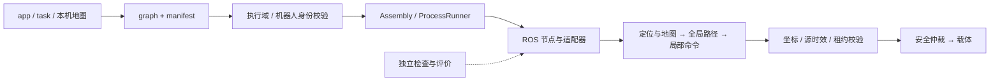

# ros1-slam · 四足机器人 SLAM 与导航

> 最新更新时间：2026-11-07 03:38:56 CST。现行路线为[计划书 v8.1](note/计划书v8.1/README.md)；能力与验收状态以[进度入口](note/进度/README.md)和[版本成果总览](note/进度/00_总览.md)为准。

本项目面向 Lite3 四足机器人，组合激光建图、定位、地图、全局规划、局部执行与安全仲裁，使用 ROS1/Noetic。x86 承担 Docker、Gazebo、MuJoCo 开发与回归；Lite3 主机采用原生 ROS1，地图与现场配置各机独立。

## 系统结构

项目保留两条装配链，共用算法、传感器和安全组件：

- **传统 ROS launch**：`lite3_bringup` 组合驱动、SLAM、定位、导航、M6 安全仲裁与 SUP 监管。
- **v8 配置装配**：应用 YAML 绑定 task、map registry 和 graph；manifest 描述端口与能力，Assembly 管理进程，运行数据经 ROS 话题传递。

详细数据流、源码阅读顺序、两种 mux 及载体边界见[项目架构与目录](note/架构/项目架构与目录.md)。Gazebo 运动学 carrier 与 MuJoCo 四足接触物理实验各有范围，不能互代，也不代表真机验收。

## 当前能力边界

代码与运行记录覆盖 v8 契约/图装配、2D 导航栈、多层支撑图、3D 全局与局部规划、传感器建图、MuJoCo 执行及 NDT 失锁恢复实验。**A2=PASS*，A1/A3/A4/A5/A6/A7=PARTIAL；formal 与真机尚未签署。** 仿真 GT 建图、声明地图和单策略结果只适用于记录中的范围。

逐批指标与历史更正集中在[进度入口](note/进度/README.md)和[v8 进度](note/进度/v8/README.md)，根 README 只维护项目介绍与导航。

## 我要找东西，去哪儿

| 内容 | 入口 |
| --- | --- |
| 架构、装配链、模块依赖 | [项目架构与目录](note/架构/项目架构与目录.md) |
| 源码分层、自研包与接口入口 | [ws/README.md](ws/README.md) |
| v8 app / graph / 模块代码 | [v8_platform](ws/src/90_platform/v8_platform/README.md)、[framework](ws/src/90_platform/v8_platform/framework/README.md) |
| 规划、组件契约与执行队列 | [计划书 v8.1](note/计划书v8.1/README.md) |
| 版本成果、当前进度与证据 | [进度入口](note/进度/README.md)、[版本成果总览](note/进度/00_总览.md) |
| 目标构建与依赖闭包 | [lite3 / x86_sim 构建说明](tooling/build/README.md)；M20 尚未接入 |
| Docker、仿真、RViz 与建图命令 | [docker/README.md](docker/README.md) |
| 完整两层Gazebo规划测试世界 | [two_floor_nav](ws/src/95_simulation/lite3_gazebo_sim/scenarios/two_floor_nav/README.md)：世界、同源地图、四个用例与统一入口 |
| MuJoCo 接触执行与阶面障碍 | [dynamics/README.md](ws/src/95_simulation/lite3_gazebo_sim/dynamics/README.md) |
| 正式门禁及复验方法 | [成员清单](scripts/verify/gate_chain.txt)、[复验作业单](note/05_复验作业单.md) |
| 隔离、安全、来源与变更台账 | [note 入口](note/00_README.md) |
| 问题与环境坑 | [问题台账](note/02_问题与坑.md) |
| 跨主机任务包与本机协作入口安装 | [scripts/agent](scripts/agent/README.md)：canonical bridge、bootstrap、导出/导入与校验 |
| 跨工具任务交接 | [协作契约](note/09_跨工具协作契约.md)、[黑板教程](note/tools/跨Agent协作黑板-使用教程.md) |
| 本机项目介绍网页 | `web/` 源码已入库；生成的地图预览/账本数据仍由生成器产出并被忽略，见其 `README.md` |
| 历史清理与恢复 | [11月4日清理](note/进度/00_清理核对_Codex_2026-11-04.md)、[本轮梳理](note/进度/00_架构梳理与瘦身_2026-11-05.md) |

## 开发与数据约定

- 新机先按[协作工具](scripts/agent/README.md)从canonical入口bootstrap；修改前阅读[协作契约](note/09_跨工具协作契约.md)并执行 `python3 .ai/bridge.py resume --as codex`，以任务卡作用域为准。
- 第三方副本、冻结判据和仍被检查器读取的基线按各自规则保留；`framework/fixtures/` 含实际运行输入。
- ROS 检查使用当前机器的 Noetic 与已构建工作区环境；前置缺失记为环境问题，不能据此判断算法通过或失败。
- 地图、实验输出、`ws/build/`、`ws/devel/` 与日志各机独立；仓内保留[map registry 模板](data/maps/registry.template.json)，本机 app 使用被忽略的 `*.local.app.yaml`。
- 入 Git 的源码/文档用 Git 追溯；地图、bag、结果和跨机交付包使用数据校验。旧文档与重复副本移出工作树时保留恢复途径并修复导航。
- 控制台 `web/`、`scripts/console`、`data/console` 是 **host-only 测试面**，不进入 `lite3`/M20 target 或机器人镜像；Git 版本控制与真机部署边界正交，详见[项目架构 §7](note/架构/项目架构与目录.md)。
- 真机运动、现场服务和参数仍有单项授权边界；本文不授权启动硬件。

本轮所有README的核对范围、处理与恢复见[全仓README核对](note/进度/00_全仓文档核对_2026-11-05.md)。

## 统一工程约束

工程标准真源：`note/架构/工程标准.md`。[工程标准](note/架构/工程标准.md)统一阶段验证落账后本地commit、用户决定push、Lite3/M20真机不构建仿真、x86仿真与训练开发，以及算法标准接口。原生与Docker入口共用显式目标构建器和清单闭包检查，目标环境编译/运行尚未验证；受支持框架已增加执行域/机器人身份校验；已增加速度坐标与源时间/单调时钟守卫，真实目标环境、接线与完整热替换仍待闭合；M20真实适配和可复现训练器也尚未提供，详见[审查记录](note/进度/00_架构与工程标准审查_2026-11-05.md)。规范统一不等于这些能力已实现。
