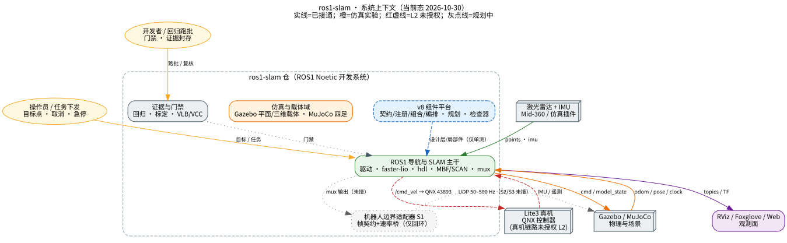
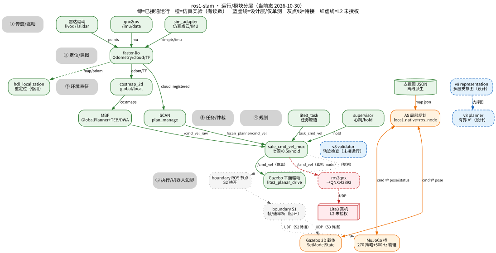
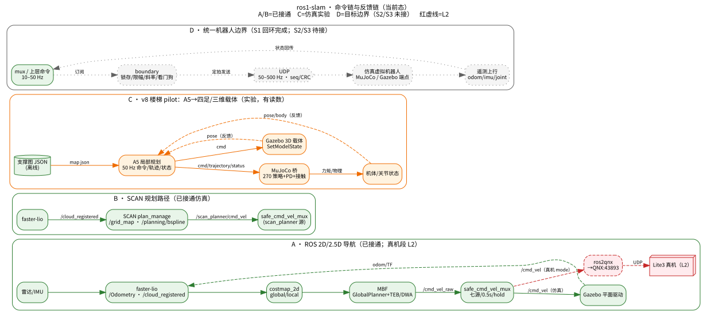

# 架构文档（当前态）

- 建模日期：2026-10-30（只读核对；未运行新批次）
- 方法：system-modeler（当前态）＋ Graphviz；证据逐条见文末“证据与未知”
- 范围：仓库内可执行代码与配置；不含真机现场状态
- **不改变任何验收状态**：A1—A7 仍 `NOT_VALIDATED`，A5 `PARTIAL`；V8-X2 真机属 L2

## 阅读顺序

| 文档 | 回答的问题 |
| --- | --- |
| [current-system.md](current-system.md) | 系统由哪些部分组成、什么真的接通、边界在哪 |
| [algorithm-swap.md](algorithm-swap.md) | 建图/定位/全局/局部/中间件今天分别怎么换 |
| [target-framework.md](target-framework.md) | 目标框架（多地图/多机器人/任意中间件/仿真通行性）与当前差距、改造路线 |
| [architecture-ros1-slam.html](architecture-ros1-slam.html) | 一页版：三张图＋状态卡（可直接浏览器打开） |

## 三张图

| 视图 | 源文件 | 渲染 |
| --- | --- | --- |
| L1 系统上下文 | [diagrams/system-context.dot](diagrams/system-context.dot) | [SVG](diagrams/system-context.svg) · [PNG](diagrams/system-context.png) |
| L2/L3 运行/模块分层 | [diagrams/system-runtime.dot](diagrams/system-runtime.dot) | [SVG](diagrams/system-runtime.svg) · [PNG](diagrams/system-runtime.png) |
| 四条命令/反馈链 | [diagrams/command-path.dot](diagrams/command-path.dot) | [SVG](diagrams/command-path.svg) · [PNG](diagrams/command-path.png) |







## 再生成

```bash
cd docs/architecture/diagrams
for f in system-context system-runtime command-path; do
  dot -Tsvg "$f.dot" -o "$f.svg"
  dot -Tpng -Gdpi=110 "$f.dot" -o "$f.png"
done
```

依赖：Graphviz 2.4x；中文字体 `Noto Sans CJK SC`。

## 状态图例

| 颜色/线型 | 含义 |
| --- | --- |
| 绿实线 | 已接通运行（配置直证；部分为历史跑批，见证据） |
| 橙实线 | 仿真实验，已有读数 |
| 蓝虚线 | 设计层/仅单测，未接运行链 |
| 灰点线 | 待接（S2/S3 等） |
| 红虚线 | L2 未授权（真机链路） |

## 证据与未知（摘要）

- **高置信**：mux 七源/0.5 s/hold；MBF 的 GlobalPlanner+TEB/DWA；bringup 同时包含 mbf 与 safety；boundary 未被任何运行件引用；46 套件 0 失败。
- **中置信**：ROS 2D 导航与 Gazebo 平面驱动按配置与历史跑批归入“已接通”，本次未活体复跑。
- **未知**：`ros2qnx` 完整帧语义与 QNX 看门狗；真机 `/cmd_vel` 是否确为 mux 唯一写者。
- 逐条 sourceRefs 与置信度见 [evidence.md](evidence.md)；仓库内正式登记以 `note/进度/00_总览.md` 与相关 R 记录为准。
