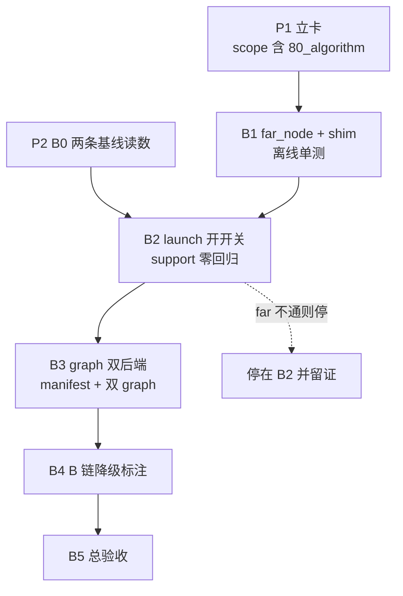

# 下一阶段任务计划 · 双后端可替换改造（2026-11-22 修订）

> **分析对象**：本仓 `ros1-slam`（本地路径，非远程拉取）
> **数据来源**：2026-11-22 04:2x—04:3x 磁盘现读，逐条落到文件与行号；未走 git 全量演化回放（本文件不含演化角度），外部资料未使用。
> **修订依据**：`note/架构/双后端可替换改造清单_2026-11-22.md`（下称「原清单」）。本文不改动该清单的任何结论，只补齐它的落点精度、前置条件与偏差。
> **性质**：计划书，不是施工令。开工仍须真人立卡（见 §5 前置 P1）。

---

## 1. 结论先行

1. **目标没变**：同一棵 BT、同一条安全链、同一个局部规划器，全局后端在**配置层**二选一（`support` / `far`）。B 链（move_base + TEB）是候选备份，不是默认。
2. **原清单的六批划分是对的**，但**不能照字面施工**：话题口径、shim 落点、graph 基准件三处与磁盘现读不一致，照抄会得到一条「话题通、语义断」的链路（§4）。
3. **当前真正的前置只有两条**：①一张覆盖 `ws/src/80_algorithm` 的新任务卡（原清单自述「暂不立项」，而它引用的 `T-20261118-02` 已是 done）；②B0 的两条基线读数（命令已给，见 §5.1）。
4. **押后项不并入本计划**：高程取 z 与 `scan_bt_bridge` 补 z 按真人定序排在本改造之后，依赖关系见 §7。

---

## 2. 现状快照（现读）

### 2.1 分层与规模

`ws/src` 下 12 个编号层、**41 个包**（`find ws/src -maxdepth 4 -name package.xml` 计数）：

| 层 | 包数 | 该层承载 |
|---|---|---|
| `00_drivers` | 5 | 雷达/底盘驱动 |
| `10_slam` | 4 | faster-lio 等建图 |
| `20_localization` | 6 | hdl / ndt / 局部定位 |
| `30_3rd` | 7 | 第三方原样（`elevation_mapping` 等） |
| `30_perception` | 7 | 语义/支撑面感知 |
| `40_navigation` | 2 | `lite3_navigation`（B 链配置）、`lite3_scan` |
| `50_task` | 1 | 任务迁移 |
| `60_safety` | 1 | `lite3_safety`（安全 mux） |
| `70_bringup` | 1 | 全部 launch 入口 |
| `80_algorithm` | 2 | `v8_algorithm`（规划/表征）、`v8_grid` |
| `90_platform` | 4 | `v8_platform`（装配框架）、`lite3_bt` |
| `90_supervisor` | 1 | 看护/监控 |

`x86_sim` 目标闭包 = **38 包**（退役 `lite3_costmap_layers` 后）；`devel/share` 42 项 ＝ 闭包 38 ＋ `common-lisp`／`gennodejs`／`roseus`（catkin 自带）＋ `livox_ros_driver`（上游副产物），差集已逐个核对。

### 2.2 三条链的实际走向（不是推断）

| 链 | 端点 | 证据 |
|---|---|---|
| 全局（A 链现状） | BT 发 `/v8/global/goal` → `run_global_planner.py` → 发 `/global_path` + `/global_path/status` | `lite3_bt/src/bt_console.cpp:1184-1186`（私有参数默认值）、`70_bringup/lite3_bringup/launch/mode_sim_bt.launch:63`（node 声明）、`v8_platform/scripts/run_global_planner.py`（rospkg + sys.path 进 `planner/`） |
| 局部 | 取 `Path` 末点作目标，**保留 z** | `v8_algorithm/local_planner/path_goal_node.py:39`（`goal: [x, y, z]`） |
| 安全 | `/cmd_vel_raw → safe_cmd_vel_mux → /cmd_vel`，`navigation` 源优先级 5、超时 0.5 s | `60_safety/lite3_safety/config/cmd_vel_mux.yaml:2,29` |

### 2.3 装配机制（两条并行，别混）

本仓**同时存在两套接线**，这是最容易踩错的地方：

| 走法 | 入口 | 全局节点话题 | 谁改 BT 的话题 |
|---|---|---|---|
| **launch 链** | `mode_sim_bt.launch` | `/v8/global/goal` → `/global_path` | 不改，用 `bt_console` 默认值 |
| **graph 链** | v8 app + graph | `/v8/3d/global/{start,goal,path,status}` | `bt` 实例显式 remap（`configs/lite3/graph_3d_lite3_bt.yaml` 的 `bt.params`） |

`v8_platform/framework/` 提供装配与校验：`graph.py`（端口方向/类型）、`config.py`（manifest 自动发现）、`cli.py`（`check` / `plan` 两个子命令）。校验式：

```bash
python3 ws/src/90_platform/v8_platform/framework/cli.py check <manifests目录> <graph文件> --package-index <索引>
# rc：0 通过 / 5 FrameworkError / 9 参数错误
```

---

## 3. 目标与验收定义

**验收定义（四条同时成立才算做完）**

1. 全局后端在配置层二选一：`global_backend:=support|far`，不改 BT 树、不改安全链、不改局部规划器。
2. 两条后端都满足统一契约：输入 `start`/`goal`（`PoseStamped`），输出 `path`（`nav_msgs/Path`，3D，末点=局部目标）+ `status`（`std_msgs/String`）。
3. `/cmd_vel` 仍只有一个写者，`gait_guard` 与 mux 源表零改动。
4. `support` 分支零回归（读数与 B0 基线一致）；`far` 分支至少能发出 3D `path` 且 `local/goal` 有值；`far` 不通允许停在 B2 并留证。

**非目标**：不动 B 链代码与配置、不做真机 L2 验收、不把 FAR fork 进仓、不改 `app_runner`/`graph.py`。

---

## 4. 现读发现的四处偏差（照抄原清单会出错）

### 4.1 BT 认的话题名，原清单 §2 写错了两处

原清单 §2 第 3 条写「树里只认 `/v8/global/path`、`/global_path/status`、`/v8/local/goal`」。磁盘现读：

```cpp
// lite3_bt/src/bt_console.cpp:1184-1186
std::string planner_goal_topic = "/v8/global/goal";   // BT 发出去的目标
std::string path_status_topic = "/global_path/status"; // BT 收的状态
std::string path_topic        = "/global_path";        // BT 收的路径
```

⇒ **路径是 `/global_path`，不是 `/v8/global/path`；全局目标 `/v8/global/goal` 与局部目标 `/v8/local/goal` 是两件事**。N1 必须按这三个名字发，否则 BT 收不到（且因为都是私有参数可覆盖，错误表现为「静默不收」而不是报错）。

### 4.2 N2 的落点写成通配，实际目录是固定的

原清单 N2 写 `ws/src/90_platform/v8_platform/**/run_global_far.py`。现读同族文件只有一处：`v8_platform/scripts/run_global_planner.py`。⇒ N2 落点＝**`ws/src/90_platform/v8_platform/scripts/run_global_far.py`**，照抄它的 `rospkg.RosPack().get_path('v8_algorithm')` + `sys.path.insert` + `import far_node` 三句结构即可。

### 4.3 N4 的基准件选错，会把 BT 那段接线丢掉

原清单 N4 写「复制 `graph_3d_lite3.yaml`，只改 `global.component`」。但仓里有两份 3D 真机 graph，差别正好在 BT：

| 文件 | `bt` 实例 | `path_goal` 实例 |
|---|---|---|
| `configs/lite3/graph_3d_lite3.yaml` | 无 | 有（`path_goal3d` 取 `/v8/3d/global/path` 末点） |
| `configs/lite3/graph_3d_lite3_bt.yaml` | 有，且把 `planner_goal_topic`/`path_topic`/`path_status_topic` 全 remap 到 `/v8/3d/global/*` | **无**（注释明写：FollowPath 自己发 `/v8/local/goal`） |

本次改造的前提是「**同一棵 BT**」，所以 N4 应以 **BT 版**为基准；若照抄非 BT 版，「far 后端接到 BT」这段实际上没接。⇒ 建议：N4 基准＝`graph_3d_lite3_bt.yaml`，N5 基准＝`framework/fixtures/graphs/graph_3d_gazebo_bt.yaml`（同族文件均在位），并在验证记录里写明取舍理由。

### 4.4 开工前置：缺卡，且原清单引用的卡已终结

原清单头部自述「真人 2026-11-22 裁决：**暂不立项**，不得据此开工；开工前须由真人立新任务卡并确认 scope」，理由是 `T-20261118-02` 的 scope 不含 `ws/src/80_algorithm`（N1 落点在外）。现读 `.ai/state.json`：`T-20261118-02` 状态 **`done`**，title 是 `v8_grid 几何基元统一与地基收口（M0-M10）`，与本改造无关。

⇒ **前置 P1 不是「找那张卡」，而是「立一张新卡」**，scope 至少要含：`ws/src/80_algorithm`、`ws/src/90_platform`、`ws/src/70_bringup`、`note`。

---

## 5. 分批计划

### 前置（不做完不开 B1）

| 编号 | 事项 | 判定 | 备注 |
|---|---|---|---|
| **P1** | 真人立新任务卡，scope 含 `ws/src/80_algorithm` 等四路径 | 卡在 `.ai/tasks/` 且 `bridge.py check` 一致 | 无卡开工＝违 `note/09` 契约 |
| **P2** | B0 两条基线读数落册 | 两行读数进验证记录 | 命令见 5.1，不改代码 |

### 5.1 B0 补读数（不动代码）

```bash
# 基线一：A 链（support）
bash docker/sim.sh smoke stageB          # m2_smoke Stage B，期望 9/0、dev_gt ≤0.35 m
# 基线二：B 链（move_base + TEB），1 m 用例
bash scripts/verify/run_bt_navigation_window.sh
```

落册件：`note/架构/双后端可替换_验证记录_2026-11-22.md`（原清单 N7，目前尚未创建）。
**为什么这条不能跳**：B2 的硬验收是「support 分支零回归」，没有基线就没有「零回归」的判据，只剩「看起来正常」。

### 5.2 B1 · FAR 适配骨架 + 离线单测（不接主链）

| 项 | 内容 |
|---|---|
| 新增 | `ws/src/80_algorithm/v8_algorithm/planner/far_node.py`（纯函数与 ROS 分离） |
| 新增 | `ws/src/90_platform/v8_platform/scripts/run_global_far.py`（照 §4.2 结构） |
| 入向 | `/rslidar_points` + 高程 → `terrain_cloud`（`intensity`＝离地高）；`PoseStamped` goal → `/goal_point`（`PointStamped`） |
| 出向 | `/way_point`（`PointStamped`）→ 组 `nav_msgs/Path` → `/global_path` + `/global_path/status`（status 复刻 `planner/topic_node.py:50-57` 的 JSON 形） |
| 单测三件 | ①`PoseStamped(x,y,z=1.4)` → 末点 z 仍 1.4；②`h=0.0` 落 free 云、`h=0.3` 落 obs 云（阈值 0.2 m）；③空 waypoint / 无 odom → 只发 status 不发 path |
| 验收 | 单测全绿、`py_compile` 通过、不起任何节点即可跑 |
| 回滚 | 删两个新文件 |

> 为什么不复用 `topic_node`：`topic_node` 是「地图 JSON + 起终点 → 路径」的本地求解器，FAR 是「点云 + 位姿 → 单航点」的外部节点，两者输入模型不同；只有 status 的序列化形状值得照抄。

### 5.3 B2 · 仿真链接入（`mode_sim_bt.launch` 加开关）

| 项 | 内容 |
|---|---|
| 改一处 | `mode_sim_bt.launch`：加 `<arg name="global_backend" default="support"/>`；把第 63 行的 `run_global_planner.py` 节点包进 `support` 的 `<group if>`，另起 `far` 的 `<group if>` |
| 必设参数 | far 侧 `is_multi_layer: true`（单层模式会把 goal 的 z 压回「地形高度＋车高」，3D 静默退化） |
| 验收 | `support` 读数＝B0 基线（硬门槛）；`far` 能发 `/global_path` 且 `/v8/local/goal` 有值 |
| 加严项 | 「z 差 3 m 不被压平」对表（否则 B2 绿了也说明不了 3D 真的生效） |
| 回滚 | `git checkout -- mode_sim_bt.launch` + 删 B1 两文件 |

### 5.4 B3 · v8 graph 链接入

| 项 | 内容 |
|---|---|
| 新增 | `framework/fixtures/manifests/manifest_global_far.json`（`id=v8.fw.global_far`、`dimensions=3`、输入 `start/goal/cloud`、输出 `path/status`） |
| 新增 | `configs/lite3/graph_3d_lite3_far.yaml`（**以 `graph_3d_lite3_bt.yaml` 为基准**，只改 `global.component`，见 §4.3） |
| 新增 | `framework/fixtures/graphs/graph_3d_gazebo_far.yaml`（基准 `graph_3d_gazebo_bt.yaml`） |
| 新增 | `configs/lite3/lite3_real_3d_far.app.yaml`（仅 `graph:` 指向上一行） |
| 校验 | `framework/cli.py check <manifests> <graph> --package-index <索引>` rc=0；`target_workspace.py plan --target x86_sim` 闭包仍 38 包不破 |
| 验收 | manifest 过 schema、`component` 解析成功、端口方向/类型全绿、闭包含 `v8.fw.global_far` |
| 回滚 | 删四个新文件（不动既有 graph/app） |

### 5.5 B4 · B 链降级标注（零行为）

| 项 | 内容 |
|---|---|
| 改 | `mode_sim_teb.launch` 顶部注一句「候选/回归对照，非默认」；`note/架构/项目架构与目录.md` §4 补一句默认后端 |
| 验收 | `mode_navigation.launch` 的 `enable_motion`/`enable_bt` 缺省仍 `false`，`test_navigation_contract.py` 仍绿 |
| 回滚 | 恢复两处注释 |

### 5.6 B5 · 总验收与回归

```bash
bash docker/build.sh --plan                       # 闭包不破
bash docker/sim.sh smoke stageB                   # Stage B 9/0、dev_gt ≤0.35 m
bash scripts/verify/run_bt_navigation_window.sh   # B 链 1 m 仍 PASS（证明降级不屈）
GATE_ONLY=SYN,PYST,ISO,DC,账构 bash scripts/verify/run_gate_chain.sh
docker ps                                          # 退净：无残留、11313/11345 零监听
```

读数全部写入验证记录；回滚按 B4→B3→B2→B1 逆序。

---

## 6. 顺序与依赖



纯文本等价：

```
P1(立卡) ─┐
          ├─> B1 ─> B2 ─> B3 ─> B4 ─> B5
P2(基线) ─┘            └─(far 不通)─> 停
```

---

## 7. 押后项（本计划不含，依赖本改造完成）

| 项 | 内容 | 为什么必须后置 |
|---|---|---|
| D1 | `support_map` 按 `(x,y)` 取 z（读 `surfaces[].data_uri`，多面命中用 `select_support`，不许默认取最低面） | 与「全局后端二选一」耦合：far 自建图，support 读 `support_map`，两边地图来源不同，先定后端再改取 z 才不会返工 |
| D2 | `scan_bt_bridge.py` 三处补 z（`publish_reference`/`on_pose`/`on_goal` 现只带 x/y） | 同上：它产出的 `/initial_path` 是后端无关的输入，改早了会在两套后端下各测一遍 |

两项都挂在 `T-20261122-01`（已置 `blocked`，理由写明「押后至本改造之后」）。

---

## 8. 待裁清单（需真人一句话）

| # | 事项 | 选项 | 影响面 |
|---|---|---|---|
| R1 | 后三项退役处置：`elevation_costmap.yaml`、`manifest_controller_teb_adapter.json`、`test_navigation_contract.py` 仍覆盖 B 链入口 | 有意保留 / 漏做补归档 | 决定 B4 之后 B 链的「备份」边界写到什么程度 |
| R2 | `variants` 三档的 rosparam 加载行接不接 | 接 / 不接 | 接入＝TEB 行为参数才真生效，属改运行语义 |
| R3 | 镜像侧 2.21GB 是否清（删未被容器引用的 tag 镜像，含旧版 `ros1-slam`） | 清 / 留 | 清＝省盘但丢回滚资产 |

---

## 9. 风险与门控（在原清单 §6 之上补两条）

| 风险 | 影响 | 处置 |
|---|---|---|
| **双链话题并存**（新增） | launch 链用 `/global_path`、graph 链用 `/v8/3d/global/path`；B2 与 B3 若混用同一套参数，会出现「B2 通、B3 静默不通」 | 每批验收必须写明走的是哪条链；B3 的图以 BT 版为基准（§4.3） |
| **graph 基准件选错**（新增） | 照抄非 BT 版 ⇒ BT 那段 remap 丢失，far 路径到不了 BT | N4/N5 基准件写死在计划里，不再用「复制某个 graph」这种模糊说法 |
| FAR 只能给单航点 | 路径长度语义失效，只有末点可信 | 文档写明；需要整条可视路径就由 N1 累积历史航点自行拼 |
| 地形云 `intensity` 语义 | 原样喂点云会把 free/obs 判成一类 | B1 单测②强制覆盖两种高度 |
| `is_multi_layer` 未开 | goal 的 z 被压平，3D 静默退化 | B2 必设 `true` + 「z 差 3 m」对表 |
| 改 `profiles.json` 触发全量重建 | 构建成本 | N1 留在 `v8_algorithm` 包内，**不加新包**，避开重建 |

---

## 10. 立即可做的三件事（不改代码、不等卡）

1. 建 `note/架构/双后端可替换_验证记录_2026-11-22.md` 空骨架（B0 两条读数落这里）。
2. 跑 `bash docker/sim.sh smoke stageB` 拿 A 链基线。
3. 跑 `bash scripts/verify/run_bt_navigation_window.sh` 拿 B 链基线。

这三件都不动代码、不扩 scope，做完 P2 就闭合，只剩 P1 等卡。

---

## 附录 A · 关键指针

| 用途 | 路径 |
|---|---|
| BT 话题默认值 | `ws/src/90_platform/lite3_bt/src/bt_console.cpp:1184-1186` |
| 全局节点 shim 范式 | `ws/src/90_platform/v8_platform/scripts/run_global_planner.py` |
| status 序列化形状 | `ws/src/80_algorithm/v8_algorithm/planner/topic_node.py:50-57` |
| launch 链接线点 | `ws/src/70_bringup/lite3_bringup/launch/mode_sim_bt.launch:63` |
| graph 双基准件 | `v8_platform/configs/lite3/graph_3d_lite3_bt.yaml`、`framework/fixtures/graphs/graph_3d_gazebo_bt.yaml` |
| 装配校验 | `ws/src/90_platform/v8_platform/framework/cli.py`（`check` / `plan`） |
| 安全链 | `ws/src/60_safety/lite3_safety/config/cmd_vel_mux.yaml:2,29` |
| 末点保 z | `ws/src/80_algorithm/v8_algorithm/local_planner/path_goal_node.py:39` |

## 附录 B · 当前基线读数（2026-11-22 04:2x 现读）

| 项 | 读数 |
|---|---|
| 提交 | `0a1eeb4a`，未推送 8 条 |
| 构建 | `x86_sim` 闭包 38 包，`--clean` rc=0 / 255 target |
| 门禁 | SYN 0(91)｜PYST 0(66)｜ISO 0(ws_src_files=4786)｜DC 0（A 类 0／B 类 16）｜账构 0 |
| 任务游标 | `T-20261122-01` = blocked，epoch 1490 |

> ★ISO 的 `ws_src_files` 含 `.pyc`，跨批比对前先跑 `find ws/src -name '*.pyc' | wc -l`；不然会把清缓存的差额读成文件丢失。★
