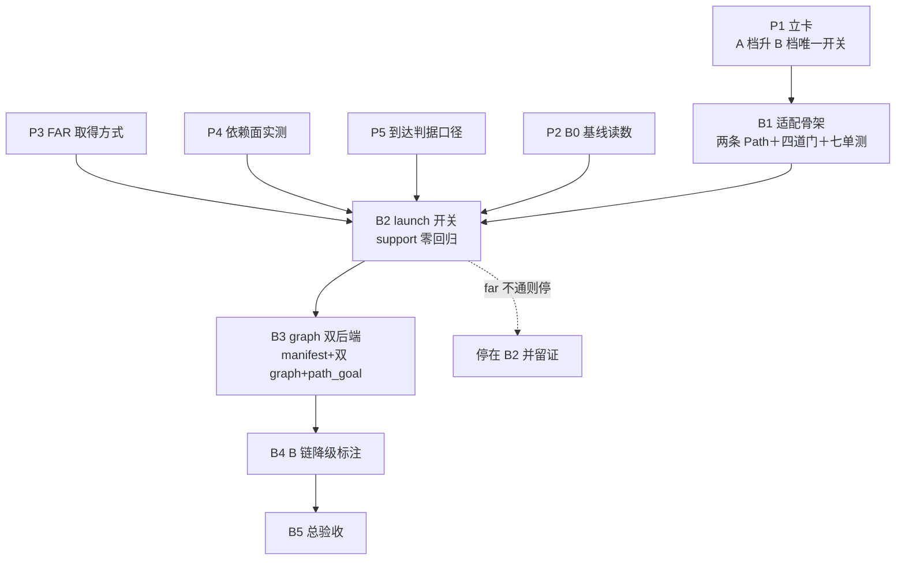

# 下一阶段任务计划 · 双后端可替换改造（2026-11-22 三次修订）

> **分析对象**：本仓 `ros1-slam`（本地路径，非远程拉取）
> **现读时点**：2026-11-22 第三轮，逐条落到「文件:行号」；行号按当前 HEAD `2e6f2fe9`＋本次修订核对。
> **修订依据**：`note/架构/双后端可替换改造清单_2026-11-22.md`（下称「原清单」）。本文件不改原清单的任何历史结论，只把它施工面上的假设改成可执行的事实。
> **性质**：计划书，不是施工令。**没有新任务卡时，本文件最高状态＝技术准备完成，不构成开工授权**（见 §5.0）。
> **三次修订相对二次的改动**：新增 §4.5（3D 到达判定）；§4.3 补延长段与六条测试／失败判据；新增 §5.0（开工门槛三档）并给 B1／B2 标注授权状态。目标、阶段数（B0—B5）、scope 边界**一格未动**，未新增任何施工阶段。

---

## 1. 结论先行

1. **目标没变**：同一棵 BT、同一条安全链、同一个局部规划器，全局后端在**配置层**二选一（`support` / `far`）。B 链（move_base + TEB）保留技术备份，不是默认。
2. **「只改 `global.component` 一行」不成立**（§4.2）。FAR 没有 `map` 输入端口，现有 graph 里 `map.map → global.map` 这条边会让 `graph.py` 直接抛 `E_GRAPH_PORT`；且换后端后旧 params 不会被校验拒绝、只会静默失效。最小可过校验的改动是**三处**（component ＋ 一条输入边的绑定对象 ＋ params 块），不是一行。
3. **graph 链上 FAR 的航点「没人吃」**（§4.1）。BT 的 `FollowPath` 从不读路径，只把**最终目标**打个包发出去；graph 链里 `/v8/local/goal` 的唯一写者正是 BT。⇒ 想让 FAR 的航点真驱动运动，必须在 FAR 版 graph 里**加一个 `path_goal` 实例并摘掉 `bt.out_goal → local.goal` 这条边**。这是接线改动，**BT 代码零改动**，但「同一棵 BT」在此处的含义要写清（同树同节点，不同连线）。
4. **`gait_guard` 会被单航点打成瞎子**（§4.3）。`stair_ahead()` 只在 `len(points) >= 2` 时才扫，单点 Path 恒返 `ahead=False` ⇒ 步态永远 `flat_mid`，楼梯/台阶永不切换。最小兼容方案＝适配器输出 **三点 Path（当前位姿 ＋ 航点 ＋ 沿同方向外推到 lookahead 的延长点）**，`gait_guard` 一行不用改。★但两点只解决「点列够不够」，不解决「前瞻够不够远、方向对不对」——后者要延长段，且拐弯场景仍不可信，见 §4.3 的六条测试与失败判据。★
5. **3D 到达判定：BT 能不改，但「到对了楼层」这件事在 D1 之前证不出来**（§4.5）。`WaitArrival` 的 pose 模式只算 `hypot(dx,dy)`（`bt_console.cpp:551-564`），跨楼层同 xy 会误判。BT 自带的口子 `~arrival_topic`（外部 `Bool` 到达占有者，`:1228-1230,1286-1289`，`scan_bt_nav.launch:18` 已有先例）可以做到**零改 BT** 换成 3D 判据；但 pose.z 与 goal.z 不同源（`sim_pose_source` 带 `z_offset: -0.11`，真机由 carrier 给），纯欧氏距离仍只是近似，稳的判据要「support_map 面 id 匹配」＝依赖押后的 D1。⇒ **D1 之前不许对外宣称「3D 导航完成」**，此条列为阻断项（§8 R7）。
6. **连带的预算坑（本轮新发现）**：`WaitArrival` 的预算按**进入该节点时那一条 Path 的长度**冻结（`bt_console.cpp:449-476`＋`arrival_budget.hpp:16-21`，公式 `max(树值, 长度/速度下限)`）。FAR 单航点模式下这条 Path 只有第一段 ⇒ 长途多层目标会被 60 s 级预算判失败，与「路走得好不好」无关（§4.5 验收 5）。
7. **门槛（§5.0）**：没卡时只能做「技术准备」（只读勘察、计划、用例表、契约表），**不得落代码、不得起仿真改状态**；B1 的代码落盘属「授权开工」，未获卡前一律称「技术准备完成」，不得称「已开工／已接入」。
8. **当前真正的前置有四条**：①一张覆盖 `ws/src/80_algorithm` 的新任务卡；②FAR 源码**根本还没进仓**，而加它必然动 `tooling/build/profiles.json`、触发全量重建、改变 ISO 基线（§4.4）；③B0 两条基线读数；④四条待裁（§8 R4／R5／R6／R7）。
9. **押后项不并入**：`support_map` 按 `(x,y)` 取 z、`scan_bt_bridge.py` 三处补 z，仍按真人定序排在本改造之后（§7）。

---

## 2. 现状快照（现读）

### 2.1 分层与规模

`ws/src` 下 12 个编号层、**41 个包**（`find ws/src -maxdepth 4 -name package.xml` 计数）：

| 层 | 包数 | 该层承载 |
|---|---|---|
| `00_drivers` | 5 | 雷达/底盘驱动 |
| `10_slam` | 4 | faster-lio 等建图 |
| `20_localization` | 6 | hdl / ndt / 局部定位 |
| `30_3rd` | 7 | 第三方原样（`elevation_mapping` 等） |
| `30_perception` | 7 | 语义/支撑面感知 |
| `40_navigation` | 2 | `lite3_navigation`（B 链配置）、`lite3_scan` |
| `50_task` | 1 | 任务迁移 |
| `60_safety` | 1 | `lite3_safety`（安全 mux） |
| `70_bringup` | 1 | 全部 launch 入口 |
| `80_algorithm` | 2 | `v8_algorithm`（规划/表征）、`v8_grid` |
| `90_platform` | 4 | `v8_platform`（装配框架）、`lite3_bt` |
| `90_supervisor` | 1 | 看护/监控 |

`x86_sim` 目标闭包 = **38 包**（退役 `lite3_costmap_layers` 后）。构建目标清单在 `tooling/build/profiles.json`：`targets.x86_sim.roots` **26 项**、`local_packages` **46 项**、`manifest_overrides` 1 项 —— 这三张表是「往仓里加包」的必经登记面（§4.4）。

### 2.2 三条链的实际走向（不是推断）

| 链 | 端点 | 证据 |
|---|---|---|
| 全局（A 链现状） | BT `RequestPath` 发 `/v8/global/goal` → `run_global_planner.py` → 发 `/global_path` + `/global_path/status` | `lite3_bt/src/bt_console.cpp:1184-1186`、`70_bringup/lite3_bringup/launch/mode_sim_bt.launch:63`、`v8_platform/scripts/run_global_planner.py` |
| 局部目标 | launch 链由 `run_path_goal.py` 取 `Path.poses[-1]` 写 `/v8/local/goal` | `mode_sim_bt.launch:66-69`、`local_planner/path_goal_node.py:11-18,29-40` |
| 局部规划 | 订 `/v8/local/goal`，**无目标新鲜度校验**（一次发布长期有效） | `local_planner/ros_node.py:158,219-222,286` |
| 安全 | `/cmd_vel_raw → safe_cmd_vel_mux → /cmd_vel`，`navigation` 源优先级 5、超时 0.5 s | `60_safety/lite3_safety/config/cmd_vel_mux.yaml:2,29` |

### 2.3 装配机制（两条并行，别混）

| 走法 | 入口 | 全局节点话题 | 谁改 BT 的话题 | `/v8/local/goal` 的写者 |
|---|---|---|---|---|
| **launch 链** | `mode_sim_bt.launch` | `/v8/global/goal` → `/global_path` | 不改，用 `bt_console` 默认值 | `run_path_goal.py`（**不是 BT**） |
| **graph 链** | v8 app + graph | `/v8/3d/global/{start,goal,path,status}` | `bt` 实例显式 remap（`configs/lite3/graph_3d_lite3_bt.yaml`） | **BT 自己**（`out_goal_topic: /v8/local/goal`，该图无 `path_goal` 实例） |

校验口径（两条命令都会跑，rc 语义不同）：

```bash
python3 ws/src/90_platform/v8_platform/framework/cli.py check <manifests目录> <graph文件> --package-index <索引>
# rc：0 通过 / 5 FrameworkError / 9 参数错误
```

---

## 3. 目标与验收定义

**验收定义（七条同时成立才算做完）**

1. 全局后端在配置层二选一：`global_backend:=support|far`，**BT 源码、局部规划器源码、安全链配置零改动**。
2. 两条后端都满足统一契约：输入 `start`/`goal`（`PoseStamped`），输出 `path`（`nav_msgs/Path`，3D，末点=下一局部目标）+ `status`（`std_msgs/String`，`{"ok":bool,"points":int,"reason":str}` 形）。
3. `/cmd_vel` 仍只有一个写者；`gait_guard` 与 mux 源表零改动，且 `far` 分支下 `gait_guard` 的 `ahead`/`step_m` 能随台阶路况变化（不是恒 `False`），并按 §4.3 的六条测试出读数（含两条必红／必记项）。**该项在 B3 的 graph 链上验收**：`gait_guard` 只作为 graph 实例存在，launch 链（B2）没有这个节点。
4. `support` 分支零回归（读数与 B0 基线逐项一致）。
5. `far` 分支至少能发出 3D `path`、`/v8/local/goal` 有值、**取消后车真的不再动**；`far` 不通允许停在 B2 并留证。
6. **到达判定含 z**：`far` 分支的到达判据必须带 z，跨楼层同 xy 场景**不得判到达**（§4.5 验收 1／2）。`support` 分支维持现状（xy）并登记为已知缺口，不改其行为。
7. **口径**：D1 完成并通过跨楼层实测之前，任何交付说明**不得出现「3D 导航完成」「支持跨楼层到达」**字样，只能写「3D 规划链路已通、到达判据为近似式」。此条是文案级验收，同样要过。

**非目标**：不动 B 链代码与配置、不做真机 L2 验收、不 fork FAR 源码（含义见 §8 R4）、不改 `app_runner`/`graph.py`/`bt_console.cpp`/`stair_ahead.py`。

---

## 4. 五项核查（全部现读）

> 标注约定：**【事实】**＝磁盘字面可复核；**【推断】**＝由事实推出但未跑过；**【待实测】**＝必须起进程才有答案。
> §4.1—§4.4 为二次修订内容，§4.5 为三次修订新增（3D 到达判定）。

### 4.1 P0-1 · FAR 航点执行语义：BT 不消费路径，两个链的局部目标所有权本来就不一样

**【事实】BT 树只搬目标，不搬路径**

`lite3_bt/trees/navigate_with_planner.xml` 主干：`IsNotCancelled → WaitForGoal → CheckLocalization → RequestPath → WaitForPath(30s) → FollowPath → WaitArrival(0.25m/60s) → Dwell(1.0) → Stop`。

`bt_console.cpp:355-415` 的 `FollowPath` 是 `SyncActionNode`、`providedPorts()` 返回空表，全程**没有读过 `nav_msgs/Path`**；它只做一件事：把 `g_state.current_goal` 打包发出。发到哪由 `~execution_request_topic` 是否为空决定：

```cpp
// bt_console.cpp:377-405
if (g_state.execution_request_pub) { /* std_msgs/String，JSON 含 seq/session/frame/x..qw */ }
else g_state.goal_pub.publish(goal);   // geometry_msgs/PoseStamped，发到 ~out_goal_topic
```

`lite3_bt/config/bt_console_demo.yaml` 里 `execution_request_topic: ""` ⇒ **走 `goal_pub` 分支**（`PoseStamped`），不是 JSON。

**【事实】launch 链的局部目标来自 `path_goal`，BT 的 `out_goal` 落在一个死链上**

`bt_console.launch` 把 `out_goal_topic` 设成 `/v8/bt/goal_request`，并起一个 `goal_gate.py`，其 `output_topic` 写死 `/v8/3d/global/goal`、`require_lease: true`、`allowed_callers: /bt_console`。而 `mode_sim_bt.launch:63` 的全局规划器用的是 `bt_console` 默认值 `/v8/global/goal` ⇒ **`/v8/3d/global/goal` 在 launch 链上没有订阅者**。launch 链真正驱动运动的是 `run_path_goal.py`（`:66-69`）写 `/v8/local/goal`。

⇒ 结论一：**launch 链上「航点如何持续送达局部规划器」是天然成立的**——`path_goal_node.py:29-40` 对**每一条** `Path` 消息取 `poses[-1]` 发一次 `PoseStamped`；局部规划器无目标新鲜度检查，收到即长期有效。所以适配器**只需在每个新航点上发一条 Path**，不需要定时重发。

**【事实】graph(BT) 链里 BT 自己就是 `/v8/local/goal` 的唯一写者**

`configs/lite3/graph_3d_lite3_bt.yaml` 的 `bt.params.out_goal_topic: /v8/local/goal`，且该图**没有** `path_goal` 实例（文件注释原话：「path_goal is absent: FollowPath publishes /v8/local/goal itself」）。⇒ 在 graph 链上，局部目标＝操作员最终目标，**FAR 的航点根本进不了运动回路**，只会通过 `global.path → gait_guard.path` 和 BT 的 `pathCallback` 影响步态与到达预算。

**【事实】取消挡不住残留航点**

`local_planner/ros_node.py:254-267` 的 `on_cancel` 置 `stop_latched=True, stop_reason='E_LOCAL_CANCELLED'`、`goal=None`；但 `:42-51` 的 `accept_goal` 对**任何** `frame_id=='map'` 的新目标都会 `stop_latched=False, cancel_requested=False`。⇒ **取消之后再来一条航点，车会重新开起来**。这是本轮最需要堵的一个洞。

**【事实】最终到达判定与航点无关，但只看 xy**

`bt_console.cpp:551-564`：pose 模式下 `remaining = hypot(pose.x-goal.x, pose.y-goal.y)`，`remaining <= 0.25` 即判到达；**z 不参与**。`current_goal` 始终是操作员目标（`/v8/bt/goal`），不是航点。

| 问题 | 结论 |
|---|---|
| 航点如何持续送达局部规划器 | launch 链：每条航点发一条 Path 即可（`path_goal` 一 Path 一 goal）。graph 链：**默认送不到**，见下方方案 |
| 取消 | BT cancel → `/v8/local/cancel` → local 清 goal 并 latch 停；但**新 goal 会解锁** ⇒ 适配器必须自带取消门 |
| 最终到达判定 | 归 BT，判据是操作员目标的 xy 距离，与 FAR 无关；**z 不参与 ⇒ 跨楼层同 xy 会误判到达**，本项单独在 §4.5 处理，不在本节解决 |
| 目标发布所有权 | launch 链＝`path_goal` 独占；graph 链＝BT 独占。FAR 接入后**每条链内仍须保持单写者** |

**最小实施方案（优先零改 BT）**

- **launch 链（B2）**：适配器 `far_node.py` 输出 Path，frame 固定 `map`，`queue_size=1`、**不 latch**（`path_goal` 只在收到消息时转发，latch 会把过期航点回灌给新进程）。每收到一条 `/way_point` 发一条 Path。点列构造见 §4.3（不是两点，是三点含延长段）。
- **取消门（B2，新增必做项）**：适配器订阅 `/v8/local/cancel`（两条链上 BT 都发这个话题：launch 链由 `bt_console.cpp:1220,1260` 发，graph 链由 `bt.cancel_cmd → local.cancel` 边承载）。收到后进入 `halted` 状态：**停止转发航点**，并发一条**空 Path**（`pathCallback` 把空 Path 定义为规划的拒绝/取消标记，`local_planner` 对空 Path 不产生 goal）；`halted` 只在新 `/v8/global/goal`（或 graph 链的 `planner_goal`）到达时解除。
  - 若实测「空 Path 不足以让车停」（车会继续追旧目标），用 §4.4 里的停止手段二选一，**不许**改成由适配器写 `/cmd_vel`（破单写者）。
- **graph 链（B3）**：FAR 版图里**加回 `path_goal` 实例**（组件已存在：`v8.fw.path_goal3d`，输入 `path`、输出 `goal`，`manifest_path_goal3d.json`），并**摘掉 `bt.out_goal → local.goal` 这条边**、改成 `global.path → path_goal.path` ＋ `path_goal.goal → local.goal`。BT 节点、参数、树全部照旧，只是 `out_goal` 这条线不接。
  - ⇒ 「同一棵 BT」的准确含义：**同树、同节点、同参数集，FAR 版的连线不同**。这条口径必须写进验证记录，否则下一个人会以为是同一个行为契约。

**验收标准**

1. launch 链 `far`：`rostopic echo -n1 /v8/local/goal` 的 z 与 `/way_point` 的 z 相等（±1e-6），且 `Path.poses` 恰好 2 帧。
2. 发一次 cancel（`rostopic pub /v8/bt/cancel`），随后**人为再发一条航点**：`/cmd_vel` 保持 0、`/v8/local/goal` 无新增消息。
3. graph 链 `far`：`cli.py check` rc=0，`startup_order` 里 `path_goal` 出现在 `local` 之前。
4. BT 侧零改动可由 `git diff --stat ws/src/90_platform/lite3_bt/src ws/src/90_platform/lite3_bt/include` 为空来证明。

---

### 4.2 P0-2 · Graph 接口兼容：换 component 会当场撞三条硬校验，params 则是静默失效

**【事实】两份现成件的端口形状**

| 件 | 关键内容 |
|---|---|
| `framework/fixtures/manifests/manifest_global3d_topic.json` | `dimensions: 3`；inputs＝`map`(`std_msgs/String`, `schema: support_map/v1`, topic `/v8_support_map`)、`start`、`goal`(均 `PoseStamped`)；outputs＝`path`(`nav_msgs/Path`)、`status`(`std_msgs/String`) |
| `framework/fixtures/graphs/graph_global3d_topic.yaml` | `external`：`global.map`(type `std_msgs/String`)、`global.start`、`global.goal`；无 `edges` 段 |

**【事实】`graph.py` 的五道闸，逐条对上 FAR 会红在哪**

| 校验 | 代码位置 | 换 component 后是否触发 |
|---|---|---|
| 端口不存在 | `graph.py:25-36`（`E_GRAPH_PORT`） | **触发**。`graph_3d_lite3_bt.yaml` 有 `- {from: map.map, to: global.map}`，FAR 无 `map` 输入端口 |
| 类型不等 | `graph.py:65-68`（`E_GRAPH_TYPE`） | 外部输入只比 `type`（`:91-93`）；`global.start` 保留则仍要 `PoseStamped` |
| schema 不等 | `graph.py:69-73`（`E_GRAPH_SCHEMA`） | 边两侧都无 `schema` ⇒ 不触发；若给 FAR 的 `cloud` 加 `schema`，绑它的一条边也要同值 |
| 维度不等 | `graph.py:76-80`（`E_GRAPH_DIMENSION`，只查 `nav_msgs/Path` 边） | 不触发：`manifest_gait_guard`／`manifest_bt_console`／`manifest_local_native_raw` 全是 `dimensions: 3`（已逐个核对） |
| 必填未绑 | `graph.py:141-144`（`E_GRAPH_INPUT`，`required` 缺省 `True`） | **触发**。FAR 的 `cloud` 若声明为必填，必须绑 |
| 同一端口绑两次 | `graph.py:123-125`（`E_GRAPH_INPUT_DUP`） | 需注意：`global.goal` 已由 `bt.planner_goal` 边绑定，**不能再**加一条 external |

**【事实】params 不会被拒**

`param_schema` 只在 `config.py:265` 被装载，`graph.py`／`execution.py` 里**没有任何使用点**。⇒ 把 `global` 的 component 换成 FAR、params 还留着 `budget`/`min_clearance_m`/`map_topic`/`path_topic` 这些自研规划器的键，`check` 照样 rc=0，**只是那些键对新组件毫无意义**。这是「绿了但没生效」的典型形态，必须靠人工对表，不能靠门禁。

**【事实】manifest 支持 `kind: include`**

`config.py:208-221` 的 `_launch_spec` 支持 `kind: include` + `launch_file` + `args`；仓内已有 6 个实例（`manifest_nav2d_teb.json`、`manifest_faster_lio.json` 等），且那些 manifest 的 inputs 可以写 `"required": false`。
**用途**：FAR 本体（上游 `far_planner`）与适配器是两个进程，而 `kind: node` 一个实例只能起一个节点 ⇒ FAR 组件**用 `include` 承载一个只起这两节点的 launch 文件**，端口仍按适配器对外暴露的契约声明。注意 `graph.py:145-148`：`config:` 只许 `node`/`plugin`，`include` 实例不能挂 `config`。

**最小实施方案**

1. 新增 `framework/fixtures/manifests/manifest_global_far.json`：
   ```jsonc
   "id": "v8.fw.global_far", "dimensions": 3,
   "launch": {"kind": "include", "package": "v8_platform",
              "launch_file": "launch/far_stack.launch", "args": {"is_multi_layer": "true"}},
   "ports": {"inputs": [
       {"name": "cloud", "type": "sensor_msgs/PointCloud2", "required": true},
       {"name": "start", "type": "geometry_msgs/PoseStamped", "required": false},
       {"name": "goal",  "type": "geometry_msgs/PoseStamped"}],
     "outputs": [{"name": "path", "type": "nav_msgs/Path"},
                 {"name": "status", "type": "std_msgs/String"}]}
   ```
   `cloud` 声明成 `PointCloud2` 而非 `support_map/v1`：FAR 要的是**带 intensity 的语义地形云**，不是支撑图 JSON；`schema` 一律不写，避免和绑它的边对不上。
2. FAR 版 graph 至少三处差异，逐条列出（这就是「一行」不成立的账）：
   - `global.component` → `v8.fw.global_far`；
   - `- {from: map.map, to: global.map}` → **删**，改为 `external: {to: global.cloud, type: sensor_msgs/PointCloud2, source: lidar}`（`map.map` 仍供 `local.map` 与 `gait_guard.map`，不许一并删掉 `map` 实例）；
   - `global.params` 整块换成 FAR 的参数（`is_multi_layer: true`、`world_frame: map`、`vehicle_height` 等），旧键一个不留；
   - （若采纳 §4.1 的 graph 方案）再加 `path_goal` 实例与两条边、摘一条 `bt.out_goal` 边。
3. 复核一遍 `external` 里 `global.start` 的去留：FAR 用 `/odom_world` 拿位姿，不读 `start`；保留则 `required: false`（绑不绑都行），删掉则**必须同时删这条 external**，否则 `E_GRAPH_PORT`。

**验收标准**

1. `cli.py check <manifests> graph_3d_lite3_far.yaml` rc=0；把 `global.cloud` 的 external 临时注释掉 ⇒ 必须 rc=5 且报 `E_GRAPH_INPUT`（证明闸是活的，不是空集拒判）。
2. 把 `manifest_global_far.json` 的 `cloud` 类型改成 `std_msgs/String` ⇒ 必须 rc=5 且报 `E_GRAPH_TYPE`。
3. `support` 版图 rc 仍 0、`startup_order` 与改前一致（零回归）。
4. 全仓 grep `budget|min_clearance_m` 在 FAR 版图里 0 命中（params 换干净）。

---

### 4.3 P1-3 · `gait_guard` 兼容：单点 Path 让前瞻恒 False；两点只补了「帧数够」，不够「看得够远」

**【事实】前瞻靠「点列里相邻两点的连线」**

- `nodes/stair_gait_guard_node.py:150-152`：`on_path` 只存 `[(x,y,z), …]`，不判长度。
- `stair_gait_guard_node.py:192`：`stair_ahead(self.map_value, self.pose, self.path, lookahead_m=…, min_step_m=…)`。
- `framework/stair_ahead.py:50-53`：
  ```python
  def _path_points(pose, path):
      if path:                                  # 单点 path 也走这一支（非空即用）
          return [tuple(point[:3]) for point in path]
      return [(pose[0], pose[1], pose[2])]
  ```
- `stair_ahead.py:64-66,72-96`：`for index in range(1, len(points))` —— **点列不足 2 帧时循环体一次都不进**，直接返回
  `{'ahead': False, 'reason': 'no_step_within_lookahead', 'scanned_m': 0.0}`。

⇒ **单点 Path ⇒ 前瞻恒 False ⇒ `GaitDecision` 永远给 `flat_mid`**，台阶/楼梯前不会切 `high_step`。这不是「精度下降」，是**功能整体失效**，而且日志上看不见（`reason` 是一句正常的「lookahead 内没台阶」）。

**【事实】两点 Path 是必要条件，不是充分条件 —— 两处会失真**

`stair_ahead.py:74-82` 用 `sample_m=0.05` 在每段直线上插值采样、累计 `travelled`，一旦 `travelled > lookahead_m + 1e-9` 就 `break`（`:81-82`）；`_has_edge`（`:45-47`）要求 support_map 里起点面到目标面存在 `step`/`slope` 边。于是：

| 失真 | 机理 | 后果 |
|---|---|---|
| **覆盖距离不足** | 点列总长＝pose 到末点的折线长度，扫描到点列末尾就结束。航点距车 0.3 m 时只扫 0.3 m，而 `lookahead_m` 配 1.5 m | 车前方 1.2 m 的台阶**看不见**，`ahead=false`，与「单点 Path」在效果上等价 |
| **方向靠外推** | 航点之后没有任何信息，`_path_points` 只能沿折线走 | FAR 航点间距 < `lookahead_m` 时，前瞻的是一条「假设继续直走」的射线；**线路拐弯时方向就是错的** |

**【事实】还有一条实现硬约束：起点必须同帧**

起点面用的是 `pose`（`stair_ahead.py:67` 的 `_surface_at(surfaces, pose[0], pose[1], pose[2])`），而扫描线起点用的是 `path[0]`（`:52,72`）。两者不是同一个点时，`rise` 会拿「A 处的面」去减「B 处的面高度」，判出来的 `step_m` 没有意义。⇒ **`poses[0]` 必须就是同一次回调里传给 `stair_ahead` 的那份 `pose`**，不允许「用上次的 pose 拼点列」。

**【事实】`gait_guard` 的地形判据不随后端转移**

`stair_gait_guard_node.py:47` 的 `map_topic` 默认 `/v8_support_map`；`stair_ahead` 的 `map_value['surfaces']` 就来自它。FAR 自建图、**不写 support_map** ⇒ 如果 FAR 走出一条 support_map 里没有登记台阶边的路（例如 FAR 自己发现的层间通道），`gait_guard` 依旧不会切步态。⇒ 这条不是兼容问题，是**两套地图并行**的固有缺口，只能在文档与风险表里写明，不改代码。

**最小实施方案（三点，含延长段 —— 不是两点）**

- `poses[0]` ＝ 最近一次 `/v8/local/pose`（frame `map`；取不到就**跳过本次发布**，不许拿航点顶替）。
- `poses[1]` ＝ 当前 `/way_point`。
- `poses[2]` ＝ `航点 + u · max(0, lookahead_m + 0.3 − |航点 − pose|)`，其中 `u` ＝ `pose→航点` 的单位向量（水平面内）。当 `|航点 − pose| ≥ lookahead_m + 0.3` 时**省略** `poses[2]`，两点即可（此时扫描本就到不了航点）。
- `header.frame_id = map`，`header.stamp = now`，`queue_size = 1`、**不 latch**。
- `lookahead_m` 适配器与 `gait_guard` 必须同值：`gait_guard` 只作为 graph 实例存在（现读 launch 文件里 0 命中），所以同值靠 **B3 的 graph 实例 params** 与适配器 arg 两边各写一份，并在 B3 验收里比对相等，不能指望一个 `<arg>` 同时喂两个进程。
- 明确不做：不改 `stair_ahead.py`、不改 `stair_gait_guard_node.py`、不改 BT。延长段是**给已有判据喂够距离**，不是改判据。
- 注意「插值补点」解决不了这个问题：插值只加密、不加长；有的写法把 2 点插成 40 点，总长还是 0.3 m，照样扫不到 1.2 m。必须沿方向**延长**。

**测试与失败判据（六条，缺一不可）**

| # | 场景 | 期望 | 失败判据（出现即本项不通过） |
|---|---|---|---|
| T1 | 航点距车 0.3 m、平地无台阶 | `status.scanned_m` ≥ 0.95 × `lookahead_m`（1.5 m ⇒ ≥1.42） | `scanned_m` ≈ 0.3 m（说明延长段没生效或被 `break` 提前截断） |
| T2 | 航点距车 0.3 m、台阶在车正前 1.2 m 且与延长方向一致 | `ahead=true`；`step_m` ＝台阶高 ±0.01；`distance_m` ∈ [1.0, 1.4] | 任一项不满足 |
| T3 | 航点距车 2.5 m（不需延长）、台阶 1.2 m | `ahead=true`；`distance_m` ∈ [1.0, 1.4] | 两点/三点切换逻辑把正常场景搞坏 |
| T4 | 平地、航点 2 m（反向用例） | `ahead=false` 且 `step_m` 缺失 | 出现凭空的 `step_m`（假台阶） |
| T5 | **反控**：去掉 `poses[2]` 退回两点，重跑 T1／T2 | **必须翻红**（`scanned_m`≈0.3、`ahead=false`） | T5 不红 ⇒ 场景没打到判据（空控），T1／T2 的通过不算数，本批判据作废重设 |
| T6 | **已知失败模式（只登记，不判通过）**：航点 0.5 m、通道右转、台阶在右转后 1.0 m | 预期 `ahead=false` | 若出现 `ahead=true` 反而要查是不是碰巧命中；无论结果如何，验证记录必须写明「FAR 航点间距 < lookahead_m 且路线含 ≥60° 转弯时，步态前瞻不可信，不得据此宣称自动上下楼」 |

**失败总判据一句话**：T1—T4 必须过，T5 必须红，T6 必须留记录。任一条不满足，本项即判不通过，B2 停在留证，**不允许用「差不多能走」放行**。

**且与另两处消费面不冲突**：`path_goal_node.py:14` 取 `poses[-1]`——三点时末点变成延长点，会把局部目标推到航点之外！⇒ **延长点只能给 `gait_guard`，不能进 `/global_path`**。落实办法：适配器发两条话题——`/global_path` 只放 `[pose, 航点]`（两点，供 `path_goal` 与 BT 的 `pathCallback`），`/v8/gait_guard/path` 放三点（`gait_guard` 的 `path_topic` 参数改指它）。这是本节唯一一处「需要改配置接线」的地方，改的是参数不是代码，且两侧都在 FAR 分支内。

---

### 4.4 P1-4 · FAR 部署与故障验收：源码还没进仓，而进仓就动构建闭包

**【事实】仓里没有 FAR，一行都没有**

`find ws -iname "*far*"` 只命中 `20_localization/fast_gicp/thirdparty/nvbio/...` 两个无关的 C 文件；`grep -rn "way_point"`（`ws/src`＋`note`）**0 命中**。⇒ 上游 `far_planner`（也含它自己依赖的 `visibility_graph_msg`）**尚未取得、尚未编译**，纸面结论全部来自原清单 §7 的 GitHub 直取（该段自称源码字面）。**本轮没有复核上游**，不动那条结论，但也不把它当已落地的资产。

**【事实】加包不是「丢一个目录进去」**

| 登记面 | 现值 | 加 FAR 后 |
|---|---|---|
| `tooling/build/profiles.json` → `targets.x86_sim.roots` | 26 项 | **+1 或 +2**（`far_planner`、可能还有 `visibility_graph_msg`） |
| 同上 → `local_packages` | 46 项 | 同步 +1/+2，否则会被当成外来包 |
| 构建闭包 | 38 包 | 随之 +1/+2，且**必须全量重建**（改 `profiles.json` 即触发） |
| ISO `ws_src_files` 基线 | 4786（含 `.pyc`） | 基线整体平移，须当批重记，不得跨批比对 |
| 重建姿势 | — | 宿主机 `ros1-slam-dev` 仅 1 GiB，必 OOM；用临时容器 `docker run --rm --volumes-from ros1-slam-dev -u 1000:1000 …`（约 6 min） |

⇒ 上一版 §9 那句「N1 留在 `v8_algorithm` 包内、不加新包、避开重建」**只对适配器成立**，对 FAR 本体不成立。这是本轮必须改掉的一处计划文字。

**【事实】依赖面（待实测三项）**

原清单 §7.1 第 5 条称 FAR 只依赖 `roscpp/std_msgs/sensor_msgs/visibility_graph_msg/pcl_ros`。仓内是否已有 `pcl_ros` 与 `pcl_conversions` **未核**（属 B0 的一次 `rospack find`，不需起仿真）。

**【推断】故障降级的两条断层**

- **FAR 进程退出**：ROS1 `roslaunch` 不重启、不报错给上游。适配器收不到 `/way_point` 就会安静地停在最后一个航点；而 `local_planner` **没有目标新鲜度检查**（§2.2），会继续朝那个旧目标规划 ⇒ 车一直开。
- **航点超时**：FAR 是事件驱动（新航点才发），本来就可能有长间隔（车正在沿边走）。所以超时门不能设太紧，否则正常行驶被判故障。

**停止手段（二选一，须实测后再定，写进 §8 R6）**

| 方案 | 做法 | 代价 |
|---|---|---|
| **甲**（首选，零权限变更） | 故障时发一条「单点 Path ＝ 当前位姿」⇒ 局部目标落在脚下，规划出零位移 | 需实测 `local_native` 对「目标≈起点」的返回：若报 `E_LOCAL_*` 终态并 latch 停，等效于停住（可接受）；若只是发 0 速但每帧重规划，需看 CPU 与日志噪声 |
| **乙**（兜底，需授权） | 适配器直接发 `/v8/local/cancel`（`std_msgs/String`，格式对 `cancel_policy.parse_cancel`：`seq`/`scope`/`reason`） | 新增一个 cancel 写者，虽不破 `/cmd_vel` 单写者，但属行为面变更，须真人一句话（R6） |

**最小实施方案（B1 就要写进适配器，不留到 B2）**

1. **航点超时门**：`waypoint_timeout_s` 缺省 5.0（≈ FAR 重发周期的保守上界，实测后调）；超时 → 发 `status {"ok":false,"reason":"E_FAR_WAYPOINT_STALE"}` ＋ 进入 `halted`（按上面甲乙之一执行停止动作）。
2. **进程存活门**：`/far_reach_goal_status` 与 `/way_point` 双通道；两者都静默超过 `waypoint_timeout_s` 同样落 `halted`。**不**去探 `rosnode list`（那是指标代理量，不是「它还活着」的判据——坑88 的形态）。
3. **旧目标清理**：每次新 `goal`（launch 链 `/v8/global/goal`、graph 链 `planner_goal`）到达时清空内部状态、`halted=False`、并**立刻**发一条 `status {"ok":false,"reason":"E_FAR_WARMUP"}` 占位（这是 `transient_plan_reason` 认的瞬时态，`bt_console.cpp:161` 那族），避免 BT 的 `WaitForPath` 把「还没算完」当终态拒绝。
4. **版本固定**：`note/09` 第三方清单登记「上游仓库 + 固定 commit sha + 取得日期 + BSD 声明与缺 LICENSE 文本的事实」；升级＝换 sha 并重跑 B1 单测。
5. **启动顺序**：`far_stack.launch` 内先起 `far_planner`、后起适配器（`<node … launch-prefix="">` 不做延时，靠适配器自己等 `/odom_world` 与首帧云，`is_odom_init_` 未就绪时上游回调直接 return）。

**验收标准**

1. `rosnode kill /far_planner`（或 `kill -TERM`）后 `waypoint_timeout_s` 内：`/cmd_vel` 回 0 并保持 10 s；`/v8/local/goal` 不再新增；`status` 出现 `E_FAR_WAYPOINT_STALE`。
2. 同上但只断 `/terrain_cloud` 发布：结果必须与 1 一致（证明判据落在「航点/状态」这一层，不是「云没了才反应」）。
3. 取消 → 立即发新 goal：`halted` 解除、`status` 从 `E_FAR_WARMUP` 过渡到 `ok:true`，且期间不出现「旧航点闪回」。
4. 上游 sha 与 `note/09` 登记一致（`grep` 对表）。
5. 全量重建一次 rc=0，`docker ps` 退净、11313/11345 零监听。

---

### 4.5 P0-3 · 3D 到达判定：BT 能不改，但「到对了楼层」在 D1 之前证不出来

**【事实】pose 模式只判 xy**

`bt_console.cpp:551-564`：

```cpp
const double dx = pose.pose.position.x - goal.pose.position.x;
const double dy = pose.pose.position.y - goal.pose.position.y;
const double remaining = std::hypot(dx, dy);      // z 不参与
if (remaining <= distance_) { /* 判到达 */ }
```

`distance_` 由树端口给（`navigate_with_planner.xml` 的 `WaitArrival distance="0.25"`）。⇒ 目标在上层、车停在下层同一 xy 处，`remaining ≈ 0`，**当场判到达**。多层语义下这不是精度问题，是错判。

**【事实】BT 自带一个「外部到达占有者」的口子，用它不必改 BT 一行代码**

| 件 | 现读 |
|---|---|
| 参数 | `~arrival_topic`（`std_msgs/Bool`，空＝保持 pose 判据），`bt_console.cpp:1228-1230` |
| 接线 | `if (g_state.arrival_signal_enabled) arrival_sub = nh.subscribe<std_msgs::Bool>(arrival_topic, 1, arrivalCallback);`（`:1286-1289`） |
| 判定 | signal 模式只认 `signal_arrived`（`:536-550`）；**只断言 true，永远不会由它自己判失败**；预算守卫仍在下面（`:582-593`）兜底 |
| 互斥 | 与 `~planner_result_topic`（执行器 ack 模式）互斥，同时设会 `return 1` 拒启动（`:1231-1235`）；demo profile 里 `planner_result_topic: ""` ⇒ 可用 |
| 现成先例 | `70_bringup/lite3_bringup/launch/scan_bt_nav.launch:18` 已用 `arrival_topic=/v8/bt/arrived`，由 `lite3_scan/scripts/scan_bt_bridge.py:165-167` 把 SCAN 自己的 `/lite3/scan/arrived` 原样转发（`Bool`，`latch=True`） |

⇒ **这条口子是既有机制，不是新造**。但要注意：现有唯一的生产者是「转发 SCAN 的判据」，仓内**没有**通用的 3D 到达判据节点（`grep` 全仓无第二处 `arrived_pub`）。

**【事实】z 的两端不同源，纯欧氏距离只是近似**

- `pose.z` 来自 `/v8/local/pose`：仿真由 `sim_pose_source.py` 给，**带 `z_offset: -0.11`**（`mode_sim_bt.launch:42`）；真机由 `carrier` 给（`graph_3d_lite3_bt.yaml` 的 `carrier.params.pose_source: tf`）。语义＝机身某点的 z。
- `goal.z` 来自操作员 ／ 上层任务，通常是**支撑面标高**（`support_map` 的 `z_reference` 一族）。
- ⇒ 两者之间有**固定偏置**（0.11 m 量级或车高）。直接比 `|pose−goal|` 会把「到了但差一个车高」判成没到，或反过来。所以判据必须留 `z_tol`，而 `z_tol` 的取值本身就是实测项。

**最小实施方案（三选一，推荐甲）**

| 方案 | 做法 | 代价 | 结论 |
|---|---|---|---|
| **甲（推荐）** | **适配器兼发 `/v8/bt/arrived`**：它本来就同时持有 `/v8/local/pose` 与目标（做两点 Path 与取消门都要），加一段「3D 距离判据 → `Bool`」即可，**零新文件、零新组件、零 graph 端口** | 适配器职责变宽（规划桥 ＋ 到达判据） | 采纳。**仅在 `far` 分支启用**（`arrival_topic` 只在 far 的 `<group>` 里设），`support` 分支参数不动 ⇒ 零回归 |
| 乙 | 独立小节点 `framework/nodes/arrival_3d_node.py`（职责分离，可复用） | 新文件 ＋ 新 manifest ＋ 若要进 graph 还得给 `manifest_bt_console` 加 `arrived` 输入端口（否则 `E_GRAPH_PORT`） | 备选；只有真人要求职责分离时才走 |
| 丙 | 改用 `~planner_result_topic` 执行器 ack 模式 | 要按 `seq`/`session` 回 ack（`parse_execution_ack`），还要处理 `FollowPath` 的 `execution_request_pub` 分支 | 不做，件太重且与现有 demo profile 冲突 |

**判据设计（甲案的实现口径）**

```
arrived := (|pose − goal|_3d ≤ r3)  or  (hypot(dx,dy) ≤ r_xy  and |pose.z − goal.z| ≤ z_tol)
- r_xy 建议取树里的 0.25（与 support 分支同值，便于对表）
- r3 = hypot(r_xy, z_tol) 由上面两项推得，不独立配，避免两套门限互相矛盾
- z_tol 缺省 0.30（与 support_map 的 z_tol 同量级），B2 必须实测标定后写回配置
- 新目标到达时先发 Bool(false)，杜绝「上一任务的 true 留在 latch 上」
- 发布用 queue_size=1、latch=True（与 scan_bt_bridge 一致，防 BT 启动晚于判据）
```

**做不到的部分（必须作为阻断项写死）**

1. 「到了正确的楼层」这件事，用「pose.z ＋ goal.z ＋ 一个经验 `z_tol`」只能做到**近似**：两楼层间距若小于 `2 × z_tol`，判据依然分不开。
2. 真正稳的判据是「**pose 所在支撑面 id ＝ goal 指定面 id**」，而这要 `support_map` 按 `(x,y)` 取 z／取面——正是押后的 **D1**（`surface_cells`/`select_support` 已在仓内，见 §7）。
3. ⇒ **D1 完成并通过跨楼层实测之前，任何交付说明不得出现「3D 导航完成」「支持跨楼层到达」**（验收第 7 条）。本计划的最高表述是「3D 规划链路已通、到达判据为带 z_tol 的近似式」。此条列入 §8 R7 由真人确认口径。

**【连带发现】到达预算按「首段长度」冻结，长途目标会被误判失败**

`bt_console.cpp:449-476` 在 `onStart` 里取当时那条 Path 的长度并**冻结**成 `budget_`，公式在 `include/lite3_bt/arrival_budget.hpp:16-21`：`budget = max(base_s, path_length_m / speed_floor_mps)`，`base_s` ＝树里的 `timeout`（60 s），`speed_floor_mps` ＝ `bt_console.launch` 的 `arrival_speed_floor_mps`（0.02）。
FAR 单航点模式下，`WaitArrival` 启动时那条 Path 只有「位姿→首个航点」这一小段（≈1—2 m ⇒ 预算 60—100 s），而整条多层路线可能要 300 s ⇒ **`elapsed > budget_` 判 FAILURE（`:584-593`），与路走得好不好无关**。

不改 BT 的缓解（B2 实测后择一，写进验证记录）：

- 把 `far` 分支的 `arrival_speed_floor_mps` 调小（如 0.005 ⇒ 每米 200 s），代价是真正卡死时收尾更慢；
- 或用 `/v8/bt/goal_policy` 逐目标给 `arrival_timeout_s`（`bt_console.cpp:446-448` 覆盖 `timeout_`），由操作侧按路线长度填。

真修法（`WaitArrival` 按累计里程而不是首段长度计预算）属**改 BT**，本计划不做，登记为限制。

**验收标准**

1. **跨楼层同 xy（主测）**：车在 F1、目标在 F2 同一 `(x,y)`、`z` 差 3.0 m ⇒ 适配器的 `/v8/bt/arrived` 必须保持 `false`，`WaitArrival` 不得判到达（support 分支同一场景会判到达，属已知缺口，不修）。
1a. **主测的错误输入版**：把喂给**适配器**的 pose 人为挪层（或 z 偏 3.0 m），目标不动 ⇒ 适配器**不得**产出 `arrived=true`。**不要**拿「直接向 `/v8/bt/arrived` 发 `Bool(true)`」当功能测试：`bt_console.cpp:1065-1070` 的 `arrivalCallback` 只做 `arrival_signal = msg->data`、无 callerid／ACL 校验，直注必然提前成功，那是接口既有行为，测不出判据对错；该直注只作**信任边界测试单独记录**（对照：`goal_gate` 有 `allowed_callers`／`require_acl`，`arrived` 这侧没有，属已知不对称，本改造不补）。
2. **正常到达**：车到目标 xy 且 `|Δz| ≤ z_tol` ⇒ `arrived=true`，`WaitArrival` 进 `Dwell`。
3. **偏置标定**：平地静止时打印 `pose.z − goal.z`（goal 取支撑面标高），把实测值写进 `z_tol` 依据；无此读数则 `z_tol` 不许定值。
4. **support 零回归**：`arrival_topic` 在 support 分支为空，`bt_console` 启动日志必须是 `pose-based arrival mode`；A 链读数与 B0 基线逐项一致。
5. **预算**：给一个「首个航点 1 m、实际路线 15 m」的场景，`far` 分支必须走完而不是 60—100 s 判失败；若仍失败，按上面的缓解项调参并记读数，**不得**改判「正常」。
6. **零改 BT**：`git diff --stat ws/src/90_platform/lite3_bt` 为空。

---

## 5. 分批计划（阶段数不变：B0—B5）

### 5.0 开工门槛（三档，先定档再谈进度）

| 档 | 名称 | 允许做什么 | 允许怎么表述 | 进入条件 |
|---|---|---|---|---|
| **A** | **技术准备** | 只读勘察、读代码、写计划／用例表／契约表／参数表、评审、对本文件提出修订 | 只能说「技术准备完成」「方案已核」；**不得**说「已开工」「已接入」「已联调」 | 无需卡；且不得落代码、不得改配置、不得起仿真改状态 |
| **B** | **授权开工** | 落代码（B1 两个新文件）、写单测、起仿真跑 B2 验收、改 launch／graph／manifest | 可说「已开工（卡号 xxx）」 | **卡在册 ∧ scope 覆盖要动的路径 ∧ `bridge.py check` 一致**，三者同时成立 |
| **C** | L2 面 | 真机、红线、官方表述笔权、授权面外的新决策族 | — | 不在本计划内，按 `note/09` 呈报 |

**当前定档＝A（技术准备完成）**：`T-20261118-02` 已 `done`，新卡未立；本轮只做了只读勘察与计划修订，**没有落任何代码、没有起任何仿真、没有改任何配置**。
⇒ 因此 §5.2（B1）以下全部标「授权后」，在本表的 B 档条件成立之前，`far_node.py`／`run_global_far.py`／`far_stack.launch`／`manifest_global_far.json`／两份 FAR graph **一个都不许创建**。单测用例可以先在纸面上写完、评审完，但不得落成 `.py` 文件。

### 前置（不做完不开 B1）

| 编号 | 事项 | 判定 | 备注 |
|---|---|---|---|
| **P1** | 真人立新任务卡，scope 含 `ws/src/80_algorithm`、`ws/src/90_platform`、`ws/src/70_bringup`、`tooling/build`、`note` | 卡在 `.ai/tasks/` 且 `bridge.py check` 一致 | 无卡开工＝违 `note/09`；`T-20261118-02` 已 `done`，不能顶替；**这是 A 档升 B 档的唯一开关** |
| **P2** | B0 两条基线读数落册 | 两行读数进验证记录 | 见 5.1，不动代码；A 档内可做（属只读运行，不改仓） |
| **P3** | FAR 源码取得方式定案（§8 R4） | 真人一句话 | 直接决定闭包、重建与 ISO 基线 |
| **P4** | 依赖面三条实测：`rospack find pcl_ros` / `pcl_conversions` / `visibility_graph_msg` | 三条各有读数 | 只读，不编译；A 档内可做 |
| **P5** | 到达判据口径定案（§8 R7）：far 用 3D 近似式、support 保持 xy 且登记缺口 | 真人一句话 | 决定 §4.5 甲案是否成立、以及对外表述口径 |

### 5.1 B0 补读数（不动代码）

```bash
bash docker/sim.sh smoke stageB          # A 链基线：期望 9/0、dev_gt ≤0.35 m
bash scripts/verify/run_bt_navigation_window.sh   # B 链基线：1 m 用例 PASS
```

落册件：`note/架构/双后端可替换_验证记录_2026-11-22.md`（原清单 N7，尚未创建）。
**为什么不能跳**：B2 的硬验收是「support 零回归」，没有基线就没有判据，只剩「看起来正常」。

### 5.2 B1 · FAR 适配骨架 ＋ 离线单测（**授权后 · §5.0 档 B**；不接主链）

> 无卡时本节只能以纸面形式存在：用例表、契约表、参数表可以写完并评审，但**两个新文件不得创建**。此状态下本节的正确表述是「技术准备完成」，不是「B1 已完成」。

| 项 | 内容 |
|---|---|
| 新增 | `ws/src/80_algorithm/v8_algorithm/planner/far_node.py`（纯函数与 ROS 分离：`terrain_cloud(points, h)`、`two_point_path(pose, waypoint)`、`gait_path(pose, waypoint, lookahead_m)`、`status_json(ok,points,reason)`） |
| 新增 | `ws/src/90_platform/v8_platform/scripts/run_global_far.py`（照 `run_global_planner.py` 的 rospkg 定位法） |
| 入向 | `/rslidar_points` ＋ 高程 → `/terrain_cloud`（`intensity`＝离地高，free/obs 阈值 0.2 m）；`PoseStamped` goal → `/goal_point`（`PointStamped`）；`/v8/local/pose` 供两条 Path 的首帧 |
| 出向（两条） | `/global_path` ＝ **两点** Path（`[pose, 航点]`，供 `path_goal` 取末点、供 BT `pathCallback` 量长度）；`/v8/gait_guard/path` ＝ **三点** Path（含 §4.3 的延长点，仅给 `gait_guard`）——两者都**不 latch**、`queue_size=1` |
| 到达判据 | 兼发 `/v8/bt/arrived`（`Bool`，latch，§4.5 甲案）；判据 `(3D 距 ≤ r3) or (xy ≤ r_xy and abs(Δz) ≤ z_tol)`，新目标先发 `false` |
| 门 | 航点超时门、进程存活门、取消门、新 goal 清理（§4.4 四项，B1 就写，不留尾巴） |
| 单测七件 | ①`two_point_path` 恰好 2 帧、末点 z 与航点相等、首点取自 pose；②`PoseStamped(x,y,z=1.4)` 进 → 末点 z 仍 1.4（不透传不压平）；③`h=0.0` 落 free 云、`h=0.3` 落 obs 云；④空 waypoint / 无 pose → 只发 `status` 不发 `path`；⑤取消后收到新航点 → 仍 `halted`、不发 `path`；⑥`gait_path` 在「航点距车 0.3 m」时第三点使总长 ≥ `lookahead_m + 0.3`、且 `poses[0]` 与传入 pose 全等（同帧约束）；⑦`gait_path` 在「航点距车 2.5 m」时返回 2 帧不延长 |
| 验收 | 七测全绿、`py_compile` 通过、不起任何节点即可跑；⑥⑦为纸面可验，不依赖仿真 |
| 回滚 | 删两个新文件 ＋ `pyst_face.txt` 摘两行 |

> 为什么不复用 `topic_node`：`topic_node` 是「支撑图 JSON ＋ 起终点 → 整条路径」的本地求解器，FAR 是「语义地形云 ＋ 位姿 → 单航点」的外部节点；只有 `status` 的序列化形状值得照抄。

### 5.3 B2 · 仿真链接入（**授权后 · §5.0 档 B**；`mode_sim_bt.launch` 加开关）

| 项 | 内容 |
|---|---|
| 改一处 | `mode_sim_bt.launch`：加 `<arg name="global_backend" default="support"/>`；把 `:63` 的 `run_global_planner.py` 包进 `support` 的 `<group if>`，另起 `far` 的 `<group if>`（内含 `<include file="$(find v8_platform)/launch/far_stack.launch"/>`） |
| far 组必设 | `is_multi_layer: true`（单层模式 `graph_planner.cpp:349` 会把 goal 的 z 压回「地形高度＋车高」，3D 静默退化）；同一份 `lookahead_m` 喂适配器 |
| **`arrival_topic` 走参数不走组** | BT 的 include 在 `:84-90` 的 `<group if="$(arg enable_bt)">` 里，与 `global_backend` 组**同级**，组内 `<param>` 传不到 `bt_console`。正形＝顶层加 `<arg name="arrival_topic" default=""/>`，在**现有那次 include** 里透传 `<arg name="arrival_topic" value="$(arg arrival_topic)"/>`；far 运行显式带 `arrival_topic:=/v8/bt/arrived`。验收只认启动日志那一行（`bt_console.cpp:1289` 的 `external arrival signal mode: …`；support 必须是 `pose-based arrival mode`） |
| **`gait_guard` 不在这条链上** | 现读：`grep stair_gait_guard / v8_gait_guard` 在全部 `.launch`／`.yaml` 里 **0 命中**，它只作为 graph 实例（`graph_3d_lite3_bt.yaml`）被渲染启动。⇒ B2 的 launch 链**没有** `gait_guard`，`path_topic` 无处可改；§4.3 的 T1—T6 只能在 **B3 的 graph 链**上跑（或 B2 期间用 graph 链单独验步态）。本行是上一版计划的错，按现读改正 |
| support 组 | 以上三项**一个都不设**（`is_multi_layer` 不传、`arrival_topic` 保持空），否则零回归当场失效 |
| 必做项 | §4.4 的四个门在 launch 链首次真跑：航点超时、进程被杀、取消、取消后重发 goal |
| 验收 | `support` 读数＝B0 基线（硬门槛）；`far` 能发 `/global_path`（**2 帧**）、`/v8/local/goal` 有值、`arrived` 判据按 §4.5 验收 1／1a 跑 |
| 加严项一 | 「z 差 3 m 不被压平」对表（否则 B2 绿了也说明不了 3D 真生效） |
| 加严项二 | §4.5 验收 1—6 全跑：跨楼层同 xy **不得判到达**、错误位姿不得产出 `arrived=true`、`pose.z − goal.z` 偏置有读数、长途路线不被首段预算判失败 |
| 步态验收去向 | §4.3 T1—T6 移到 B3（graph 链）执行；B2 不持有该项，避免出现「按计划改了 `path_topic` 却发现没这个节点」的空跑 |
| 回滚 | `git checkout -- mode_sim_bt.launch` ＋ 删 B1 两文件 |

### 5.4 B3 · v8 graph 链接入（本批改动量最大，别按「一行」排工）

| 项 | 内容 |
|---|---|
| 新增 | `framework/fixtures/manifests/manifest_global_far.json`（`kind: include`，端口见 §4.2） |
| 新增 | `launch/far_stack.launch`（两节点：上游 `far_planner` ＋ 适配器；`is_multi_layer` 由 arg 传入） |
| 新增 | `configs/lite3/graph_3d_lite3_far.yaml`（**以 `graph_3d_lite3_bt.yaml` 为基准**）：component 换、`global.map` 边换 `global.cloud` external、params 整块换、加 `path_goal` 实例并摘 `bt.out_goal → local.goal`、`bt.params` 补 `arrival_topic: /v8/bt/arrived`、`gait_guard.params.path_topic` 改指 `/v8/gait_guard/path` |
| 新增 | `framework/fixtures/graphs/graph_3d_gazebo_far.yaml`（基准 `graph_3d_gazebo_bt.yaml`，同样七处） |
| 新增 | `configs/lite3/lite3_real_3d_far.app.yaml`（仅 `graph:` 指向上一行） |
| 端口注记 | `arrival_topic` 走**实例 params**，不加端口：`manifest_bt_console.json` 的 inputs 没有 arrived 位，硬加端口反而要给 `bt` 加边（§4.5 乙案代价）。params 不受 `param_schema` 校验（§4.2），能传通，但**没有任何门禁能证明它生效** ⇒ 验收必须看 `bt_console` 启动日志的 `external arrival signal mode: /v8/bt/arrived` 一行 |
| 起节点 | `/v8/bt/arrived` 的生产者是适配器，它在 `far_stack.launch` 里；`goal_gate` 同样只在 launch 层不在图里，先例一致 |
| 校验 | `cli.py check` rc=0；两条反向注入必须 rc=5（§4.2 验收 1／2）；`target_workspace.py plan --target x86_sim` 闭包数＝38＋FAR 新增数，且与 `profiles.json` 同步 |
| 验收 | manifest 过 schema、component 解析、端口方向/类型全绿、`startup_order` 中 `path_goal` 先于 `local`、support 版图 rc 仍 0 且顺序不变、`bt_console` 日志出现 `external arrival signal mode`；**§4.3 的 T1—T6 在本批执行**（`gait_guard` 只在这条链上，T5 必红、T6 必记）、适配器与 `gait_guard` 的 `lookahead_m` 两边读数相等 |
| 回滚 | 删四个新文件 ＋ 摘掉 `run_global_far.py`（不动既有 graph/app） |

### 5.5 B4 · B 链降级标注（零行为）

| 项 | 内容 |
|---|---|
| 改 | `mode_sim_teb.launch` 顶部注一句「候选/回归对照，非默认」；`note/架构/项目架构与目录.md` §4 补一句默认后端 |
| 验收 | `mode_navigation.launch` 的 `enable_motion`/`enable_bt` 缺省仍 `false`，`test_navigation_contract.py` 仍绿 |
| 回滚 | 恢复两处注释 |

### 5.6 B5 · 总验收与回归

```bash
bash docker/build.sh --plan                       # 闭包不破
bash docker/sim.sh smoke stageB                   # Stage B 9/0、dev_gt ≤0.35 m
bash scripts/verify/run_bt_navigation_window.sh   # B 链 1 m 仍 PASS
GATE_ONLY=SYN,PYST,ISO,DC,账构 bash scripts/verify/run_gate_chain.sh
docker ps                                          # 退净：无残留、11313/11345 零监听
```

外加 §4.4 的四条故障验收（进程被杀／云断／取消／取消后重发）、§4.3 的 T1—T6（T5 必红、T6 必记）、§4.5 的六条到达验收。读数全部进验证记录；回滚按 B4→B3→B2→B1 逆序。

**总验收的文案项（也要过）**：交付说明里不得出现「3D 导航完成」「支持跨楼层到达」；只能写「3D 规划链路已通、到达判据为带 z_tol 的近似式，跨楼层判定待 D1」。这条与代码验收同级，缺一不算过。

---

## 6. 顺序与依赖



纯文本等价：

```
P1(立卡) ─┬─> B1 ─> B2 ─> B3 ─> B4 ─> B5
P2(基线) ─┤          └─(far 不通)─> 停
P3(取得) ─┤
P4(依赖) ─┤
P5(判据) ─┘

门槛：无 P1 时整条链只停在「技术准备」，B1 之后的方框一个都不许动工（§5.0）。
```

---

## 7. 押后项（本计划不含，依赖本改造完成）

| 项 | 内容 | 为什么必须后置 |
|---|---|---|
| D1 | `support_map` 按 `(x,y)` 取 z（读 `surfaces[].data_uri`，多面命中用 `select_support`，不许默认取最低面） | ①与「全局后端二选一」耦合：far 自建图、support 读 `support_map`，两边地图来源不同，先定后端再改取 z 才不返工；②**它同时是「3D 到达判定」的严格解**（面 id 匹配），未完成前 `far` 分支的到达只能是近似式（§4.5） |
| D2 | `scan_bt_bridge.py` 三处补 z（`publish_reference`/`on_pose`/`on_goal` 现只带 x/y） | 同上：它产出的 `/initial_path` 是后端无关输入，改早了要在两套后端下各测一遍 |

两项都挂在 `T-20261122-01`（已置 `blocked`，理由写明「押后至本改造之后」）。
★注意 D1 的新身份★：它先前只是「取 z 精度」的优化项，现在多了一重身份——**跨楼层到达能否严格判定的前置**。⇒ 本改造完成而 D1 未完成时，交付口径必须停在「近似式」（§3 验收 7）。

---

## 8. 待裁清单（需真人一句话）

| # | 事项 | 选项 | 影响面 |
|---|---|---|---|
| R1 | 后三项退役处置：`elevation_costmap.yaml`、`manifest_controller_teb_adapter.json`、`test_navigation_contract.py` 仍覆盖 B 链入口 | 有意保留 / 漏做补归档 | 决定 B4 之后 B 链「备份」边界写到什么程度 |
| R2 | `variants` 三档的 rosparam 加载行接不接 | 接 / 不接 | 接入＝TEB 行为参数才真生效，属改运行语义 |
| R3 | 镜像侧 2.21GB 是否清（删未被容器引用的 tag 镜像，含旧版 `ros1-slam`） | 清 / 留 | 清＝省盘但丢回滚资产 |
| **R4**（新） | FAR 源码入仓方式：① 原样 vendored 进 `ws/src/30_3rd/far_planner`（含 `visibility_graph_msg`）② 仓外 overlay 工作空间，本仓只用不改 ③ 只登记 sha、按需装 | ①/②/③ | ① 动 `profiles.json` 两张表＋全量重建＋ISO 基线平移＋许可证文本入仓；②③ 本仓闭包不变，但「一条命令起全套」不成立，B2/B3 的启动脚本要多一步 |
| **R5**（新） | graph 链的局部目标所有权：FAR 版引入 `path_goal` 实例（BT 的 `out_goal` 不接），还是坚持 BT 独占（FAR 航点只喂 `gait_guard`） | 引入 / 独占 | 引入＝「同一棵 BT」变成「同树同节点不同连线」，但 FAR 航点真驱动；独占＝两后端行为一致，但 FAR 退化成「只出首个航点做门槛」 |
| **R6**（新） | 故障停止手段：甲＝发「当前位置」单点 goal（零权限变更）；乙＝适配器写 `/v8/local/cancel`（新增写者） | 甲 / 乙 | 甲要先实测 `local_native` 对零距离目标的返回；乙要授权新增一个 cancel 写者 |
| **R7**（新，阻断级） | **3D 到达判据**：甲＝far 分支由适配器兼发 `/v8/bt/arrived`（3D 距离＋`z_tol` 近似式），support 保持 xy 并登记为已知缺口；乙＝等 D1 做完再一次到位（本改造期间不碰到达判据）；丙＝乙案（独立 `arrival_3d_node.py`）＋给 `manifest_bt_console` 加 arrived 端口 | 甲 / 乙 / 丙 | 甲＝B2 能过「跨楼层同 xy 不误判」，但表述须停在「近似式」；乙＝本改造不宣称任何到达改进，把「3D 到达」整块交 D1；丙＝多一个新组件与新端口，改动面最大。**选哪一支决定 §4.5 是否进 B2** |

---

## 9. 风险与门控

| 风险 | 影响 | 处置 |
|---|---|---|
| **BT 不消费路径**（本轮新增） | 以为「FAR 换上去就自动沿航点走」，实际 graph 链上航点进不了运动回路 | §4.1 写成计划条文；B3 显式加 `path_goal`；验收看 `startup_order` 与 `/v8/local/goal` 实际值 |
| **单点 Path 打死 gait 前瞻**（本轮新增） | 楼梯前不切 `high_step`，且日志看不出异常 | 三点 Path（含延长段）＋ §4.3 T1—T6；T5 反控必须红，T6 拐弯场景必须留记录 |
| **两点 Path 只解决帧数、不解决覆盖距离**（三次新增） | 航点离车近时前瞻只扫零点几米，台阶在 1.5 m 处看不见，表现与「单点 Path」等价 | 延长段到 `lookahead_m + 0.3`；T1 用 `scanned_m ≥ 0.95 × lookahead` 卡住，不许只看 `ahead` |
| **前瞻方向在拐弯处不可信**（三次新增） | 延长段是直线外推，路线拐弯时方向错，可能误判有台阶或漏掉台阶 | T6 登记为未覆盖场景；对外表述不得写「自动上下楼」 |
| **3D 到达只是近似式**（三次新增） | `pose.z` 与 `goal.z` 不同源，`z_tol` 分不开层间距小的楼层；对外宣称「3D 导航完成」＝过度承诺 | §4.5 判据留 `z_tol`；§3 验收 7 的文案项；严格解挂 D1（R7） |
| **到达预算按首段长度冻结**（三次新增） | FAR 单航点模式下预算只有 60—100 s，长途多层目标被误判 FAILURE，与路况无关 | §4.5 验收 5；缓解＝调小 `arrival_speed_floor_mps` 或按路线长给 `arrival_policy`；真修属改 BT，不做 |
| **取消后残留航点重新起步**（本轮新增） | 安全面：取消动作失效 | 适配器取消门；验收含「取消后再发航点必须不动」 |
| **FAR 进程死于静默**（本轮新增） | 车继续追最后航点 | 航点超时门 ＋ 停止手段（R6） |
| 双链话题并存 | launch 链 `/global_path`、graph 链 `/v8/3d/global/path`；B2 与 B3 混用参数会出现「B2 通、B3 静默不通」 | 每批验收写明走哪条链；B3 图以 BT 版为基准 |
| graph 基准件选错 | 照抄非 BT 版 ⇒ BT 那段 remap 丢失 | 两份基准件已写死在 §5.4，不再用「复制某个 graph」这种模糊说法 |
| **params 换不干净**（本轮新增） | `check` 照样 rc=0，跑起来才发现参数没用 | §4.2 验收 4（grep 旧键 0 命中） |
| 地形云 `intensity` 语义 | 原样喂点云会把 free/obs 判成一类 | B1 单测③强制覆盖两种高度 |
| `is_multi_layer` 未开 | goal 的 z 被压平，3D 静默退化 | B2 必设 `true` ＋「z 差 3 m」对表 |
| **两套地图并行**（本轮新增） | FAR 走的通道在 support_map 里没登记 ⇒ `gait_guard`／`local_native` 仍按旧图判 | 文档写明；不做「一张图喂两后端」的假设；真机前必须实测一次楼梯 |
| 改 `profiles.json` 触发全量重建 | 构建成本（约 6 min，且必须用临时容器，`ros1-slam-dev` 1 GiB 会 OOM） | 与 R4 一并定时一次做完，不分散在多批 |

---

## 10. 立即可做的事（A 档内，不改代码、不等卡）

| # | 事项 | 档 | 产出 |
|---|---|---|---|
| 1 | 建 `note/架构/双后端可替换_验证记录_2026-11-22.md` 空骨架（B0 两条读数落这里） | A | 文档骨架 |
| 2 | 跑 `bash docker/sim.sh smoke stageB` 拿 A 链基线 | A（只读运行，不改仓） | 一行读数 |
| 3 | 跑 `bash scripts/verify/run_bt_navigation_window.sh` 拿 B 链基线 | A | 一行读数 |
| 4 | P4 依赖面三条 `rospack find` | A | 三行读数 |
| 5 | 把 §5.2 的七条单测、§4.3 的 T1—T6、§4.5 的六条验收整理成纸面用例表（**不落 `.py`**） | A | 一张表 |
| 6 | 平地静止量 `pose.z − goal.z` 偏置（为 `z_tol` 定值） | A（只读） | 一个数 |

**当前不许做**（这些都在 B 档，须 P1 卡）：创建 `far_node.py`／`run_global_far.py`／`far_stack.launch`／`manifest_global_far.json`／两份 FAR graph／改 `mode_sim_bt.launch`。

做完 1—6 仍只是**技术准备完成**；本文件到此为止的状态就是「方案已核、待授权」，不是「B1 已开工」。

---

## 附录 A · 关键指针（三次修订校订）

| 用途 | 路径 |
|---|---|
| BT 话题默认值 | `ws/src/90_platform/lite3_bt/src/bt_console.cpp:1180-1186` |
| `FollowPath` 只发目标、不读路径 | `ws/src/90_platform/lite3_bt/src/bt_console.cpp:355-415`（分支在 `:377-405`） |
| `WaitForPath` 判据（ok＋points>0） | `ws/src/90_platform/lite3_bt/src/bt_console.cpp:305-323` |
| `WaitArrival` 只看 xy | `ws/src/90_platform/lite3_bt/src/bt_console.cpp:551-564` |
| 外部到达占有者（`~arrival_topic`） | `bt_console.cpp:1228-1230`（参数）、`:1231-1235`（与 `planner_result_topic` 互斥）、`:536-550`（只断言 true）、`:1286-1289`（订阅） |
| 到达预算公式 | `ws/src/90_platform/lite3_bt/include/lite3_bt/arrival_budget.hpp:16-21` |
| 外部到达的现成先例 | `ws/src/70_bringup/lite3_bringup/launch/scan_bt_nav.launch:18`、`ws/src/40_navigation/lite3_scan/scripts/scan_bt_bridge.py:165-167` |
| 到达预算取值点（含单点 Path 回退） | `ws/src/90_platform/lite3_bt/src/bt_console.cpp:449-476`（回退在 `:458-464`） |
| `pathCallback` 两点判据 | `ws/src/90_platform/lite3_bt/src/bt_console.cpp:996-1011` |
| `parse_path_status` 需要的键 | `ws/src/90_platform/lite3_bt/include/lite3_bt/goal_queue.hpp:111-153` |
| `goal_gate` 与 `out_goal` 接线 | `ws/src/90_platform/lite3_bt/launch/bt_console.launch`（`out_goal_topic` 与 `goal_gate.py` 段） |
| launch 链接线点 | `ws/src/70_bringup/lite3_bringup/launch/mode_sim_bt.launch:57-69` |
| 末点取 z | `ws/src/80_algorithm/v8_algorithm/local_planner/path_goal_node.py:11-18,29-40` |
| 局部目标接受/取消语义 | `ws/src/80_algorithm/v8_algorithm/local_planner/ros_node.py:42-51`（`accept_goal`）、`:254-267`（`on_cancel`） |
| status 序列化形状 | `ws/src/80_algorithm/v8_algorithm/planner/topic_node.py:56-57,84-86` |
| 前瞻判据（点列≥2） | `ws/src/90_platform/v8_platform/framework/stair_ahead.py:50-66,72-96` |
| gait_guard 接线 | `ws/src/90_platform/v8_platform/framework/nodes/stair_gait_guard_node.py:47-70,150-152,192` |
| graph 校验 | `ws/src/90_platform/v8_platform/framework/graph.py:25-36,62-80,123-125,141-148` |
| graph/manifest 解析（含 `kind: include`） | `ws/src/90_platform/v8_platform/framework/config.py:208-221,275-338` |
| `path_goal3d` 组件 | `framework/fixtures/manifests/manifest_path_goal3d.json` |
| graph 双基准件 | `v8_platform/configs/lite3/graph_3d_lite3_bt.yaml`、`framework/fixtures/graphs/graph_3d_gazebo_bt.yaml` |
| 构建目标登记面 | `tooling/build/profiles.json`（`targets.x86_sim.roots` 26／`local_packages` 46） |
| 安全链 | `ws/src/60_safety/lite3_safety/config/cmd_vel_mux.yaml:2,29` |

## 附录 B · 当前基线读数（2026-11-22 现读）

| 项 | 读数 |
|---|---|
| **本计划书档位** | **A 档·技术准备完成**（§5.0）；未立新卡，不含任何开工授权 |
| 提交 | 二次修订＝`58efdc1f`（已推送，`origin/main` 现指它）；三次修订（本批）hash 见 `git log -1`，不写死 |
| 未推送 | 本批提交后为 1 条（`4fffd3db` 系本批；作数须现读 `git rev-list --count origin/main..HEAD`；未 fetch，远端当前状态未复核） |
| 工作区 | 本批只改本文件一行段，提交前 `git status -s` 应只有本文件 |
| 构建 | `x86_sim` 闭包 38 包，`--clean` rc=0 / 255 target |
| 门禁 | SYN 0(91)｜PYST 0(66)｜ISO 0(ws_src_files=4786)｜DC 0（A 类 0／B 类 16）｜账构 0 |
| 任务游标 | `T-20261122-01` = blocked，epoch 1490 |
| FAR 资产 | 仓内 **0 个** FAR 相关文件（`find ws -iname "*far*"` 仅命中 fast_gicp 第三方） |

> ★ISO 的 `ws_src_files` 含 `.pyc`，跨批比对前先跑 `find ws/src -name '*.pyc' | wc -l`；加 FAR 包后这个基线必然平移，须当批重记。★
