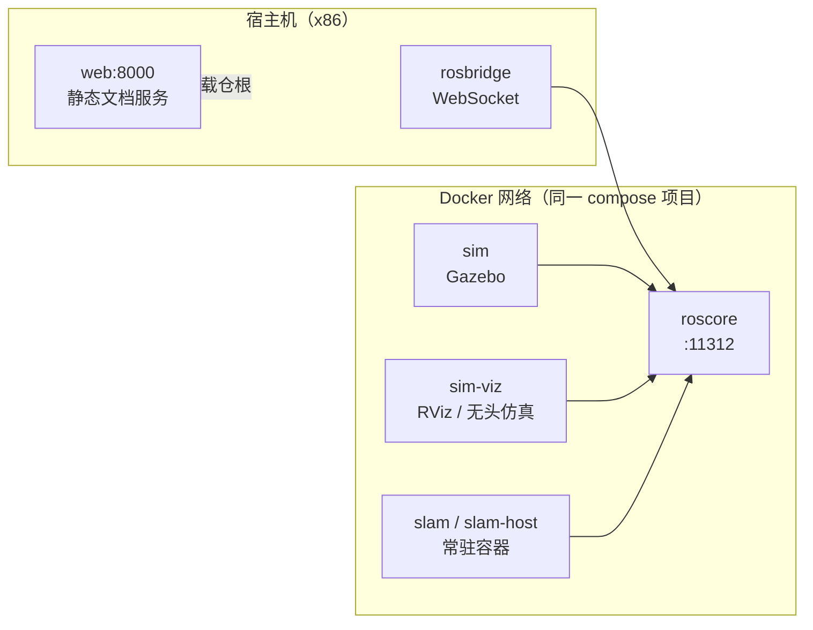
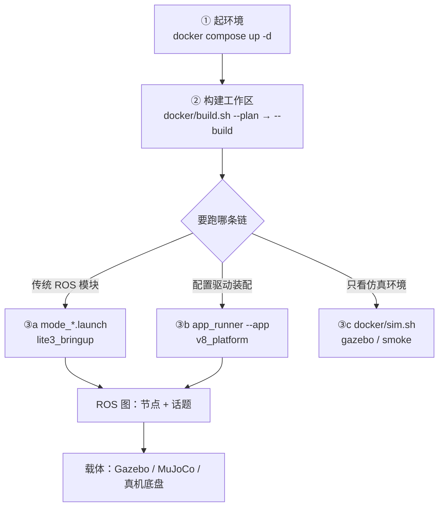
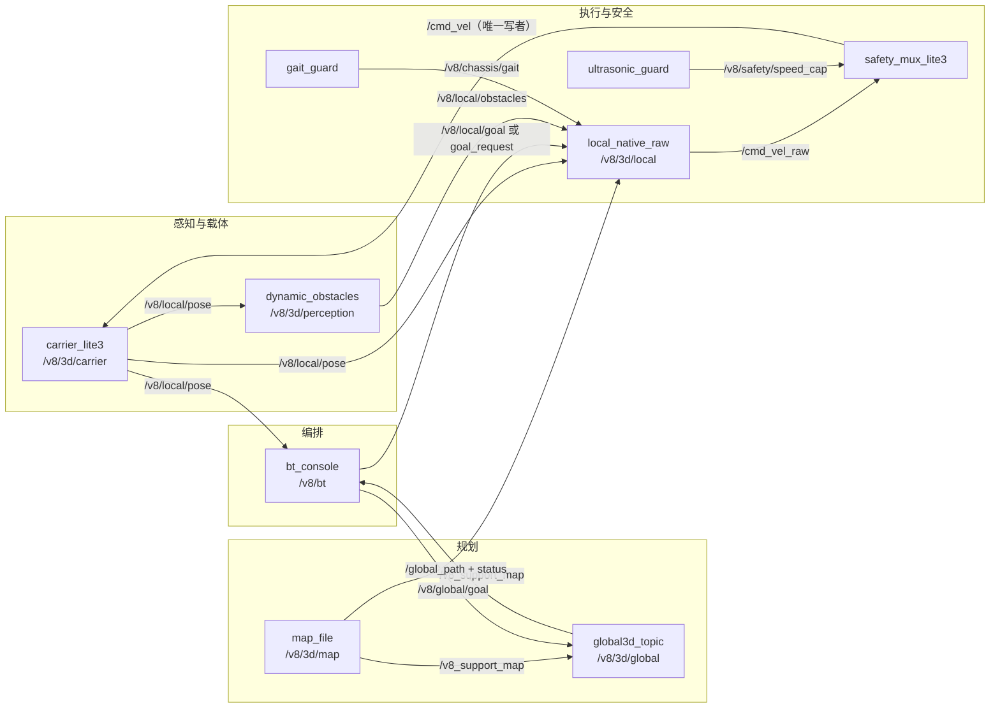
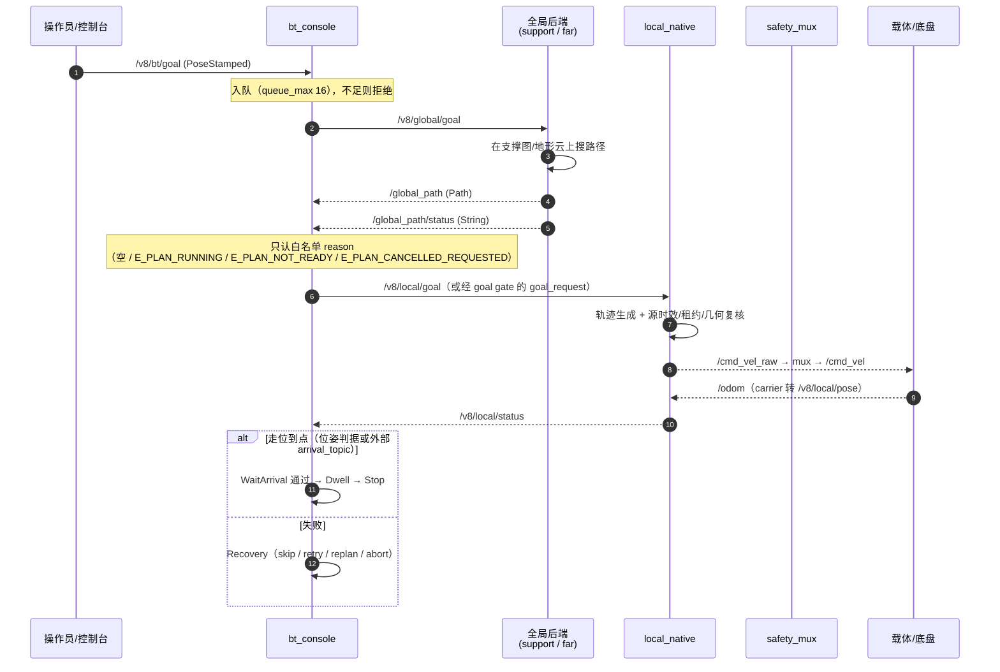
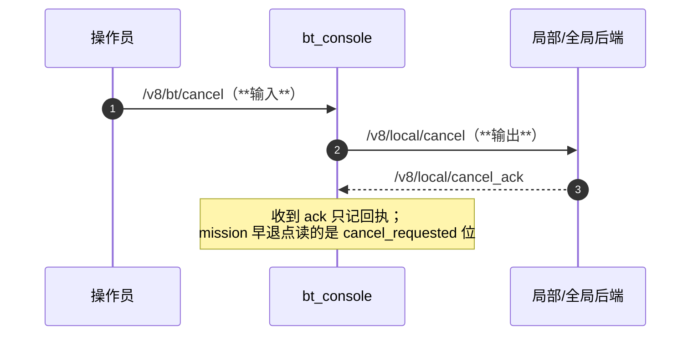
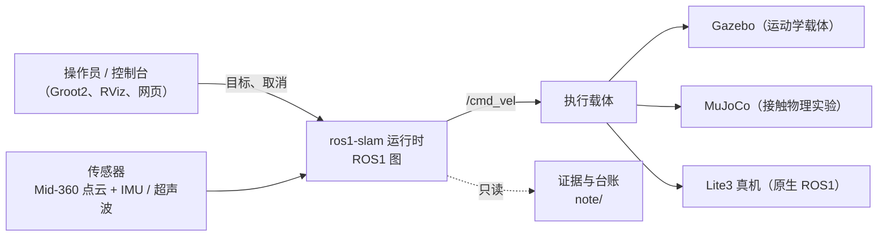
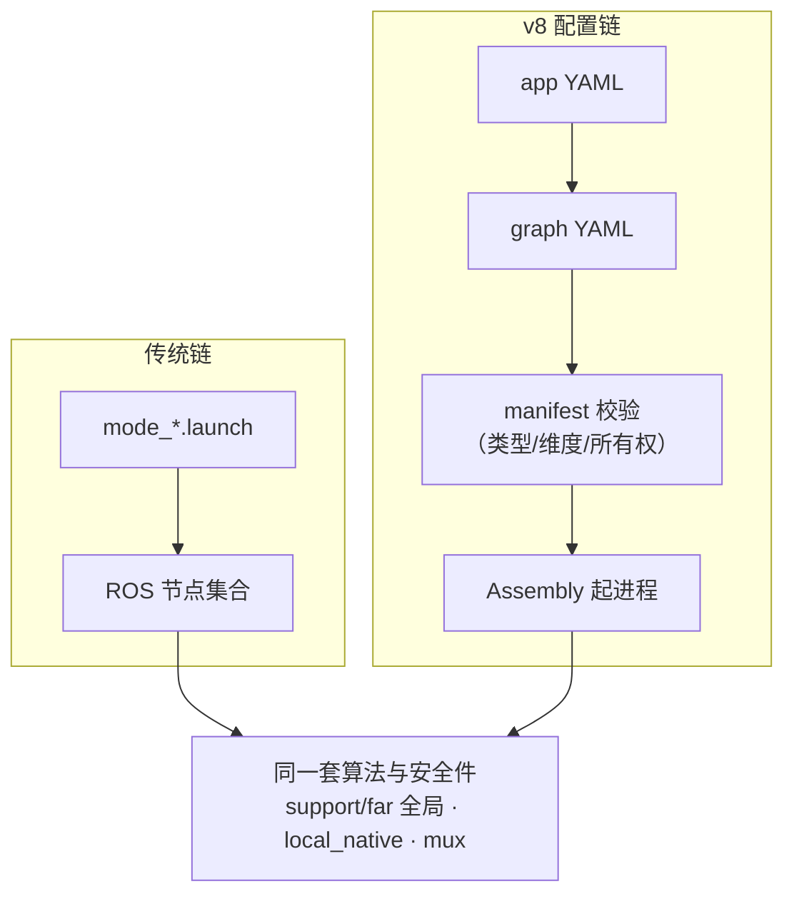

# 运行链路与接口文档（2026-11-23）

> 分析对象：`ros1-slam` 主仓（HEAD `7989c859`）。语言/框架：**ROS1 Noetic**，C++（catkin）+ Python 3.8，Gazebo 11、BehaviorTree.CPP 3.8.8、MuJoCo。
> 方法：**静态分析**（读 launch / graph / manifest / 节点源码 / compose），未做运行时验证；凡「实际跑起来的行为」一律标注 **【需运行验证】**。
> 证据口径：每个结论都带 `文件:行`；推断出的业务语义标注 **【推断，请与维护者确认】**。
> 敏感信息：全仓扫描 `password=/api_key=/secret=` 命中 0 处真实凭据（仅 2 处为命令行 token 名与正则变量名）；`docker/.env` 被 `.gitignore` 排除，不入库。
> 机器可读接口表：同目录 `接口清单_2026-11-23.tsv`（55 条端口，8 列）。

---

## 1. 系统概览

### 1.1 它是什么

一个「四足机器人 + 激光 SLAM + 导航」的开发仓。核心能力：建图／定位／全局路径／局部执行／速度仲裁，仿真在 x86 Docker 里跑，真机在 Lite3 主机上跑原生 ROS1。

### 1.2 技术栈

| 层 | 技术 | 证据 |
| --- | --- | --- |
| 中间件 | ROS1 Noetic（catkin，roscpp + rospy） | `docker/Dockerfile:41-42`（ROS_BASE_TAG=noetic-ros-base-focal） |
| 编排 | BehaviorTree.CPP 3.8.8（`bt_console` 节点） | `docker/Dockerfile:294-297`（BTCPP_TAG/SHA 固定） |
| 仿真 | Gazebo 11 + livox/mid360 插件；MuJoCo 专项 | `subprojects/simulation/ws/src/` |
| 定位/建图 | faster_lio、hdl_localization、ndt_omp、fast_gicp | `ws/src/10_slam/`、`ws/src/20_localization/` |
| 规划 | 自研 3D（`v8_algorithm`）+ 上游 SCAN（`30_3rd`）+ MBF/TEB（2D） | `ws/src/80_algorithm/`、`ws/src/30_3rd/`、`ws/src/40_navigation/` |
| 运行期环境 | Docker Compose（7 个服务） | `docker/docker-compose.yml` |

### 1.3 仓库结构（三个工作区 + 一个文档面）

| 位置 | 角色 | 规模 |
| --- | --- | --- |
| `ws/` | 主 catkin 工作区，设备/算法/平台全在这 | 38 包（x86_sim 构建闭包） |
| `subprojects/simulation/ws/` | 独立 catkin 工作区：Gazebo 世界、机器人描述、传感器的仿真插件、MuJoCo | 独立 `devel/` |
| `subprojects/console/` | 本机任务台（host-only，不进机器人镜像） | — |
| `note/` | 路线、台账、进度与证据（不是运行依赖） | 8.2k 文件 |

### 1.4 代码分层（`ws/src`）

```
00_drivers      传感器与底盘桥（livox 驱动、message_transformer、ros2qnx）
10_slam         faster_lio / pcd2grid / lite3_slam 包装
20_localization hdl_localization / ndt_omp / fast_gicp / lite3_localization
30_3rd          上游 SCAN 规划包（plan_env / path_searching / bspline_opt …）
30_perception   自研感知、高程生产者、vendor 依赖
40_navigation   lite3_navigation（MBF 装配）、lite3_scan（SCAN 接缝）
50_task         任务原语（pipeline_tracking）
60_safety       safe_cmd_vel_mux（/cmd_vel 单写者）
70_bringup      mode_*.launch 顶层入口
80_algorithm    v8_algorithm（representation/planner/local_planner/calibration）、v8_grid
90_platform     v8_platform（契约/装配/编排/校验）+ lite3_bt（BT 编排）+ v8_msgs
90_supervisor   心跳与 hold（不直接发速度）
```

### 1.5 运行时拓扑（Compose 服务）



服务清单与端口（`docker/docker-compose.yml`）：`roscore`（`:11312`，`ROS_PORT` 可覆盖）、`slam`、`slam-host`（`profiles: hostnet`）、`sim`（`profiles: sim`）、`sim-viz`（`profiles: viz`）、`rosbridge`（`profiles: extras`）、`web`（`:8000` → 宿主 80）。

---

## 2. 它是怎么跑起来的（四条路径）

### 2.1 路径全景



### 2.2 ① 起环境

```bash
cd <repo>/docker && docker compose --env-file .env up -d
```

七个服务默认 `sleep infinity`（常驻容器），只有 `roscore/rosbridge/web` 真正跑进程。所以「起环境」= 把容器拉起来，真正的 ROS 节点要另外 launch。

### 2.3 ② 构建

```bash
bash docker/build.sh --plan     # 只读：打印 38 包闭包与 rosdep 命令，不编译
bash docker/build.sh            # 真编译（容器内，JOBS 可调）
```

- 闭包来源：`tooling/build/profiles.json` 的 `targets.x86_sim.roots`（26 个根 → 38 包）；生成物在 `ws/.profiles/x86_sim/`。
- `lite3` 目标只装真机需要的包、不装仿真；`m20` 目标 `supported:false` 明确拒绝。
- **【需运行验证】** 首次全量编译约 6 分钟（38 包 / `JOBS=8`），本报告未执行编译。

### 2.4 ③a 传统 launch 链

入口都在 `ws/src/70_bringup/lite3_bringup/launch/`：

| 入口 | 用途 | 关键行为 |
| --- | --- | --- |
| `mode_mapping.launch` | 建图 | 起驱动 + SLAM，**不起运动桥** |
| `mode_localize.launch` | 定位 | 起定位后端 + TF |
| `mode_navigation.launch` | 真机导航 | `enable_motion` / `enable_bt` **缺省 false**，真机动作须现场授权 |
| `mode_sim_bt.launch` | 仿真 + BT 3D 导航 | 本报告的主链路，见 §3 |
| `mode_sim_teb.launch` | 仿真 2D（MBF/TEB） | 2026-11-22 起 B 链降级为「候选/回归对照」 |
| `interactive_2d.launch` | 2D 交互导航 | `docker/README.md` §4.6.1 的现行入口 |

典型调用（`mode_sim_bt.launch:21-35` 声明的 10 个顶层 arg）：

| arg | 缺省 | 作用 |
| --- | --- | --- |
| `enable_bt` | `true` | 是否起 `bt_console` 编排层 |
| `bt_profile` | `demo` | BT 演示配置档 |
| `local_twist_topic` | `/cmd_vel_raw` | 局部规划器输出的 Twist 话题 |
| `map_json` | `contracts/fixtures/map_single_floor.json` | 单层地图夹具 |
| `tf_source` | `fresh` | TF 来源策略 |
| `global_backend` | `support` | **全局后端开关**：`support`（本仓支撑图规划器）或 `far`（第三方 FAR overlay）。同一棵 BT、同一条安全链、同一个局部规划器，只换全局那一节（launch 注释原文） |
| `arrival_topic` | 空 | 外部到达信号（`std_msgs/Bool`）。空＝BT 用位姿判据；**`far` 后端必须显式给** |
| `far_debug` / `far_terrain_flatten` | `false` / `true` | FAR 后端调试与地形压平 |
| `zmq_pub_port` / `zmq_sub_port` | 5555 / 5556 | Groot2 可视化端口（仅本机） |

### 2.5 ③b v8 配置驱动链（app_runner）

这是「配置装配」那条链：不是写死 launch，而是 **app YAML → graph → manifest 校验 → Assembly 起进程**。

```bash
python3 -B ws/src/90_platform/v8_platform/framework/nodes/app_runner.py \
  --app ws/src/90_platform/v8_platform/framework/fixtures/apps/nist_sensor_3d.yaml \
  --out /tmp/app_out.json [--execute] [--gui] [--real] [--interactive] [--rviz]
```

- `app_runner.py` 只是 façade：`app_runner_prepare`（解析与准备）+ `app_runner_execute`（起进程/收尾）（`.../nodes/app_runner.py:1-20`）。
- 进程生命周期在 `framework/runtime.py` 的 `Assembly`：`start() → ready() → health() → stop()`（`runtime.py:138-206`）。
- 依赖校验链：graph 声明端口类型/schema/Path 维度/所有权 → `framework/config.py` + `graph.py` + `render.py` 生成装配计划 → `framework/execution.py` 判执行域与机器人身份。
- **不跑 `--execute` 时不启进程**，只产出计划 JSON；这是安全的「先看它要起什么」。

### 2.6 ③c 只看仿真环境

```bash
bash /opt/ros1-slam/docker/sim.sh probe        # 环境自检（GL/Xvfb/插件/端口）
bash /opt/ros1-slam/docker/sim.sh gazebo       # 只起场地，前台挂日志
bash /opt/ros1-slam/docker/sim.sh smoke stageA # 跑 M2 冒烟判据
```

---

## 3. 核心链路：从「给个目标」到「底盘动」

### 3.1 组件端口图（`graph_3d_lite3_bt.yaml` 的 9 个实例）



### 3.2 一次导航的时序（目标 → 路径 → 执行 → 到达）



### 3.3 取消链（两条话题方向相反，容易搞反）



- `/v8/bt/cancel` 是 BT 的**输入**，`/v8/local/cancel` 是 BT 的**输出**（`bt_console.cpp:1431-1432`）。
- 绕开 BT 直接发 `/v8/local/cancel`，BT 不知情，树仍在 mission ⇒ 再发 `/v8/bt/goal` 无人接。**【推断，请维护者确认】** 这是设计约束而非缺陷，已在 `note/10_真机上机Runbook.md` §7.3 定为操作口径。
- **【需运行验证】** 取消落在「路径未就绪」与「已就绪待到达」两个相位的行为不同，见 `note/架构/FAR自停快速恢复_设计与验收_2026-11-22.md`。

### 3.4 三条安全不变量（代码可查）

| 不变量 | 证据 |
| --- | --- |
| `/cmd_vel` 只有一个写者：`safety_mux_lite3` | manifest `v8.fw.safety_mux_lite3` 的 `ownership.command_topics=['/cmd_vel']`；其余组件该字段均不含 `/cmd_vel` |
| 局部规划器只能写 `/cmd_vel_raw` 与 `/v8/local/cmd_vel_3d` | manifest `v8.fw.local_native_raw` 的 `command_topics` |
| BT 不写速度，只写目标/取消/停止 | BT 输出端口为 `planner_goal / out_goal / status / lease / stop / cancel_cmd`，无速度话题 |

---

## 4. 接口文档

### 4.1 接口形态说明（为什么没有 OpenAPI）

这是 ROS1 系统，**没有 HTTP/REST 接口**，所以不产出 OpenAPI。等价物有两套，都可机读：

| 契约 | 文件 | 用途 |
| --- | --- | --- |
| 组件端口契约 | `ws/src/90_platform/v8_platform/framework/fixtures/manifests/*.json`（50 份） | 每个组件的 `ports.inputs/outputs`（名字/类型/话题）+ `ownership`（TF 边、命令话题、停止方式） |
| 装配契约 | `configs/lite3/graph_3d_lite3_bt.yaml`（`schema: pipeline_graph/v1`） | 实例 → 组件 → 命名空间 → 参数覆盖；启动 DAG 只取非反馈边 |

如果确实需要 HTTP 面，现成的只有 `rosbridge`（`docker-compose.yml:476`）与任务台 `:8780` 的 `/api/whoami`；**两者都不是本项目定义的业务接口**。

### 4.2 组件端口表（`graph_3d_lite3_bt.yaml` 装配）

> 话题名来自 manifest 缺省值；graph 的 `params` 可覆盖（例：`bt.params.goal_topic`）。完整 55 条见 TSV。

| 实例 | 组件 | 输入 | 输出 | 命令所有权 |
| --- | --- | --- | --- | --- |
| `map` | `v8.fw.map_file` | — | `/v8_support_map`、`/v8_map_status` | — |
| `global` | `v8.fw.global3d_topic` | `/v8_support_map`、`/v8/global/start`、`/v8/global/goal` | `/global_path`、`/global_path/status` | — |
| `bt` | `v8.fw.bt_console` | `/v8/bt/goal`、`/v8/local/pose`、`/global_path`、`/global_path/status`、`/v8/bt/goal_policy`、`/v8/bt/cancel`、`/v8/local/cancel_ack`、`/v8/local/localization_ok`、`/v8/bt/goal_mission` | `/v8/global/goal`、`/v8/bt/goal_request`、`/v8/bt/status`、`/v8/bt/lease`、`/lite3/teleop/app_cmd_vel`、`/v8/local/cancel` | — |
| `local` | `v8.fw.local_native_raw` | `/v8_support_map`、`/v8/local/pose`、`/v8/local/goal`、`/v8/local/obstacles`、`/v8/local/localization_ok`、`/v8/chassis/gait`、`/v8/chassis/status`、`/v8/local/cancel` | `/v8/local/cmd_vel_3d`、`/cmd_vel_raw`、`/v8/local/trajectory`、`/v8/local/status`、`/v8/local/cancel_ack` | `/v8/local/cmd_vel_3d`、`/cmd_vel_raw` |
| `perception` | `v8.fw.dynamic_obstacles` | `/cloud_registered`、`/v8/local/pose` | `/v8/local/obstacles`、`/v8/3d/perception/status` | — |
| `gait_guard` | `v8.fw.gait_guard` | `/v8_support_map`、`/v8/3d/global/path`、`/v8/local/pose` | `/v8/chassis/gait`、`/v8/gait_guard/status` | — |
| `ultrasonic_guard` | `v8.fw.ultrasonic_guard` | `/us_publisher/ultrasound`（Float64MultiArray） | `/v8/safety/speed_cap`（Float32）、`/v8/safety/ultrasonic_status` | — |
| `mux` | `v8.fw.safety_mux_lite3` | `/cmd_vel_raw`、`/lite3/supervisor/hold`、`/v8/safety/speed_cap` | `/cmd_vel` | **`/cmd_vel`** |
| `carrier` | `v8.fw.carrier_lite3` | `/odom`（nav_msgs/Odometry） | `/v8/local/pose`、`/v8/local/localization_ok`、`/v8/3d/carrier/status` | — |

### 4.3 跨组件枢纽话题（谁写、谁读）

| 话题 | 类型 | 写 | 读 | 语义 |
| --- | --- | --- | --- | --- |
| `/rslidar_points` | `sensor_msgs/PointCloud2` | Livox 驱动（`01_sensors.launch` remap） | 10 个文件（SLAM/感知/规划） | 主点云输入 |
| `/livox/imu` | `sensor_msgs/Imu` | 同上 | 2 | LIO 的 IMU |
| `/LIO/odom_vehicle` | `nav_msgs/Odometry` | faster_lio | 10 | LIO 位姿 |
| `/Odometry` | `nav_msgs/Odometry` | 2（含仿真真值源） | 5 | 单写者红线 **【需运行验证：真机/仿真来源不同】** |
| `/v8/local/pose` | `geometry_msgs/PoseStamped` | 5（carrier/pose_mux/仿真源） | 5（BT/local/guard） | 统一位姿面 |
| `/cmd_vel_raw` | `geometry_msgs/Twist` | local_native | mux | 局部命令（未仲裁） |
| `/cmd_vel` | `geometry_msgs/Twist` | **仅 mux** | 载体/真机桥 | 最终命令（单写者） |
| `/lite3/supervisor/hold` | `std_msgs/Bool` | 5（supervisor 面） | mux | 心跳失联即 hold |
| `/v8/safety/speed_cap` | `std_msgs/Float32` | 超声波守卫 | mux | 动态限速 |

### 4.4 参数接口

**(a) BT 节点参数**（`ws/src/90_platform/lite3_bt/src/bt_console.cpp:1393-1569`，私有命名空间）

| 参数 | 缺省 | 说明 |
| --- | --- | --- |
| `tree_file` | 空 | 树文件路径；`bt_console.launch` 缺省 `trees/navigate_with_planner.xml` |
| `goal_topic` | `/v8/bt/goal` | 目标入 |
| `pose_topic` | `/v8/local/pose` | 位姿入 |
| `out_goal_topic` | `/v8/bt/goal_request` | 经 goal gate 的目标出 |
| `stop_topic` | `/lite3/teleop/app_cmd_vel` | 停止命令话题 |
| `planner_goal_topic` | `/v8/global/goal` | 请路径 |
| `path_topic` / `path_status_topic` | `/global_path` / `/global_path/status` | 路径与其状态 |
| `arrival_speed_floor_mps` | 见源码 `:1414` | 到达判据的速度下限 **【需确认：单位与默认值以源码为准】** |
| `queue_max` | 16 | 目标队列上限，满则拒绝 |
| `cancel_ack_timeout` | 见源码 | 取消回执等待 |
| `recovery_mode` / `retry_max` / `retry_delay_s` | `skip` / — / — | 失败恢复策略 |
| `cancel_input_topic` / `cancel_topic` / `cancel_ack_topic` | `/v8/bt/cancel` / `/v8/local/cancel` / `/v8/local/cancel_ack` | 取消三件套 |
| `policy_topic` / `mission_topic` | `/v8/bt/goal_policy` / `/v8/bt/goal_mission` | 目标策略与任务目标 |
| `localization_topic` | 空 | 定位就绪信号（空＝不检查） |
| `planner_result_topic` | 空 | 下游执行器回执 `<seq>:ok/fail`（空＝位姿判到达） |
| `arrival_topic` | 空 | 外部到达信号（FAR 走这个） |
| `execution_request_topic` / `execution_status_topic` | 空 | 外部执行器接管 |
| `lease_topic` | 见源码 | 目标租约 |
| `zmq_pub_port` / `zmq_sub_port` | 5555 / 5556 | Groot2 可视化（只绑本机） |

**(b) local_native 参数**（`ws/src/80_algorithm/v8_algorithm/local_planner/ros_node.py:120-190`）

`~experimental_config`（整包传入 `native.Config`）、`~input_max_age_s`（缺省 1.0）、`~wall_watchdog_s`、`~map_json` / `~map_topic`、`~robot_profile_json`、`~cancel_topic` / `~cancel_ack_topic`、`~command_topic`（缺省 `/v8/local/cmd_vel_3d`）、`~twist_topic`、`~trajectory_topic`、`~status_topic`、可选 `~gait_hold_enable` 一组。

### 4.5 契约字段（manifest）

50 份 manifest 的统一键：`schema_version / id / version / roles / dimensions / capability / ownership / launch / ports / evidence / execution`。
`roles` 是装配期校验用的角色标签（`local_planner`、`controller`、`safety_arbiter`、`middleware`、`sensor_source`）；`ownership.command_topics` 是单写者校验的依据。

---

## 5. 架构图

### 5.1 系统上下文



### 5.2 两条装配链（同一套算法与安全件）



### 5.3 部署视图

```mermaid
flowchart TB
  subgraph x86["x86 开发机（Docker）"]
    C1["ws（38 包）"] --- C2["subprojects/simulation/ws"]
    C2 --- C3["web:8000 文档面"]
  end
  subgraph lite3["Lite3 主机（原生 Noetic）"]
    R1["lite3 目标包（不含仿真）"]
  end
  x86 -. 目标构建器 target_workspace.py .-> lite3
```

---

## 6. 需确认项（不要当结论用）

| # | 项 | 为什么标需确认 |
| --- | --- | --- |
| 1 | `/global_path/status` 的 JSON 字段与 `ok` 语义 | 只从代码看到白名单判定，字段全貌需读生成端 |
| 2 | `/Odometry` 在真机与仿真的写入者是否同一 | 统计到 2 个写者，来源随 `tf_source` 变，需按实际 launch 确认 |
| 3 | `arrival_speed_floor_mps` 等 4 个默认值 | 源码为多行 `pnh.param`，本报告未逐行取数 |
| 4 | 「取消两相位」的最终行为 | 属运行期时序，标注需运行验证 |
| 5 | `mode_navigation` 真机链的完整节点集 | 本报告只静态核对到 `enable_motion/enable_bt` 缺省 false，未逐一列节点 |

## 7. 复跑与索引

```bash
# 只看装配计划（不起进程）
python3 -B ws/src/90_platform/v8_platform/framework/nodes/app_runner.py \
  --app ws/src/90_platform/v8_platform/framework/fixtures/apps/nist_sensor_3d.yaml --out /tmp/plan.json
# 构建闭包（只读）
bash docker/build.sh --plan
# 组件端口重生成（本报告 TSV 的同一算法）
python3 - <<'PY'
import re,json,glob
y=open('ws/src/90_platform/v8_platform/configs/lite3/graph_3d_lite3_bt.yaml').read()
print(re.findall(r'- id: (\S+)\n\s+component: (\S+)', y))
PY
```

| 想深入 | 去看 |
| --- | --- |
| 组件契约字段含义 | `ws/src/90_platform/v8_platform/contracts/` |
| 图校验与装配计划 | `framework/{config,graph,render}.py` |
| 进程生命周期 | `framework/runtime.py` 的 `Assembly` |
| BT 树节点语义 | `ws/src/90_platform/lite3_bt/trees/*.xml` + `README.md` |
| 真机操作口径 | `note/10_真机上机Runbook.md` |
| 结构与边界 | `note/架构/项目架构与目录.md` |
