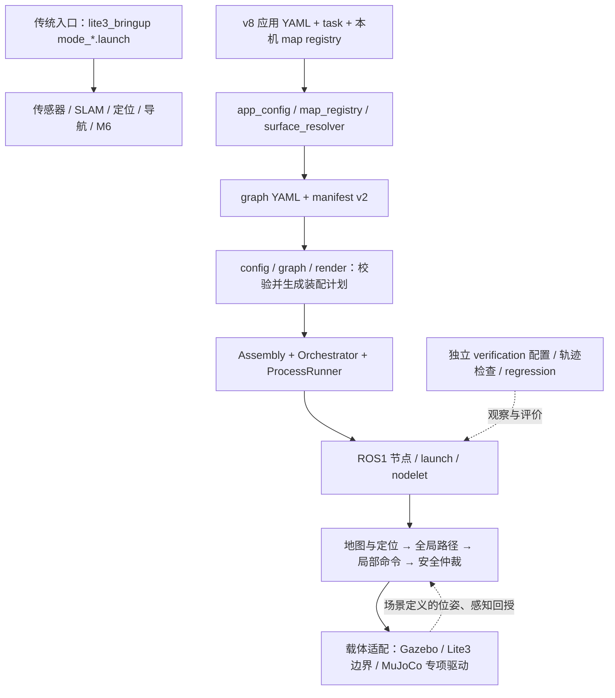

# 项目架构与目录

> 最新更新时间：2026-11-05 23:55:56 CST。核对依据：当前源码、launch、manifest 与 graph 配置；本件说明结构，不签运行验收。现行规划见 [v8 入口](../计划书v8/README.md)，进度与能力边界见 [进度入口](../进度/README.md)。

## 1. 仓库的两条装配链

本仓同时维护传统 ROS1 模块 launch 与 v8 配置驱动装配。两者复用算法、传感器与安全组件；仿真和真机采用各自的入口、地图与载体。

`Assembly` 负责进程生命周期，运行数据经 ROS 话题流动；它不把规划或控制循环搬进 Python 编排循环。`framework/verification.py` 的独立后端会检查 truth 话题不混入算法图。另有明确使用 GT 位姿的仿真建图和 carrier 实验，不能把这类实验当作真实定位或真机能力。

## 2. 源码分层

下列路径均以仓根为起点；[ws 入口](../../ws/README.md)列出包级导航。

| 层 | 职责与主要位置 |
| --- | --- |
| `ws/src/00_drivers/` | 驱动壳 `lite3_drivers`、Livox/雷达副本、`message_transformer` 传感/底盘桥 |
| `ws/src/10_slam/` | `lite3_slam` 配置包装、faster_lio、pcd2grid |
| `ws/src/20_localization/` | `lite3_localization` 与 hdl/NDT/GICP 定位后端 |
| `ws/src/30_3rd/` | SCAN 上游规划包；配置接缝由 `40_navigation/lite3_scan` 包装 |
| `ws/src/30_perception/` | 自研感知/高程生产者与独立保留的厂商、kindr 依赖 |
| `ws/src/40_navigation/` | `lite3_navigation` 的 MBF/规划器装配、`lite3_scan` 接缝和自研 costmap 层 |
| `ws/src/50_task/` | 传统任务原语与状态机 |
| `ws/src/60_safety/` | 速度源仲裁、动态限速、超时与 hold；传统/真机 `/cmd_vel` 出口 |
| `ws/src/70_bringup/` | 传统 mode 顶层 launch，组合平级模块 |
| `ws/src/90_supervisor/` | 模块心跳与 `/lite3/supervisor/hold`，不直接发速度 |
| `ws/src/90_platform/` | `v8_platform` 平台与算法适配、`v8_ndt_odom`、`v8_msgs` 消息接口 |
| `ws/src/95_simulation/` | Gazebo launch/world/传感插件/机器人描述、MuJoCo 动力学专项驱动与测试 |

第三方副本由原件约束保护，不能按“没有被当前示例加载”清理。运行证据、过期一次性台账与代码目录的清理标准不同。

## 3. v8 的依赖与阅读顺序

平台源码根为 [`ws/src/90_platform/v8_platform/`](../../ws/src/90_platform/v8_platform/)。

| 问题 | 代码入口 |
| --- | --- |
| 组件/机器人/地图/任务契约 | [`contracts/`](../../ws/src/90_platform/v8_platform/contracts/) |
| manifest 检索与声明/证据分离 | [`registry/registry.py`](../../ws/src/90_platform/v8_platform/registry/registry.py) |
| 领域组合与锁定 | [`composer/`](../../ws/src/90_platform/v8_platform/composer/) |
| 应用读入与地图、任务绑定 | [`framework/app_config.py`](../../ws/src/90_platform/v8_platform/framework/app_config.py)、[`map_registry.py`](../../ws/src/90_platform/v8_platform/framework/map_registry.py)、[`surface_resolver.py`](../../ws/src/90_platform/v8_platform/framework/surface_resolver.py) |
| graph/端口/类型/schema/维度/启动 DAG | [`framework/config.py`](../../ws/src/90_platform/v8_platform/framework/config.py)、[`graph.py`](../../ws/src/90_platform/v8_platform/framework/graph.py)、[`render.py`](../../ws/src/90_platform/v8_platform/framework/render.py) |
| 进程启动、就绪、健康与停止 | [`framework/runtime.py`](../../ws/src/90_platform/v8_platform/framework/runtime.py)、[`orchestrator/`](../../ws/src/90_platform/v8_platform/orchestrator/) |
| 多层地图、语义、MapDelta、版本持久化 | [`representation/`](../../ws/src/90_platform/v8_platform/representation/) |
| 支撑图有界全局规划与 topic 包装 | [`planner/support_planner.py`](../../ws/src/90_platform/v8_platform/planner/support_planner.py)、[`topic_node.py`](../../ws/src/90_platform/v8_platform/planner/topic_node.py) |
| 全局路径转局部目标、局部规划/输入新鲜度 | [`local_planner/path_goal_node.py`](../../ws/src/90_platform/v8_platform/local_planner/path_goal_node.py)、[`local_native.py`](../../ws/src/90_platform/v8_platform/local_planner/local_native.py)、[`ros_node.py`](../../ws/src/90_platform/v8_platform/local_planner/ros_node.py) |
| 安全接线与评价 | [`framework/safety.py`](../../ws/src/90_platform/v8_platform/framework/safety.py)、[`validator/`](../../ws/src/90_platform/v8_platform/validator/)、[`framework/verification.py`](../../ws/src/90_platform/v8_platform/framework/verification.py)、[`regression/`](../../ws/src/90_platform/v8_platform/regression/) |
| 机器人 UDP 协议、ROS 桥和回环端点 | [`boundary/`](../../ws/src/90_platform/v8_platform/boundary/) |

当前 `app_runner.py` 从 `framework/fixtures/manifests/` 读组件目录；`framework/fixtures/graphs/`、`apps/`、`configs/` 中也有实际运行入口。`fixtures` 名称不能用作删除依据。`v8_platform/CMakeLists.txt` 只声明 catkin 包，不安装 Python 模块，当前代码与测试直接按源码路径运行。

graph 按 manifest 声明检查端口类型、schema、Path 维度与所有权；这不代替真实 ROS 节点接口实测。数据反馈边必须显式声明 `feedback` 与策略，启动顺序只取非反馈边。命令图至多一个 `/cmd_vel` 写者，且须为 `safety_arbiter`；只读图允许没有写者。停止链将安全仲裁器排在最后。

## 4. 运行入口与执行边界

| 入口 | 数据/命令链 | 边界 |
| --- | --- | --- |
| 传统 `mode_mapping.launch` / `mode_localize.launch` / `mode_navigation.launch` | SUP＋驱动＋SLAM/定位＋需要的导航/安全模块 | mapping 不启动运动桥；navigation 的 `enable_motion` 缺省 false，真机动作须现场授权/预检 |
| v8 Gazebo app | 地图 → 全局 Path → `path_goal_node` → `local_native` → `cmd3d_mux_node` → `/cmd_vel` → `gazebo_carrier3d_node`；载体回授位姿/定位状态 | [`graph_3d_gazebo_app.yaml`](../../ws/src/90_platform/v8_platform/framework/fixtures/graphs/graph_3d_gazebo_app.yaml) 的 app carrier 是运动学载体，不代表四足动力学 |
| v8 Lite3 app | 感知障碍 → local；local 的 `/cmd_vel_raw` → 现有 M6 `safe_cmd_vel_mux`；超声 cap 与 SUP hold 进入 M6，carrier 读真实 TF/位姿 | [`configs/lite3/graph_3d_lite3.yaml`](../../ws/src/90_platform/v8_platform/configs/lite3/graph_3d_lite3.yaml)；模板只描述装配，不等于真机验收通过 |
| MuJoCo 专项 | 支撑图/全局或局部参考 → 策略/关节 PD/力矩 → 接触物理 → 独立测量 | [`dynamics/`](../../ws/src/95_simulation/lite3_gazebo_sim/dynamics/)；外部 MJCF/mesh/ONNX 按路径提供，不能当项目垃圾删除 |

全局障碍体积属于 `map.v2.obstacles` 输入；当前 Lite3 graph 的动态障碍流接局部规划器。它们的入口、几何与时效不同，不宜在文档中合并成一条“障碍已经接通”的宽泛结论。MuJoCo 阶面障碍驱动为 [`mj_step_obstacles.py`](../../ws/src/95_simulation/lite3_gazebo_sim/dynamics/mj_step_obstacles.py)，机器人从阶面上起步，不能由此宣称跨阶上升验收通过。

## 5. 配置、数据和工作机

- [真机应用模板](../../ws/src/90_platform/v8_platform/configs/lite3/lite3_real_3d.app.yaml)绑定 graph、map registry、地图 ID/版本与 task；每台机器用被忽略的 `*.local.app.yaml` 覆盖自身数据。模板不是可直接照搬到另一机器的地图。
- `data/maps/registry.json` 是默认本机注册表，可由 app 的 `map_registry` 显式覆盖；仓内 [registry.template.json](../../data/maps/registry.template.json)只是模板。地图内容、ID、版本与数据 SHA 必须匹配。
- `data/maps/`、`logs/`、`ws/build/`、`ws/devel/` 是各机数据或生成物；不据文件缺席自动判断代码缺失，不跨机反向清理。
- Lite3 主机使用原生 ROS1/Noetic；x86 使用 [Docker 开发环境](../../docker/README.md)承担 Gazebo/MuJoCo 与回归。连接到硬件的动作和参数仍有独立授权边界。
- [门禁清单](../../scripts/verify/gate_chain.txt)定义正式串；组件单测和仿真矩阵分别在源码测试/`regression/`。旧证据中记录的 PASS 只对其原范围生效。

## 6. 怎样做删减

当前代码、配置和真实检查的输入先建立依赖闭包；历史快照若只保留恢复价值，可移出工作树并把导航改为固定 Git/归档入口。根 README 只保留项目定位、当前阅读入口、运行环境与架构链接；逐批更新留在进度真身。禁止为减少文件数删除当前测试夹具、冻结判据或仍被检查器读取的旧基线。

## 当前接口的具体限制

- `path_goal_node.py`当前只把全局Path末点转为局部目标；局部规划器自行重规划，不能称为逐点跟踪整条全局路线。
- Lite3 graph把局部节点的plain Twist镜像送入M6；该镜像仍取map系速度，carrier只转发位姿/TF，未独立完成速度到机体系的旋转。静态或轴对齐实验不证明任意朝向的命令适配。
- 接受map v3的cells不表示所有消费者拥有完全相同语义；全局精确端点/门户连接的特定分支仍限定v2，MapService默认校验也不普遍开启带障碍地图。各入口支持范围见对应README和代码。

## 统一工程约束

工程标准真源：`note/架构/工程标准.md`。[工程标准](工程标准.md)统一阶段验证落账后本地commit、用户决定push、Lite3/M20真机不构建仿真、x86仿真与训练开发，以及算法标准接口。新增显式目标构建器与清单闭包检查，目标环境编译尚未验证；Docker旧入口、模式守卫、真实接线/TF/热替换仍待接续；M20真实适配和可复现训练器也尚未提供，详见[审查记录](../进度/00_架构与工程标准审查_2026-11-05.md)。规范统一不等于这些能力已实现。
