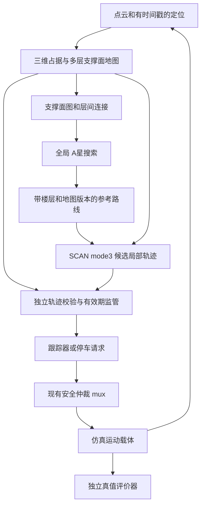

# ros1-slam：3D 全局规划、局部规划与仿真攻关计划

> 编制：Codex｜日期：2026-10-24（Asia/Shanghai）｜任务：T-20261024-01。
> 状态：**按主理人本次要求完成的分析与设计建议稿，供评审和后续施工拆包使用。**
> 基线：本仓 HEAD＝3dd0446；本次核查涵盖工作树源码、历史原件、现行路线与离线自测。文中区分「本次实测」「源码事实」「历史记录」「设计建议」。
> 效力：本件不替换 21 号 v7 正文，不自动生效为 v7 补丁，不代填 23 号队列、Q-B1/Q-B2、W8 或验收门值。算法实现和仿真达成尚未完成。

## 1. 可行性判断与推荐路线

**可以帮助项目突破当前困难，并有条件完成地面四足机器人在三维环境中的全局路径规划、局部避障和仿真验证。**已有 ROS1/Noetic、MBF、faster-lio、SCAN、仿真场景与取证体系，足以作为工程基础；缺口主要在多层环境表征、地面支撑约束、接口语义与验证载体的衔接。完成与否要通过后续实验判定，不能从「编译过」推到「算法已完成」。

推荐主线：

**复用 T1/T2 的多高度列基础 → 建立可通行支撑面图 → 有界 A* 全局搜索 → 通过 SCAN 的参考路径模式接入局部避障 → 独立检查轨迹的支撑、净空、楼层和有效期 → 分层仿真验收。**

优先自持必要的地图、全局规划与接口模块；SCAN 先按原样第三方算法使用。PCT Planner 用于多层全局规划对照；Mesh Navigation 保留为支撑面图路线的替代候选。是否需要自研局部优化器，由最小实验决定，避免一开始同时重写整套算法。

本计划把完成目标拆成三个可单独交付的层级：

| 交付层级 | 要回答的问题 | 能证明到哪里 |
| --- | --- | --- |
| 几何规划 | 同一 XY 有上下层、桥洞、坡道和断桥时，能否找到有支撑且无碰撞的路径/轨迹？ | 三维环境中的规划正确性；不证明腿部执行能力 |
| 导航系统闭环 | 感知、定位、全局、局部、仲裁、运动更新能否稳定闭合，遇障碍能否重规划或停车？ | 指定仿真载体上的导航闭环；须声明真值/估计位姿和运动模型 |
| 四足动力学 | Lite3 的步态、接触、摩擦、力矩和姿态控制能否执行路线？ | 需要腿控制器与接触模型的独立工作包；最终迁移仍需真机验证 |

本轮主要规划前两层，第三层列出前置和扩展路线。仅在 RViz 显示三维曲线、沿曲线移动模型或跨楼层瞬移，都不算导航闭环。

## 2. 盘上证据纠偏：实际起点比旧摘要更具体

### 2.1 必须修正的六个判断

| 旧摘要/容易产生的理解 | 本次核查后的准确结论 | 证据 |
| --- | --- | --- |
| perlin3d 6/8 说明真正的 3D 全局规划只差调参 | 历史 harness 向 MBF GetPath 提交 XY 起终点，使用 GlobalPlanner/NavfnROS；场景有三维来源不等于规划状态空间是三维。W2 的 6/8 后来因图外假自由带被 N1 改判数据无效 | E02、E03 |
| outcome=55 就是 CPU 不够 | 55 说明规划超出等待预算。历史修法后还有不返回、进程崩溃、不同 planner 同样超时的现象；根因不能由返回码唯一确定 | E02、E03 |
| 多高度列表征完全没有代码 | 厂商高程包仍是无源码骨架，但自有 T1 多高度列、T2 占位点/三态处理、T3 单层结构断言都已存在；T1/T2 是离线基础，不是多层在线规划服务 | E04、E05 |
| SCAN 带三维点云和 B 样条，就已具备任意跨层导航 | 当前默认 mode1 固定目标高度；A* 每个 XY 邻居的 z 按起终点插值。mode3 有带高度的参考路径入口，值得先利用，但完整的支撑面约束仍须验证/补齐 | E07、E08 |
| 高程层写入了代价格，所以能规划楼梯和桥洞 | 当前生产者每列只取相对地面最大高度，消费者把超阈格写成二维障碍；它证明链路已通，不能表达同 XY 上下两条可行通道 | E06、E12 |
| 已编译的五个可执行当前都能使用 | 编译通过属于历史记录。本次宿主未找到 ROS Noetic 和 ws/devel；Docker 查询无权限。本次没有重新证明可执行、插件和仿真运行态 | §11 |

**perlin3d 数字的使用纪律：**历史 W3 写「0/8」，同段细分又记录了规划超时和进程崩溃导致的无效采样。引用它时同时保留这些分类，不把无效样本全部重算为正常算法失败，也不把历史 6/8 当作新的 3D 成功率基线。新计划使用新的、预登记的样本集。

### 2.2 SCAN 的具体接缝与边界

源码事实如下，均以本地件为准，不以网上演示替代：

1. 「70_scan.launch」默认 navi_mode＝1。FSM 的 waypointCallback 把请求 XY 与 rviz_goal_height_ 拼成目标，后者来自初始里程计高度。直接给 RViz 目标填 z 不会得到预期的跨层目标。
2. mode3 的 pathCallback 订阅「/initial_path」，逐点读 z 并加 body_height_。这是可用的参考路线接缝；输入必须明确是**地面支撑高度**还是**机体中心高度**，避免两次加机身高度。
3. pathCallback 会按固定最小距离抽稀中间点。楼梯平台、拐角和层间连接点可能被抽掉；须在短路径契约测试里比较输入关键点与实际使用的路径。
4. dyn_a_star.cpp 的邻居扩展只有 dx/dy，z 来自 interpolateZIndexOnSearchPlane。它不能独立搜索任意楼梯拓扑。即使 mode3 能沿折线路径前进，也必须测试上楼—平台—转弯—再上楼时的局部搜索和样条平滑。
5. closed_loop_controller 计算 XY 位置误差并发布 vx/vy/wz；没有腿部接触控制。对四足上层速度接口，这不一定是缺陷，但它依赖下层步态系统或明确的仿真运动模型来实现高度变化。
6. scan_arrival_monitor 只保存目标 XY、只算平面距离。同 XY 不同楼层可被误判为到达；新 3D 链必须有独立的楼层与高度到达判定。
7. mode2 在本地源码里通过相对 tools/keypoint.yaml 路径加载预设点，原仓目录布局并非本仓布局。不能只把 navi_mode 改为 2 就宣布支持多楼层；主线优先测试 mode3。

### 2.3 可复用资产与真正缺口

| 子系统 | 可复用 | 尚缺 |
| --- | --- | --- |
| 感知/定位 | faster-lio、LIO 转发、TF 检查、仿真雷达 | 多层地图的时间一致性、姿态/高度漂移评测、在线地图版本与重定位处理 |
| 表征 | T1/T2 离线工具、现有 GridMap 编码、占位零点反控 | 全局多层支撑面、空闲空间证据、净空、可靠跨层边、在线更新 |
| 全局规划 | MBF/任务层接口、现有二维回归集 | 多层图搜索、取消/超时、路径楼层与版本契约 |
| 局部规划 | SCAN 的局部占据图、轨迹与 mode3 接口 | 支撑面走廊约束、足迹/机身连续碰撞核验、轨迹过期撤销和完整 3D 到达 |
| 仿真 | Gazebo 世界件、LiDAR、平面驱动、注入与取证脚本 | 多层场景、受支撑约束的移动载体；需要物理上楼时另补腿控制器 |
| 验证 | 三态、正反控、版本清单、五位置候选判据 | 一套固定数据集与可运行的 3D 实验入口；W8 等未决口径的正式定档 |

当前地图生产者还有明确的适用范围：每帧一个 ground_z、默认绝对 z 取样窗口、单帧成图、不做射线空闲更新、默认从仿真真值里程计取窗口中心。楼层抬高后不能继续假设其 ground_z 估计总有效。旧读数中这些条件必须随结果保留。

## 3. 算法选择：主线、对照与退出条件

| 方案 | 本项目用途 | 选择理由 | 代价/退出条件 |
| --- | --- | --- | --- |
| **自持多层支撑面图＋A*，SCAN mode3 局部规划** | 推荐主线 | 可直接利用本仓 T1/T2、SCAN 和 ROS1；先用 CPU 完成正确性闭环 | SCAN 若持续切离支撑面或无法保留层间路线，转自持局部规划分支；不能只靠不断调权重 |
| **PCT Planner** | 多层全局规划对照，必要时替代全局模块 | 原作者项目面向地面机器人多层结构；有点云层析与路径规划实现 | 官方环境涉及 CUDA/CuPy/Open3D；须独立锁定版本并用同一地图测，不能假设现机直接可编译 |
| **Mesh Navigation 的 Noetic 分支** | 备选全局/局部表面导航体系 | 以三维三角网格上的支撑曲面规划，接 MBF 概念上吻合 | 本仓历史 GSL/构建依赖失败需在隔离工作区重新确认；本次主机未见 mesh_navigation 目录，不能引用旧摘要说源码仍在 |
| 只增强二维 costmap 或继续 TEB 调参 | 保留平面基线和局部二维投影 | 有现成回归基线，能帮助分离感知/融合问题 | 单一二维格不能同时保留桥上/桥下可通行面，不能承担多层主线 |
| 无支撑约束的三维体素搜索 | 用于碰撞对照，不作四足主线 | 可快速发现几何可通空间 | 会产生悬空捷径；必须增加地面支撑和接触可行性约束 |

外部资料核验于 2026-10-24：[SCAN 原作者仓库](https://github.com/wuyi2121/SCAN-Planner)说明了三种导航模式及 Noetic 环境，并提示默认参数面向 Go2；[PCT 原作者仓库](https://github.com/byangw/PCT_planner)给出多层点云层析路线和依赖；[Mesh Navigation Noetic 分支](https://github.com/naturerobots/mesh_navigation/tree/noetic)是 ROS1 候选入口。以上是选型依据，**本次没有下载、编译或验证这些远端版本，也未证明本地 SCAN 与远端 HEAD 相同**。

PCT、Mesh 的重依赖试验限定为独立候选验证；未通过本地最小场景前，不进入主线依赖。CPU 主线是否需要加速，以地图规模、展开节点数、p95 规划延迟和峰值内存决定。

## 4. 总体架构与数据契约

### 4.1 地图：同 XY 多层，显式保留未知

建议以稀疏体素/列结构保存三维观测，以支撑面图供规划使用。每个 XY 列可以有多个表面，而不是一个 max-z：

- 几何：支撑面高度、法向、上下净空、可用面积、局部坡度/阶差/粗糙度。
- 身份：稳定 surface_id、层间连接、地图版本；floor_id 只能作语义提示，不能替代几何连通性。
- 观测：来源、时间戳、覆盖/置信信息、已观测空闲/占据/未知。无点不能直接推成空闲，也不能从「两层之间没回波」推成「机器人能穿过去」。
- 支撑面须由邻域连续性和面积验证；孤立悬空点、薄横梁、墙面和不可落足边缘不能成为可行地面。
- 桥上与桥下可在同一 XY 各有节点；只有坡道、经建模的楼梯或其他明确连接处建立跨层边。断桥两侧不能仅因欧氏距离近而连边。

T1 的有限 z 板窗口用于近场离线形状验证。建筑级地图应按 map 系高度分块/稀疏存储，不能把原雷达系短窗口直接扩称为全楼地图。T3 当前测试的是单层 OccupancyGrid 契约，新多层消息应另立契约，保留原测试职责。

在线地图增量更新时，只失效受影响的表面、边与轨迹；窗口移出、数据超时、定位跳变和地图版本切换均应可观测。对需要运行的走廊，无有效观测/支撑证据时停车或重规划。

### 4.2 全局规划：在可支撑曲面上搜索

推荐初始状态 q＝(surface_id, x, y, z_surface, yaw_bin)，其中 z 随支撑面确定；姿态可先采用由表面法向导出的保守机身包络。复杂接触与足步规划留给动力学扩展。

边的硬约束：

1. 连接沿可支撑地面连续；坡道/楼梯连接带方向、宽度和平台信息。
2. 机器人完整机身、传感器和腿部保守包络沿边扫掠均有净空；检查路径段，不只检查路径采样端点。
3. 坡度、上/下台阶、最小宽度与姿态变化按经确认的机器人能力配置判定。当前未标定值不得自动视为 Lite3 能力。
4. 不允许对角穿角、跨未知孔洞、跨楼板直连或把相邻高度片误当坡道。

候选边代价＝长度＋地形风险＋转向代价＋观测不确定性惩罚，权重非负。先用零启发式/Dijkstra 建立小图参考解；再用不高估代价的启发式 A*，在同图比较可达性与总代价。增量算法、分层搜索、图压缩是通过正确性后才引入的性能优化。

必须有节点展开上限、单调时钟期限、取消标志检查和明确的 NO_PATH/TIMEOUT/INVALID_INPUT 诊断。诊断码与项目 PASS/FAIL/INVALID 是两层概念，不能直接互换；由 harness 根据实验预期归类。

### 4.3 局部规划：先验证 SCAN 的参考路径模式

第一步用一条已知正确的「坡道—平台—转弯」支撑面路线输入 mode3，取回实际 B 样条与执行状态，验证 z、关键点保留、时间戳和重规划。只在这条最小契约过关后接全局规划器。

自持路线适配器负责：

- 把全局路径变换到 SCAN 实际消费坐标系，发布地面高度或机身高度的约定写入接口；对应 body_height_ 只能加一次。
- 对路径抽稀、曲线拟合、终点回退做前后对照；检测最终目标是否被内部调整，保留原请求目标用于验收。
- 只向局部规划器提供当前支撑面走廊；跨层处包含完整连接段，避免把上层楼板当可穿越空域。
- 管理 goal_id、route_id、map_version、过期时间、取消与抢占，防止迟到的旧轨迹覆盖新路线。

独立轨迹校验器至少检查：三维包络连续无碰撞、走廊归属、支撑连续性、终点楼层、速度/加速度边界、轨迹/地图年龄。采样间距必须由几何分辨率、机器人尺寸和运动界限推导，不能依靠少量控制点代替整条 B 样条碰撞检查。

**接线硬要求：**校验器必须真正位于可执行命令之前。SCAN 原 controller 的速度输出重映射到候选输入，只有校验通过的轨迹/命令能送入现有安全仲裁；单纯旁路报警但仍允许 controller 驱动不算防护。校验失败、规划期限超限或输入过期时先停车，再重规划，保持 cmd_vel 唯一写者约束。

若最小试验显示 SCAN 的插值搜索/优化会反复离开支撑面，且接口层不能表达必要约束，则执行替代工作包：自持基于支撑图的局部 lattice/短视域搜索，加有约束的时序轨迹优化。状态含支撑面、朝向和速度；代价含跟踪、平滑、时间和风险，碰撞/支撑/动力学界限作为硬约束。先完成可行的离散解，再做平滑，平滑后重新检查全部硬约束。第三方副本仍保持原样。

### 4.4 拟定接口表

以下名称为设计候选，实施前统一一次；不代表本仓已有这些消息或话题。

| 接口 | 必需字段/语义 | 消费端检查 |
| --- | --- | --- |
| 地形地图 | header/frame/stamp、map_version、resolution、surface 数组、覆盖状态与连接边 | 无效高度、重复 ID、跨帧更新、楼层错连 |
| 全局请求/结果 | 原始起终点、目标支撑面、goal_id、地图版本、预算、取消/失败原因 | 原请求目标与规划终点一致；目标模糊时返回歧义，禁止默选最近楼层 |
| 参考路线 | nav_msgs/Path 加配套元数据，含 route_id、surface 序列、走廊、z 语义 | Path 单独不能携带完整楼层/版本契约；两部分按 ID 原子对应 |
| 局部轨迹 | 轨迹时间基准、有效期、来源路线/地图版本、样条或时序位姿 | 不接受旧 goal 的迟到轨迹；地图变化后重新校验 |
| 到达/状态 | XY、z、yaw 误差、surface_id、持续时间、定位有效性、goal_id | 同 XY 异层必须拒绝到达；时间回跳或定位丢失时复位 |
| 安全/执行 | 候选速度、许可状态、停车原因、下层执行模式 | 双写者、失联、反复规划失败时保持可解释的停止状态 |

2D costmap 保留作现役基线，以及**已选定当前支撑面之后**的局部投影；禁止把所有楼层投影成一张二维图作为全局地图。若采用新规划进程，可由任务层适配其 action，不要求把多层图硬塞进 mbf_costmap_nav 的二维代价图。

## 5. 先排除历史失败：两个定向诊断包

### 5.1 perlin3d 规划不返回

此包解决二维基线的可靠性，并为新的全局服务提供健壮性测试，不把修好它等同于完成多层规划。

1. 从历史原件恢复模板尺寸、地图 seed、真实覆盖带、分辨率和起终点；先独立验证覆盖、障碍、未知和连通分量。
2. 固定 costmap 快照与起终点，离线/BFS 参考判连通；区分不可达与应该可达的样本。
3. 明确 planner 插件名和配置，记录一次请求、取消、返回/不返回、线程栈、CPU 时间、墙钟时间和进程存活。不要同时改变地图、分辨率、patience 和 planner。
4. 对比同步最小调用与 MBF action 调用，定位在搜索算法、包装层、锁/取消逻辑或采数流程哪一层。
5. 单纯放大 patience 历史上没有解决问题，不能作为默认修法。服务无响应时由受控的独立进程终止/重启，不在生产共享进程里堆积僵死规划线程。
6. 输出一个最小失败样例、明确根因或尚未证实的假设表，再决定修自持代码、向上游报告或替换服务。每个假设都注明可证伪的实验。

### 5.2 P4 重规划

既有 aa 稿含多次同几何 PASS；它并不等于完成场景多样性和正式验收。现行路线仍把 P4 列为未收口。重新建立事件时间线：

**障碍注入生效 → 点云看见 → 占据图改变 → 碰撞检测触发 → 新轨迹发布 → 新轨迹真正被消费 → 净空成立或停车。**

分别统计可见性、检测延迟、规划延迟、换轨延迟、最小包络净空与停车距离。设计至少包括能绕行、不能绕行、检测延迟、短时掉帧、重复/迟到轨迹和取消目标。固定 seed 的重启重复与不同空间几何是两组结果，不能互相代替。

原 blind 成因已有后续处置，本轮不预设它仍是根因。P4 的旧门值和失败封顶规则继续引用在册真身；新 3D 局部实验采用独立版本，不覆盖旧读数。

## 6. 仿真分层：先得到可信结果，再增加保真度

### 6.1 离线几何测试台

输入人工可核的支撑面/点云/网格和固定起终点，输出地图、图搜索和轨迹校验结果。用解析几何或独立碰撞实现作 oracle，不能直接调用被测器同一函数计算「真值」。

每个正例配一个只改关键几何的反例：桥净空足够/不足、有坡道/无坡道、完整支撑/断桥、同 XY 正确楼层/错误楼层。现有 T1/T2 自测在此保留，另增真正的支撑与路径验证。

### 6.2 ROS 算法闭环台

复用现有 Gazebo、LiDAR、LIO 与安全仲裁，在新建、独立命名的场景中接入新地图与规划链。原世界件与已归档证据保持可复跑。

先开**真值位姿诊断组**，用于隔离规划错误；随后开**LIO 估计位姿验收候选组**。真值只作独立评价源，不能偷偷成为正式被测链的定位输入。既有生产者使用 sim/odom_gt 的分支必须显式登记并在迁移前替换/验证。

多层算法闭环可以建设受支撑面约束的运动学载体：由速度积分 XY/yaw，只沿当前有效连接更新支撑高度，检查整段扫掠碰撞；无连接即拒绝移动。**不能直接用规划轨迹把模型的位置和高度设为答案。**这种模型仅证明导航软件闭环，不证明步态或物理上楼能力。

本地现有驱动的 kinematic 分支保持原 z、roll/pitch 置零；dynamic 分支保留竖向速度与接触影响，但载体仍无腿部步态控制。因此原台可做平地对照、撞停/接触观察，不能凭它给四足楼梯执行结论。

### 6.3 四足接触动力学台（独立扩展）

若主理人将「完成仿真」明确包含物理上楼，增加 Lite3 关节模型、惯量/碰撞、驱动限幅、足端接触、状态估计和可用步态控制器，再选择 Gazebo 或 MuJoCo 等载体。优先核对官方模型及控制接口可用性，不假定现有 URDF 已带控制能力。

以静站、平地、坡道、单阶、楼梯逐级验证，并扫描摩擦、载荷、质心偏差、测量噪声和时延。没有已验证的步态控制器时，该层是单独的控制研发项目，不能塞进本计划主线的小改动工期。动力学仿真通过后仍按 S4 真机流程验证。

## 7. 实验矩阵与验收建议

### 7.1 场景与失败注入

| 编号 | 场景 | 必须区分的行为 |
| --- | --- | --- |
| C01 | 平地直路/绕障 | 新链与现有二维链同图比较，基本功能不退化 |
| C02 | 长走廊/迷宫/perlin3d 修正覆盖图 | 有路、无路、超预算明确区分；取消可返回 |
| C03 | 上坡/下坡/横坡 | 保持支撑与机身净空，分方向记录 |
| C04 | 单阶/楼梯/转弯平台 | 路径沿连接面，平滑不削掉台阶平台与拐角 |
| C05 | 桥上/桥下同 XY 重叠 | 两条不同高度路线都保留，不相互覆盖 |
| C06 | 双层同 XY 起终点、无连接 | 返回无路或目标歧义，禁止竖直穿楼板 |
| C07 | 断桥/坑洞/悬挑 | 不把无回波当可踩地面，不规划悬空捷径 |
| C08 | 低梁/窄门/坡顶姿态包络 | 机身和传感器可过才放行；点路径可过不够 |
| C09 | 动态障碍临时封路与解除 | 可绕行时换轨；不可绕行时停稳；障碍消失后正确恢复 |
| C10 | 稀疏云/占位零点/遮挡 | 覆盖、未知与可通行分离，不虚构自由空间 |
| C11 | TF 丢失/乱序/时间回跳/LIO 高度漂移 | 输入失效能被发现，旧轨迹失效，不误判到达 |
| C12 | CPU 限额/掉帧/进程失联/新目标抢占 | 超预算或失联安全停止、取消有界、无旧目标续跑 |

场景编号是本计划测试 ID，不是新项目阶段。场景参数与随机种子先登记训练/调参集和保留验收集；同一保留集上的失败不能通过换 seed 或删难例消失。起终点分别覆盖近/远、正/反向、同层/跨层。

### 7.2 五位置判据如何接上

沿用 QB2 的「表征→可通行判据→代价地图→规划→执行」框架；新增多层图后，第三位置建议扩为「规划消费地图/图」，此项属于**待评审的判据范围扩展**，不能自行把现行 costmap 判据改名算过。

| 位置 | 记录的量 | 能抓住错误的对照 |
| --- | --- | --- |
| 表征 | 表面层数、z 误差、净空误差、未知覆盖、更新年龄 | 两层改一层、填充零点、空云、时间错位 |
| 可通行 | 支撑/净空/坡阶判定与独立几何标注的混淆矩阵 | 断桥、低梁、上/下阶差方向交换 |
| 地图/图 | 连通性、跨层边、地图版本、投影保持性 | 删除唯一坡道后路径必须消失；错误跨层边必须被抓 |
| 规划 | 可达率、正确拒绝率、路径代价、扫掠净空、规划延迟、取消延迟 | 明知无路却返回路径、超时不退出、异层终点 |
| 执行 | 目标楼层与 xyz/yaw 误差、碰撞/失支撑、重规划响应、停车距离、恢复 | 错楼层不算到达；轨迹看起来避开但机体撞梁必须失败 |

对于应无路的负例，「正确拒绝」是该测试 PASS，不把它放进可达正例的成功率分母。正式输出同时包含正例到达率、负例拒绝率、PASS/FAIL/INVALID 数量与原始样本索引。

输入/载体前置不成立时按项目三态口径记 INVALID；输入成立后算法超时、碰撞、错误到达按对应判据记 FAIL。并存 FAIL 不得被 INVALID 覆盖。故意输入坏数据的测试，应区分「坏数据场景已成功构造」与「被测器正确拒绝」两层；被测器静默放行应判该负控 FAIL。

### 7.3 数值门值与证据格式

本稿不给 W8-1 路径长差、W8-2 单跑/三连或四枚门值与三枚系数填值。提出应定档的变量：到达 XY/z/yaw 容差、支撑/净空裕量、地图过期时间、定位误差预算、全局与局部时限、停车响应、成功率及重复次数。每项同时给取法、单位、数据集和适用载体，由小美定档后冻结版本。

历史 perlin3d 的成功率红线只用于其原在册任务，不能未经裁定移作全部 3D 场景的验收标准。楼梯能力参数从仿真工程值升级为真机推荐值，须有实际标定依据。

建议每个运行目录含：run.json、有效配置、输入/地图/世界件 hash、软件和镜像版本、事件时间线、轨迹、原始 stdout/stderr、采样数据、判据版本和校验清单。run.json 只含合法 JSON，文本日志独立保存。记录 ROS 时间和单调墙钟时间，随机种子、CPU 限额、RTF、启动/退出状态同时归档。

## 8. 工作包、依赖与工期

以下 WP 是本稿工作包，归入既有 S1/S3/贯穿职责；没有新增 S5/S6。估计以一名熟悉 ROS/C++/Python 的主力工程师、有可用 x86 仿真资源、设计与验收人员可及时反馈为前提，不含等待审批/硬件/数据的时间。

| 工作包 | 工作与交付 | 依赖 | 预计人日 | 退出检查 |
| --- | --- | --- | --- | --- |
| WP0 基线与设计定档 | 运行环境清单、输入契约、授权范围、指标表、最小场景 | 本计划评审 | 2–3 | 可复跑的旧链基线；所有待定项明确责任人与适用范围 |
| WP1 历史故障与接口探针 | perlin3d 最小失败样例、P4 时间线、SCAN mode3 高度/抽稀/取消实验 | WP0；活体部分满足窗口条件 | 3–5 | 能区分输入错、算法错、包装层错；确定 SCAN 主线是否可继续 |
| WP2 多层地图与支撑图 | CPU 离线版、增量地图服务、独立几何真值与多层反控 | WP0；多层设计边界定档 | 5–8 | 桥上/桥下不丢层、无连接不串层、未知不变自由 |
| WP3 全局规划服务 | 有界 A*、基准 Dijkstra、取消/超时、楼层与版本接口 | WP2 | 4–7 | 全局正反例通过，失败有原因且可终止 |
| WP4 局部规划与安全接线 | mode3 适配、走廊/轨迹校验、换轨与停车、3D 到达 | WP1、WP3 | 6–10 | 阻塞、异层、旧轨迹与支撑缺失反控生效 |
| WP5 仿真集成 | 新世界件、运动载体、真值/估计两组、C01–C12 驱动与证据 | WP2–WP4；Q-B1/接口/窗口前置齐备 | 5–8 | 可无人干预复跑，测试与原始证据一一对应 |
| WP6 回归与交付 | 2D 同图回归、保留集、性能剖析、部署说明、评审材料 | WP5 | 3–5 | 独立复核通过，剩余边界明确 |

主线约 **28–46 人日**，按单主力约 **6–10 个工作周**。若触发自持局部规划器替代，另预留 **8–15 人日**，并以第一轮离线结果重新估算。完整腿部动力学取决于是否已有可用 Lite3 步态控制器，当前证据不足，**不承诺并入上述周期**。

可交错推进的是离线地图/搜索与接口分析；受独占窗口约束的仿真仍串行。头一个可评审演示应是「同 XY 两层、有连接能规划、去掉连接即拒绝」；随后是「全局路线引导局部绕障，封死时停车」，最后才扩大场景与性能优化。

首个施工包建议限定 WP0＋WP1 的最小探针＋WP2 的离线图，不急于引入 GPU、换 ROS 版本或训练步态策略。

## 9. 代码落点、协作约束与生效程序

### 9.1 建议落点

| 模块 | 候选落点 | 说明 |
| --- | --- | --- |
| 地图/全局/自持局部核心 | 独立算法包，候选 ws/src/35_planning/ | 新目录和依赖由设计评审确认；不把算法 .cpp/.h 放进受禁的导航壳包来绕过检查 |
| ROS 接口/路线和状态适配 | 40_navigation 下自持适配包或现有壳的独立入口 | 只承担适配与装配，核对 K3 和实际门禁扫描域 |
| 顶层装配 | lite3_bringup 新仿真入口 | 由 TOP include，保持既有主入口可回归 |
| 场景与仿真载体 | lite3_gazebo_sim 新场景/测试入口 | 原世界件、原模型参数与归档留底不覆盖 |
| 测试与证据 | 新测试随所属自持包；阶段记录归既有 S3 目录 | 已有清单的留底目录只检查，新运行用新目录 |

这些路径是未来施工建议，本次只新增本计划书。已有 lite3_costmap_layers 含 C++，而旧壳包说明和部分检查仍有范围约束；应核实既有例外的实际范围，不能据一个已有包推导「整个 40_navigation 都可随意放算法」。

### 9.2 一次性整理需要定档的事项

用户本次授权足以完成分析和落稿。后续开工需要明确下列项目既有职责面，而非每改一个可逆小步骤都重新询问：

| 事项 | 建议字面/选择 | 归口与作用 |
| --- | --- | --- |
| 多层目标范围 | 新链允许同 XY 多支撑面，旧 2.5D 链保留作基线 | 主理人＋小张；涉及原单高度假设的适用范围修订 |
| 规划算法主线 | 同意先做支撑面图＋有界 A*＋SCAN mode3 契约试验 | 主理人确定路线，施工按包执行 |
| 仿真交付范围 | 首轮交付几何规划与导航软件闭环；物理上楼另列 | 避免在没有腿控制器时承诺足端能力 |
| Q-B1、K1–K7、#46 | 核实当前裁定与载体；按现存记录补齐接口/载体条件 | 小张设计复核＋主理人；R602 的缺项不能由摘要自动销账 |
| 验收口径 | W8、QB2 扩展、多层到达与预算门值定档 | 小美；施工方提供数据与候选，不代作达成判定 |
| 算法包/仿真执行面 | 批准独立自持包落点、运行机器和可用窗口 | 确保新增代码与现行隔离/门禁范围一致 |

本件效力止于设计建议。正式采纳后按 [05 的 F 段](../05_复验作业单.md)完成应触发的 P8 补丁、计划书指针和登记，再由有权者派生队列。S3 既有主场与出口仍按 [v7 中心计划书](21_ros1-slam中心计划书-v7.md)和 [QB2 封版候选](../进度/v7/S3/26-10-23/QB2_封版_B2出口候选判据集_报窗号不开窗_R602.md)执行。

## 10. 风险与止损

| 风险 | 提前发现方式 | 处置 |
| --- | --- | --- |
| SCAN 局部模型不能维持支撑面 | WP1 短坡道/平台/转角试验，记录真实样条 | 触发自持局部算法分支；拒绝把持续停车当成完成规划 |
| 多层观测不足 | 实际近场/仰俯视角覆盖图、缺测反控 | 在 Q-B1 范围内调整载体，或明确只能运行于预建图条件 |
| 全局地图空闲/支撑被错误推断 | C05–C07、C10 及未知反控 | 保守拒绝，修地图语义，不降碰撞要求 |
| 新图与旧二维投影冲突 | 同 XY 异层例、唯一坡道删除例 | 全局保持多层图；投影仅用于指定层 |
| LIO 高度漂移或重定位跳变 | 真值/估计分组、图版本与 TF 事件 | 路径失效重规划，必要时停车，不能继续沿旧楼层 |
| 既有高程层缺失/过期仍被消费 | 关生产者、时间戳冻结、窗口移出等试验 | 提案增加 freshness 与清理语义，未验证前不授予安全责任 |
| 仿真给出假阳性 | 真值泄漏检查、运动模型声明、物理与运动学结果分列 | 降回对应交付层级，不宣布四足上楼能力 |
| 构建与运行环境漂移 | 镜像、挂载路径、源码/产物 hash 对账 | 修复可复现环境后重跑；宿主脚本通过不抵容器验收 |
| 治理持续消耗算法推进资源 | 每个 WP 必须交付可执行程序、数据或可证伪实验 | 文档服务于实验，停止只增加描述而没有新证据的循环 |

失败封顶按现行规则；触发后提交最小反例和改道建议，不用无依据加预算继续堆相同实验。

## 11. 本次实测、可复跑命令与环境边界

核验时刻：2026-10-24 02:29 左右（Asia/Shanghai）；执行面：当前 x86_64 宿主、jack 用户、Python 3.13.13，未经过 ROS 容器。验证脚本不写字节码、不启动 ROS 节点。

| 自测件 | 本次结果 | 能证明什么 |
| --- | --- | --- |
| t1_multilevel_raster_offline.py --selftest | PASS＝32，FAIL＝0，rc＝0 | 现有离线列结构与其反控能运行 |
| t2_placeholder_zeros_and_tristate_offline.py --selftest | PASS＝18，FAIL＝0，rc＝0 | 占位点/未知语义的离线测试能运行 |
| t3_decidable_input_offline.py --selftest | PASS＝18，FAIL＝0，rc＝0 | 单层结构契约与几何推导测试能运行；不是多层全链验收 |
| elevation_gridmap_publisher.py --selftest | 12 项通过，FAIL＝0，rc＝0 | 当前单层生产函数与消息布局自测能运行 |

合计 **80 项离线自测通过**，不等价于 80 个独立场景，更不代表新算法已实现或 S3 出口已通过。

仓库根下可复跑：

    PYTHONDONTWRITEBYTECODE=1 python3 note/进度/v7/S1/SCAN集成/设计/scripts/t1_multilevel_raster_offline.py --selftest
    PYTHONDONTWRITEBYTECODE=1 python3 note/进度/v7/S1/SCAN集成/设计/scripts/t2_placeholder_zeros_and_tristate_offline.py --selftest
    PYTHONDONTWRITEBYTECODE=1 python3 note/进度/v7/S1/SCAN集成/设计/scripts/t3_decidable_input_offline.py --selftest
    PYTHONDONTWRITEBYTECODE=1 python3 ws/src/40_navigation/lite3_costmap_layers/scripts/elevation_gridmap_publisher.py --selftest

另做一个直接调用现有 rasterize_elevation 的反例：A 点集＝同一 XY 上 z＝0、1 两点，B 点集＝同 XY 上只有 z＝1；指定同一地面锚和网格后，两者输出逐格相同，有效值均为 1.0。这证明 max-z 表征丢失了下面那层；不是据此判定该函数在原单层职责内有 bug。

反例复现式（在仓库根运行，零写盘）：

    python3 -B - <<'PY'
    import runpy
    import numpy as np
    m = runpy.run_path('ws/src/40_navigation/lite3_costmap_layers/scripts/elevation_gridmap_publisher.py')
    f = m['rasterize_elevation']
    a = np.array([[0.05, 0.05, 0.0], [0.05, 0.05, 1.0]])
    b = np.array([[0.05, 0.05, 1.0]])
    ga, _ = f(a, (0, 0), 1, 1, 0.1, 0)
    gb, _ = f(b, (0, 0), 1, 1, 0.1, 0)
    print('same_output=', np.array_equal(ga, gb, equal_nan=True))
    print('finite_values=', ga[np.isfinite(ga)].tolist())
    PY

本次未运行：ROS 编译、Gazebo、P1–P4 活体、新的 3D 算法、完整门禁串、真机测试。环境检查：宿主 /opt/ros/noetic/setup.bash、ws/devel/setup.bash、ws/devel/lib/scan_planner 不存在；docker ps 返回 socket permission denied。上述限制不影响源码分析与计划落稿，运行验证留 WP0/WP1。

## 12. 本地证据索引与版本锚点

链接均相对本文件，优先按节标题/函数名定位，不依赖会漂移的总览行号。

| 编号 | 真身 | 本次使用的部分 |
| --- | --- | --- |
| E01 | [v7 中心计划书](21_ros1-slam中心计划书-v7.md)、[v6 三线程计划书](../计划书v6/21_ros1-slam三线程推进计划书-v6.md)、[任务队列](../计划书v6/23_v6任务队列.md) | S3、Q-B1、B-1/B-2、判定权与阶段职责 |
| E02 | [仿真测试台进度文档](../进度/v7/S3/仿真测试台/进度文档.md) | Wave2 N1 改判、Wave3 perlin3d 修法/诊断/采数边界；后续收官段须并读 |
| E03 | [W3 实际 harness](../进度/v7/S3/仿真测试台/证据/log/matrix_w3/scripts/w3_t1_smoke.sh)、[W3-R2 harness](../进度/v7/S3/仿真测试台/证据/log/matrix_w3_r2/scripts/w3r2_t1_rerun.sh) | GetPath、XY 起终点、planner 名、预算与取样口径；仅阅读，未运行历史脚本 |
| E04 | [T1 多高度列](../进度/v7/S1/SCAN集成/设计/scripts/t1_multilevel_raster_offline.py) | 地面锚、z 窗、占位点和离线形状；本次跑自测 |
| E05 | [T2 占位与三态](../进度/v7/S1/SCAN集成/设计/scripts/t2_placeholder_zeros_and_tristate_offline.py)、[T3 单层结构](../进度/v7/S1/SCAN集成/设计/scripts/t3_decidable_input_offline.py) | UNKNOWN 与 FREE、单层契约；本次跑自测 |
| E06 | [高程生产者](../../ws/src/40_navigation/lite3_costmap_layers/scripts/elevation_gridmap_publisher.py)、[合并层](../../ws/src/40_navigation/lite3_costmap_layers/src/elevation_merged_layer.cpp) | 每列最大高度、地面分位、TF、未知跳过、二维代价写入 |
| E07 | [SCAN 接入](../../ws/src/40_navigation/lite3_scan/launch/70_scan.launch)、[FSM](../../ws/src/30_3rd/plan_manage/src/scan_replan_fsm.cpp) | navi_mode、rvizGoal/waypoint/pathCallback、body_height 与抽稀 |
| E08 | [SCAN A*](../../ws/src/30_3rd/path_searching/src/dyn_a_star.cpp)、[控制器](../../ws/src/30_3rd/plan_manage/src/closed_loop_controller.cpp) | 搜索高度插值、XY 控制与执行边界 |
| E09 | [到达监测](../../ws/src/40_navigation/lite3_scan/scripts/scan_arrival_monitor.py) | 目标和距离仅 XY |
| E10 | [平面驱动](../../ws/src/95_simulation/lite3_gazebo_sim/src/lite3_planar_drive.cpp)、[当前仿真模型](../../ws/src/95_simulation/lite3_gazebo_sim/urdf/lite3_planar.urdf.xacro) | kinematic/dynamic 边界、固定关节与载体能力 |
| E11 | [P4 读数与后续注记](../进度/v7/S1/SCAN集成/设计/aa_A7P4三连读数包_交小美判.md) | 同几何 PASS 与场景多样性/达成边界 |
| E12 | [R571](../进度/v7/S3/26-10-22/R571.md)、[R572](../进度/v7/S3/26-10-22/R572.md) | 高程生产与合并层历史修通；本稿未复跑其活体数值 |
| E13 | [QB2 草案](../进度/v7/S3/26-10-22/QB2_判据集草案_R559.md)、[R602 封版候选](../进度/v7/S3/26-10-23/QB2_封版_B2出口候选判据集_报窗号不开窗_R602.md) | 五位置、W8 留空、接口与窗口前置 |
| E14 | [旧多层盘点及更新](../进度/v7/S1/SCAN集成/设计/m_3d多层_载体缺口与出路.md)、[三态盘点](../进度/v7/S1/SCAN集成/设计/al_3D三态盘点单_答主理人之问.md) | 仅作为历史入口；原句与后续更正必须并读 |

本次关键件 SHA256 前 16 位（工作树现取；匹配失败即说明需要重新核查对应结论）：

| 件 | SHA256 前 16 位 |
| --- | --- |
| T1 | d6d2773224f0b5be |
| T2 | 610b773edd5b7253 |
| T3 | 748c38d0193bfb90 |
| elevation_gridmap_publisher.py | 1c16bfd9c3de57f4 |
| dyn_a_star.cpp | 3170b41a6100f18e |
| scan_replan_fsm.cpp | cd384a6d9503767b |
| scan_arrival_monitor.py | df73fcaa302209de |

本计划的完成标准是：设计路线、工作包、数据契约、可失败的实验与证据来源已交齐。后续算法及仿真完成标准则是上述实施交付经过正式定档与独立验收；两者不混为一项。
