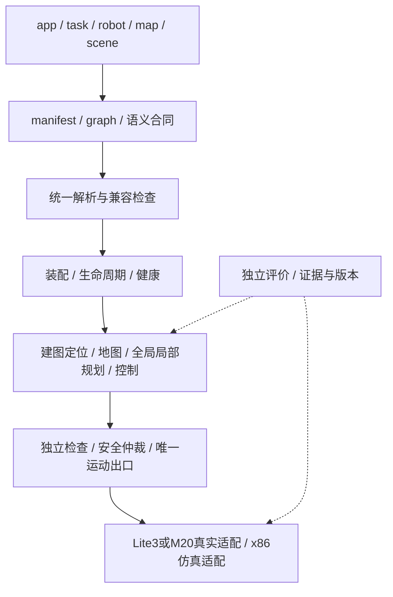

# 21 · ros1-slam 中心计划书（v8.1）

> 最新更新时间：2026-11-06 15:18:56 CST。源码基线：`c31edd25c52a8a04029035f5b6daa4bda4c9c00c`。本次为规划整合，不产生算法、目标运行或真机验收。工程标准真源：`note/架构/工程标准.md`。

## 1. 目标和范围

建立基于ROS1/Noetic的可组合导航平台：用户通过app、robot/map/scene配置、graph与组件manifest选择建图、里程计、全局定位、表征、全局/局部规划、控制及安全后端。替换算法以保持任务业务接口、独立评价器和安全链稳定为目标，允许新增适配器及显式合同版本。

| 当前需求 | v8.1交付要求 | 当前边界 |
| --- | --- | --- |
| Lite3与M20真机部署 | 显式机器人身份与运行依赖闭包，独立生成空间，不构建仿真或训练 | Lite3有入口和离线守卫，原生部署未验；M20尚无真实适配 |
| x86开发端 | 承担算法仿真、运动学/动力学、策略训练与独立评测 | 已有Gazebo/MuJoCo与外部策略推理；可复现训练器尚缺 |
| 算法可替换 | 统一类型、语义、参数、所有权、生命周期与任务结果合同 | 静态组合和专项切换已有实物，实际接线与完整后端等价尚缺 |
| 多层3D导航 | 同XY多支撑面、净空、合法连接、全包络碰撞、完整路线/轨迹版本 | 多层表征和原生规划已有实物；全局到局部目前主要传末点 |
| 健康与运动安全 | 模式隔离、TF/命令唯一所有者、真实坐标/源时间、失效撤销与停止 | 已修部分入口和Lite3 carrier/local；其他适配器仍需逐件核验 |
| 可维护与可复现 | 清晰规划/队列/证据职责，定向验证、独立复核、阶段本地提交 | 文档与规则工具已有基础，干净目标环境复现仍未闭合 |

本期主线是既有平台正确性、稳定算法接口与可复现导航交付。M20真实接入、可复现训练闭环、完整四足地面到阶面的动力学执行列为扩展阶段；不因列入规划就获得实施、硬件动作或正式结论授权。

启动前选配、停止后换算法是主线替换方式。既有热替换入口必须补齐兼容检查并消除无证保持声明；不中断在线重接、任意状态迁移和通用热插拔不列为首版必达项。ROS2迁移不作本期依赖。

## 2. 源码和证据基线

| 能力 | 在位入口/证据 | 当前结论与缺口 |
| --- | --- | --- |
| 目标构建与仿真依赖分离 | `scripts/build/target_workspace.py`、`tooling/build/profiles.json`、`v8_simulation`；提交 `b63ebc52` | 声明闭包/独立输出离线通过；外部依赖、原生编译和install-only未验 |
| Docker统一入口 | `docker/build.sh`、`catkin_build.sh`、Dockerfile/Compose；`2b6058b9` | 固定x86_sim，独立卷；真实镜像构建未验，代理传参仍有缺口 |
| 模式与身份 | `framework/execution.py`、manifest/v3、assembly_plan/v2；`1bbd8805` | 受支持框架入口离线守卫及绑定通过；框架外rosrun/传统launch另管 |
| Lite3坐标/源时效 | `common/pose_safety.py`、`LocalPoseInput/LocalControl`、`Lite3Carrier`；`c31edd25` | 同点yaw平面、源stamp/单调进展和发布互斥离线通过；真实TF/参考点/设备/停止时距未验 |
| 组件与运行平台 | `contracts/registry/composer/framework/orchestrator` | 已有schema、锁、装配及进程管理；TF所有权、接线、参数和热替换存在实际接缝 |
| 地图与规划 | `representation/`、`planner/`、`local_planner/` | 多层、MapDelta、障碍、全局/局部与独立检查已有代码/专项证据；消费者版本和路线语义未全面一致 |
| 建图与定位 | faster-lio、hdl相关入口、`localization_node.py`、`pose_mux.py`、`v8_ndt_odom` | 有估计/失锁/切源实验；换匹配核不等于换完整后端，部分节点仍重写源stamp/frame |
| 仿真与执行 | `v8_simulation`、`lite3_gazebo_sim/dynamics/`、verification/evaluator | Gazebo运动学与MuJoCo接触专项分别存在；阶面初始化不证明完整上阶，ONNX推理不证明训练 |

这些是继承起点，不重报为本次新测试。最新四个工程切片的实现、自动化、目标环境和证据见[隔离整改](../进度/00_构建与运行隔离_2026-11-05.md)；历史技术能力见[v8证据入口](../进度/v8/README.md)。当前规划不把旧“窄口径收口”升级为全系统完成。

## 3. 目标架构

此图表示目标职责；当前分开的framework与领域composer尚未共享全部检查，render与实际进程接线也未统一。[22号](22_架构与接口契约.md)分别列出现状、必须补齐的合同和扩展设计，不从图示推断实现完成。

传统bringup保留为已存在的部署入口，v8 app/graph是配置装配入口。二者复用算法和安全资产；迁移必须先证明覆盖与回退，不按目录名整树删除，也不将第三方改动作为接缝。

## 4. 阶段与依赖

| 阶段 | 目标和主要任务 | 出口 |
| --- | --- | --- |
| P81-0 规划与基线 | V81-00整合文档、状态、入口和检查覆盖 | 六件一致、旧证据保护、当前指针唯一、独立复核及本地提交 |
| P81-1 装配正确性 | V81-01 TF、V81-02端口、V81-03接线、V81-04语义、V81-05既有热替换安全 | 拒绝真实冲突，校验/渲染/进程消费同一解析，未证兼容先拒绝 |
| P81-2 导航语义闭合 | V81-06建图/定位/地图适配、V81-07完整路线 | 两完整估计后端与路线版本合同，换后端不改任务业务，故障撤销可检验 |
| P81-3 目标复现 | V81-08环境构建、V81-09分层运行与评价 | 干净目标构建、GT/EST分离、有效输入和适用场景证据；不得用stub代替运行 |
| P81-4 交付 | V81-10文档、复现、性能边界和迁移 | 按固定清单复现、缺陷/不支持项明确、旧入口有覆盖才退役 |
| 扩展 | V81-11 M20、V81-12训练、V81-13完整接触上阶 | 独立环境/设备与模型前置、专项出口，不绑定主线已完成结论 |

具体依赖以[23号队列](23_v8.1任务队列.md)为准。V81-08的只读环境盘点可前置，但编译/仿真仍须具体授权和适用预检。A09真实类型虽原审查列P2，却是A07接线正控的前置，不机械按旧优先级逐号执行。

原v8的42—68人日是2026-10-24的从零估算，不是v8.1剩余工期。每个获选切片在接口、环境与验收范围明确后估算并记录；本次不编造日期、吞吐或设备参数承诺。

## 5. 完成定义

每个交付必须分别记录：实现状态、自动化验证、目标环境验证、证据位置。文档落册、静态通过、owned stub、真实ROS、接触物理、真机是不同证据面；目标未验写NOT_RUN/PARTIAL，不能据某面完成跳过该缺口。

原v8能力A2仍为PASS*窄域，其余A1/A3/A4/A5/A6/A7为PARTIAL，formal和真机未签署；A0/A8按原报告范围解释。新验收映射使用[24号C81-*](24_验证与交付方案.md)，不改旧A项门值/分母，不将旧样本合入新正式结果，也不由规划签署技术终审或现场许可。

## 6. 风险和解除动作

| 风险 | 具体解除动作 |
| --- | --- |
| 声明相等但实际类型/接线不同 | V81-02对真实节点，再由V81-03证明实际命令参数和话题连接 |
| TF/旧源时效/高度参考点混淆 | V81-01及06核唯一所有者、测量stamp、真实变换和参考点；未定外参不猜数值 |
| 局部只取末点绕开全局安全走廊 | V81-07以必须绕行和同XY多层正反例证明不丢路线约束 |
| 历史测试或替身冒充真实能力 | 版本/场景/环境绑定，GT/EST与推理/训练分开，保留原失败 |
| 环境不足拖成算法故障 | V81-08独立核Noetic、SDK/外部资产、代理、本机registry和安装空间；缺前置不归算法FAIL |
| 规划文档代替实施 | 每个获选任务绑定可执行产物与正反控；只维护一份当前队列，不增重复流水账 |

## 7. 规则整合

| 原分散/冲突口径 | v8.1统一入口 |
| --- | --- |
| 平台分工、接口、阶段commit分散于补丁和skills | [工程标准](../架构/工程标准.md)为唯一共同规范，skills只维护职责和指针 |
| 旧总览记每批动作、状态从多份日志推断 | [25号](25_v8.1执行与迁移规则.md)分开版本报告、当前队列、任务卡和原始证据 |
| 已取消或缺状态被当成下一可执行项 | [23号](23_v8.1任务队列.md)显式候选/授权/依赖；当前用户指令决定实施范围 |
| v8初版、框架F阶段、工程A项混用完成度 | [24号](24_验证与交付方案.md)绑定证据层次；[25号迁移表](25_v8.1执行与迁移规则.md)保留旧编号原含义 |

本轮授权为形成v8.1规划与同步入口；后续源码整改和真实运行不因列入阶段就自动开工。执行时每阶段验证落账后本地 `git commit`，push由用户决定。历史v8与证据保持原时点，当前路线以本套六件为准。
