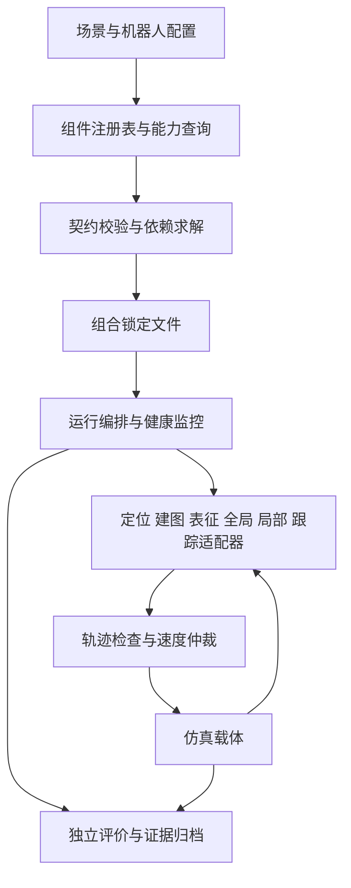

# 21 · ros1-slam 中心计划书（v8）

> 编制：Codex｜日期：2026-10-24（Asia/Shanghai）｜基线：3dd0446＋本次工作树核查。
> 效力：按用户本轮明确要求落册为新的路线与任务规划入口；不宣称独立技术终审已完成，也不宣称项目或算法已通过验收。
> 本轮范围：规划、可行性分析、任务拆分与登记。算法改造、依赖安装、仿真运行和真机运行均未执行。

## 0. 目标、继承与适用范围

用户希望各类 2D/3D 定位、全局规划、局部规划等算法可以按场景标签组合使用，并允许为此重构整个项目。本计划将其定义为：**建立有明确能力契约、能解释兼容关系、能复现运行结果的导航算法组合平台，并完成地面机器人三维环境中的全局与局部规划仿真。**

可行性结论为「可以在现有基础上改造实现」。依据是仓内已有 ROS1 通信、MBF 插件装配、SCAN、定位与仿真基础；尚缺统一注册表、组合校验器、运行编排、多层支撑地图及完整的三维验收链。完成这些需要架构改造，单靠增加 launch 参数或标签字段不足以达成目标。

### 0.1 规划权威与边界

| 对象 | v8 起的处理 |
| --- | --- |
| 路线与优先级 | 本件为真源；22、24 细化设计与验证；23 由三件派生 |
| 当前执行队列 | [23_v8任务队列](23_v8任务队列.md)，使用新 ID，旧行不伪装为已完成 |
| 历史计划与队列 | [v7](../计划书v7/21_ros1-slam中心计划书-v7.md) 与 [旧 23 号](../计划书v6/23_v6任务队列.md) 转为历史依据；未结项逐类映射，不直接删除或自动结案 |
| 历史判据 | v7 §8 指向的 v5.3／v5.4 继续用于其原有范围；v8 新验收集独立建账，不回改旧门值或旧结论 |
| 新判据 | 24 号定义验收项目与定标过程；数值配置须在正式实验前冻结并复核，不以计划中的建议值冒充已签门值 |
| 安全与来源 | 继承 [00 硬规则](../00_README.md)、[09 协作契约](../09_跨工具协作契约.md)，第三方原件、历史证据与真机隔离边界继续有效 |
| 本次授权 | 用户明确授权制定并落册新计划；此前允许全面改造用于可行性设计。本批不把该授权扩展为立即实施或运行真机 |

v7 的 S0—S4 保留历史含义。v8 用 **M0—M6** 表示新里程碑，两者不按序号等同。原 S4 真机安全要求继续约束将来的真机工作；新里程碑完成不能替代真机许可。

### 0.2 三个完成层次

1. **平台可用**：能发现组件、解释能力、校验组合、生成确定配置、启动与停止、保存实验清单。至少两类定位后端、两种全局与两种局部/控制后端证明可替换性；不能把算法库名当成完整定位插件。
2. **3D 仿真闭环完成**：同 XY 上下层、坡道、桥洞、楼梯几何和动态堵路场景中，有支撑的全局路线、局部重规划、可靠停车及三维到达判定全部得到证据。地图、位姿来源和载体能力必须明确。
3. **四足动力学与真机**：接触、步态、力矩、打滑与姿态稳定性验证，作为扩展 X1／X2。前两层的通过只能证明相应层次，不能证明 Lite3 已能物理爬楼。

## 1. 实际起点与失败教训

详证与复现安排见 [24 §1](24_仿真验收与迁移方案.md#1-历史问题与新任务的对应)，源码核查详见 [v7 独立攻关分析](../计划书v7/22_3D全局与局部规划及仿真攻关计划_2026-10-24.md)。本件只列会影响路线的结论。

| 已有资产 | 能支持什么 | 尚不能据此声称什么 |
| --- | --- | --- |
| MBF 的 GP/Navfn、TEB/DWA 配置及任务层选择 | 平面导航基线与插件适配入口 | 任意 2D/3D 算法互换；标签驱动的兼容组合 |
| faster-lio、hdl_localization、配准库 | 里程计、建图、定位后端候选 | 每个库都是独立定位器；所有后端都已稳定运行 |
| SCAN 五包与 mode3 参考路径入口 | 三维环境局部轨迹候选 | 任意楼层拓扑搜索、足部执行能力、完整三维到达 |
| T1/T2/T3 离线件与高程 GridMap 链 | 多高度列离线基础、单层输入合同与融合验证 | 已有在线多层导航地图；单值高程能表达桥上桥下 |
| 历史 Gazebo 与验证工具 | 运行、取证、注入、停车与三态测试基础 | 运动学移动证明物理上楼；历史所有失败均属算法差 |

必须纠正三类旧归因：perlin3d 的三维场景名不代表三维规划状态空间；outcome=55 不能唯一归因为算力不足；P4 后续已有多次通过记录，不能继续用早期「只有一轮通过」概括全部历史。另一方面，多次局部通过也不能替代尚未完成的系统验收。

## 2. 产品使用方式

用户先选择机器人能力配置与仿真场景，再按标签查看候选组件；界面或 CLI 必须同时显示「适用声明」和「验证证据」，不能只显示推荐分数。

一次组合应经历：**选择 → 校验 → 查看装配图和拒绝原因 → 固化配置 → 运行 → 查看路径、状态与报告 → 对比另一组合**。无效组合在启动前拒绝；运行中的健康失效则取消任务、撤销轨迹并停车。

首版先交 CLI 与配置文件，不以图形拖拽界面为前置。下列是拟实现用例，不是现成命令：

- 查询适合室内平层、三维定位输入、CPU 运行的全局规划组件。
- 在同一场景更换 GP/Navfn，或更换 TEB/DWA，自动生成独立实验编号。
- 选择多层支撑图全局规划＋SCAN 适配器；系统检查地图、楼层、路径高度和运动模型。
- 将多层路径直接交给只接收二维 costmap 的组件时，显示不兼容字段和缺失适配器。
- 比较同一地图、机器人、起终点、随机种子下不同组合的有效样本、成功率、耗时、碰撞及停车结果。

首版支持**启动时选择、停止后换组合**。运行时热替换涉及状态迁移、TF 与控制权切换，列为后续扩展，不计入首版完成条件。

## 3. 目标架构与改造策略

平台内核处理算法目录、类型与能力约束、资源所有权、依赖顺序、生命周期和证据，不承担规划数学。算法通过适配器进入平台：已有 MBF 插件可包成后端，ROS 节点以进程适配，必要的非 ROS 库以独立节点封装。**可插拔指契约可替换，不要求所有算法都编译成同一种 pluginlib 插件。**

现有目录与目标落点：

| 资产 | 计划处理 | 替换前必须满足 |
| --- | --- | --- |
| 30_3rd、上游定位库 | 保留版本与来源，外部适配；需要改算法时建立独立自持实现或明确分叉 | 来源、许可证、版本、行为差异登记，原件可回取 |
| 40_navigation 装配与 lite3_scan | 先包进适配层，逐步削减硬编码和专用任务支路 | 旧入口回归、新入口等价或差异说明、独立回退入口 |
| 50_task、70_bringup | 逐步由统一导航任务和编排层替代直接拼 launch | 取消、失败反馈、清理与互斥测试通过 |
| 60_safety | 复用停车、超时与速度仲裁机制并纳入控制权契约 | 最终运动命令只有一个所有者，仿真不接入真机驱动 |
| 新平台和新算法 | 拟在 ws/src 下设独立平台包与自持算法包，具体分层在 V8-02 确定 | 明确所有权；若与现有壳包源码禁令/扫描规则冲突，先落差异规则与正反控再建包，不能暗中放宽检查 |
| 历史脚本与门禁 | 保留有效职责，修复错误前提；过期项通过迁移表退役 | 覆盖关系、替代验证、历史结果可追溯；不得为得到绿灯删掉失败检查 |

不以 ROS2 迁移作为本期依赖。部署环境、编译工具和依赖版本在 M0 锁定；本次没有证明当前宿主能运行 ROS。未来如需迁移中间件，可重用契约及数据集，另行立项。

## 4. 3D 算法路线

### 4.1 表征与全局规划

建立「观测体素/多高度列 → 可支撑曲面 → 曲面连通图」。同一 XY 允许多个支撑面，节点保留高度、法向、净空、观测状态与地图版本。层间边必须来自真实几何连接和机器人能力，不能按距离把上下楼板、断桥或未知孔洞直接连起来。

全局初版用有界 A*；小图以 Dijkstra 参考解核对可达性和代价。状态含支撑面身份、位置及必要的朝向离散；碰撞检查覆盖完整机身的沿边扫掠。起终点含 z 与支撑面身份，不能只在 XY 上判断到达。无路、预算耗尽、取消和进程异常分别报告。

PCT Planner、Mesh Navigation 作为对照/备选，选型资料沿用 v7 独立分析；需另锁版本、依赖与许可证，未在本仓实测前不得写成现成能力。初版主线不依赖 GPU。

### 4.2 局部规划与执行

先对 SCAN mode3 做独立最小实验，核对地面高度与机体高度、关键点抽稀、转层、局部搜索和平滑后的支撑约束。适配器输出候选轨迹，**独立轨迹检查器**核验支撑、净空、时间有效性、地图版本和运动学上限，再交跟踪器与仲裁层。

轨迹检查器只会拒绝危险轨迹，不能据此声称规划器已解决问题。若安全检查持续拒绝、无法完成指定场景，必须改局部规划能力或更换后端。M0 结束时给出 SCAN 可用范围；M4 对失败类型最多安排两轮有假设、有对照的修复试验，仍不合契约则转自持「受支撑走廊约束的局部搜索/优化＋保守跟踪」备选。禁止通过放宽安全边界换取通过。

### 4.3 定位与建图

分开里程计、全局定位、重定位、建图和地图服务器职责。先用真值位姿隔离验证规划，再加入估计位姿闭环；用于打分的真值不能流入被测定位链。三维定位输出接二维算法时须使用有记录的投影适配，限制在选定支撑面并校验倾角/高度范围，不能隐式丢 z。

第二定位后端优先盘点仓内 hdl 系；其历史崩溃若不能复现定位并消除，则改选可独立验收的后端。换 NDT/GICP 匹配核与换完整定位后端是两个层次，验收报告分别标注。

## 5. 里程碑、依赖与估算

| 里程碑 | 主要交付 | 退出证据 | 估计人日 |
| --- | --- | --- | --- |
| M0 基线与风险验证 | 环境锁定、资产清单、契约初版、SCAN/多层最小实验 | 可复跑基线；关键能力边界与主备路线有结论 | 3–5 |
| M1 平台内核 | 注册表、组合求解、锁定文件、编排与健康管理 | 合法组合可组装；错误组合与失效注入可被拒绝/停车 | 7–11 |
| M2 二维组合基线 | 定位后端与 MBF 适配、可替换组合、对比报告 | 同一契约下更换后端，不改任务业务逻辑 | 4–6 |
| M3 多层地图与全局规划 | 在线/离线地图服务、支撑图、全局搜索 | 同 XY 双层、断桥、桥洞与坡道正反例通过 | 10–16 |
| M4 三维局部闭环 | SCAN 适配或备选、轨迹检查、三维到达与重规划 | 新障碍事件链、有效期、停车和跨层路线通过 | 7–12 |
| M5 仿真集成与评测 | 分层载体、真值/估计位姿双轨、批量实验 | 24 号必测矩阵可复跑，独立评价与结果分类完整 | 8–13 |
| M6 交付与迁移 | 用户教程、组合样例、旧入口迁移及回滚 | 干净环境按文档复现，旧依赖退出有依据 | 3–5 |

合计 **42–68 人日，单名熟悉 ROS1 的工程师约 9–14 个工作周**，是规划估算，不是承诺。假设有可用 x86 仿真环境、可获取依赖和地图，且不包含腿控制器开发。若 SCAN 备选从零开发或定位后端需替换，应在 M0/M4 复估，不挤掉验收时间。v7 独立 3D 计划的 28–46 人日覆盖面更窄，不直接沿用到平台整体。

M3 的离线地图工作可在契约冻结后与 M1/M2 交错开展；不要求平台全部完成才验证 3D 风险。M5 的场景/评价器准备也应前置。详细依赖由 23 号记录，不以日期硬压未满足的前置。

## 6. 范围取舍与风险处置

| 风险 | 早期可见信号 | 处置与去向 |
| --- | --- | --- |
| 标签丰富但组合无约束 | 接口不合仍能启动，切算法需改业务代码 | M1 以拒绝样例和任务不改码作为验收条件 |
| 维度/高度混淆 | 地面 z 被重复加机身高度，同 XY 不同层误到达 | 明确参考点、坐标和支撑面身份；契约测试先于集成 |
| 规划、地图、环境问题混为一谈 | 只看 timeout，不记录输入/图/节点状态 | 在 24 号证据链逐层定责，再决定调参或加算力 |
| SCAN 不满足支撑约束 | 样条切过楼板、拐角丢层，检查器长期拒绝 | M0 探针＋M4 有限修复轮次＋明确备选 |
| 资源不足 | 仿真时间停滞、地图过大、实时因子低 | 先记录规模与消耗；降复杂度做定位实验，再优化或迁机 |
| 治理工作替代算法进展 | 只增加登记、算法里程碑无可运行产物 | 每项任务绑定可执行产物和场景；记录只保留必要证据与指针 |

原有独占运行、环境隔离和真机约束继续遵守。对未来本地/异机仿真，可在 M0 明确资源与实验域后新建 v8 实验基线；不自动复活历史停测项，不把新样本计入旧分母。旧审批问题若与新路线无关，按 24 号迁移规则隔离，不让过期条件无限阻塞离线设计。

## 7. 落册与后续执行规则

本批落册包括：五件规划文档、入口指针、23 号新队列、旧队列换源说明、04 批次台账、05 的 P8 登记、裁定请求单的授权摘录、进度总览与 R614 全文。用户本轮明令足以完成这些文档登记，不另设一轮「是否可以写计划」确认。

后续状态只从交付物和实验记录更新：文档落册不等于技术终审，开工不等于完成，编译不等于可运行，单次通过不等于场景能力已验证。判据复核、独立技术评审及真机许可分别保留，不代填姓名、签字或结论。

提交与发布沿用 v7.4 已落册纪律：本地 commit、由用户决定 push；本批只提交本任务文档，不混入其他工作树修改。历史证据不搬不改，新增批次写入进度/v8，对应索引仍在进度/00_总览。
